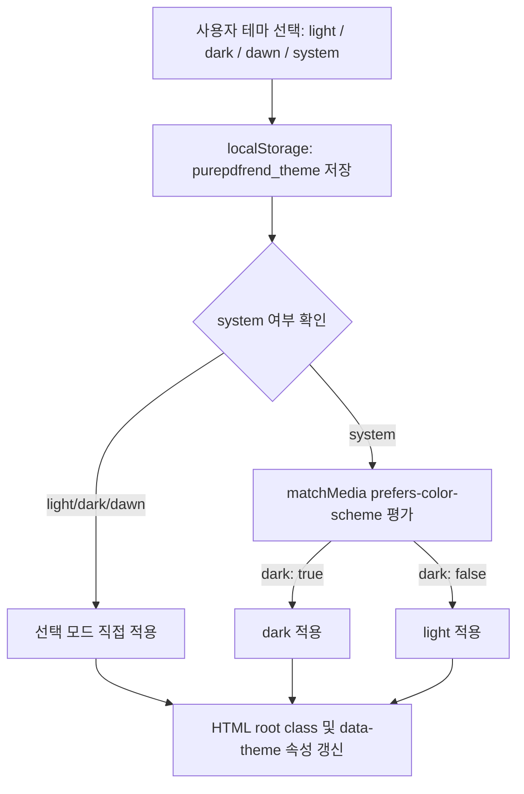

# 05-29. 4모드 테마 시스템 및 권한별 시스템 전환 상세설계서

> **문서 ID**: `DOC-DES-05-29`  
> **버전**: v1.0.0  
> **작성일자**: 2026-10-11  
> **작성자**: Gemini 3.8 Flash (AI Coding Agent) / jkoogit  
> **상태**: 승인됨 (Approved)  
> **적용 세션**: SESSION-0028

---

## 1. 개요 및 설계 목적

purePDFrend 플랫폼의 사용자 경험(UX) 고도화 및 서비스 상용화 전환을 위해 다음 세 가지 핵심 아키텍처를 수립한다.

1. **4모드 테마 시스템 (4-Mode Theme Engine)**:
   - 기존의 단순 Light/Dark 2단계 토글을 확장하여, 주간(Light), 야간(Dark), 여명(Dawn - 심야 블루/새벽 고대비 감성), 시스템설정(System - OS prefers-color-scheme 자동감지)의 4개 모드를 지원.
   - 단일 진실 공급원인 `src/styles/tokens.ts`와 CSS 변수/Tailwind 클래스 체계로 무손실 동기화.
2. **첫 화면 서비스 포털 기본 표시 (Default Service-First Landing)**:
   - 애플리케이션 첫 기동 시, 기존의 개발자/하네스 거버넌스 화면 대신 엔드유저 중심의 **'PDF 비즈니스 서비스 포털 (`PurePdfServicePortal`)'**을 첫 화면으로 기본 노출.
3. **권한 기반 3대 시스템 전환 인터페이스 (Role-Based System Switcher)**:
   - 상단 글로벌 헤더에 현재 사용자 권한(`UserRole`)에 따른 시스템 스위처 인터페이스 구축:
     * **일반 사용자 (`ROLE_USER`)**: 'PDF 서비스' 화면 기본 제공.
     * **서비스 설정자 (`ROLE_OPERATOR` / 서비스설정 권한)**: '서비스설정' (25개 와이어프레임 & 시스템 설정) 전환 버튼 제공.
     * **시스템 관리자 (`ROLE_ADMIN` / `ROLE_SUPER_ADMIN` / 마스터 권한)**: '에이전트관리' (하네스 거버넌스 & 마스터 원장) 전환 버튼 제공.

---

## 2. 4모드 테마 아키텍처

### 2.1 테마 모드 정의

```typescript
export type ThemeMode = 'light' | 'dark' | 'dawn' | 'system';
export type ResolvedTheme = 'light' | 'dark' | 'dawn';
```

| 모드 | 식별자 | 배경/패널 기본 톤 | 주 텍스트 / 포인트 | 특징 |
| :--- | :--- | :--- | :--- | :--- |
| **주간 (Light)** | `light` | White (`#ffffff`) / Slate-50 (`#f8fafc`) | Slate-900 / Blue-600 | 선명한 주간 가독성, 고대비 문서 리딩 |
| **야간 (Dark)** | `dark` | Slate-950 (`#020617`) / Slate-900 (`#0f172a`) | Slate-100 / Sky-400 | 눈부심 방지, OLED 친화적 다크 모드 |
| **여명 (Dawn)** | `dawn` | Deep Midnight (`#0b1329`) / Navy (`#111c38`) | Slate-50 / Cyan-400, Indigo-400 | 새벽 감성 블루, 심야 장시간 집중 및 독서 최적화 |
| **시스템 (System)** | `system` | OS 동적 감지 (Light / Dark) | OS 매칭 동적 갱신 | `window.matchMedia('(prefers-color-scheme: dark)')` 실시간 리스너 바인딩 |

### 2.2 테마 해석 및 DOM 적용 파이프라인



---

## 3. 권한 기반 3대 시스템 전환 아키텍처

### 3.1 3대 시스템 도메인 정의

```typescript
export type SystemDomain = 'service' | 'settings' | 'harness';
```

1. **PDF 서비스 (`service`)**:
   - 컴포넌트: `PurePdfServicePortal`
   - 대상: 일반 사용자, 도서 뷰어, OCR 교정, PDF 변환, 주석/메모 이용자
2. **서비스 설정 (`settings`)**:
   - 컴포넌트: `WireframeStudio` & 관리자/사용자 와이어프레임 25개 화면
   - 대상: 서비스 운영자, UI/UX 디자이너, 도구 단축키 및 폰트/게시판 설정자
3. **에이전트 관리 (`harness`)**:
   - 컴포넌트: `WorkGraphViewer`, `TaskInfoManager`, `AgentUsageViewer`, `IntegrityAuditManager`, `DocsGovernanceManager`, `SystemConfigManager`
   - 대상: 시스템 마스터, DevOps 엔지니어, AI 에이전트 관리자

### 3.2 역할별 가시성 매트릭스 (RBAC Matrix)

| 역할 (Role) | PDF 서비스 (`service`) | 서비스 설정 (`settings`) | 에이전트 관리 (`harness`) | 기본 화면 |
| :--- | :---: | :---: | :---: | :--- |
| **ROLE_GUEST / ROLE_USER** | ✅ 필수 | 🔒 접근제한 (안내) | 🔒 비노출 | PDF 서비스 (`service`) |
| **ROLE_OPERATOR** (서비스설정) | ✅ 가능 | ✅ 전환 가능 | 🔒 접근제한 (안내) | PDF 서비스 (`service`) |
| **ROLE_ADMIN / SUPER_ADMIN** | ✅ 가능 | ✅ 전환 가능 | ✅ 마스터 전환 가능 | PDF 서비스 (`service`) |

---

## 4. 모바일 반응형 및 터치 가드레일 (44px)

- 테마 스위처 및 시스템 스위처는 데스크톱 글로벌 헤더 및 모바일 햄버거 드로어 양쪽 모두에 배치.
- 모든 스위처 버튼은 `min-h-[44px]`, `min-w-[44px]` 터치 규격을 준수하여 모바일 오작동 방지.
- Zero-pill 규율 준수 (`rounded-lg`, `rounded-xl`).
