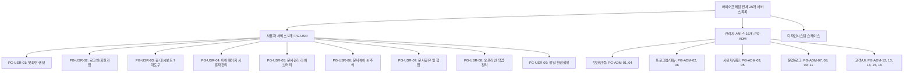
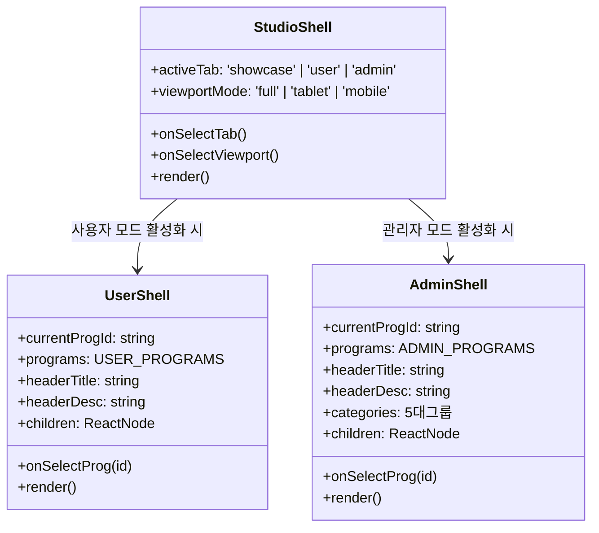

# 05-30. 3대 공통 쉘 아키텍처 및 와이어프레임 서비스목록 상세설계서

> **문서 ID**: `DOC-DES-05-30`  
> **버전**: v1.0.0  
> **작성일자**: 2026-10-14  
> **작성자**: Gemini 3.8 Flash (AI Coding Agent) / jkoogit  
> **상태**: 승인됨 (Approved)  
> **적용 세션**: SESSION-0029

---

## 1. 개요 및 설계 목적

purePDFrend 플랫폼의 25개 와이어프레임 화면(사용자 9개, 관리자 16개)과 디자인시스템 쇼케이스의 레이아웃 파편화를 해소하고, 일관된 UI/UX 및 디자인 토큰(`tokens.ts`) 전면 대입을 달성하기 위해 다음 핵심 아키텍처를 수립한다.

1. **상단 중앙 와이어프레임 서비스 목록 퀵 점프 네비게이션**:
   - 글로벌 헤더(`Navbar.tsx`) 및 스튜디오 상단 바의 중앙(Center) 영역에 25개 와이어프레임 화면 전체를 그룹별(사용자 9개, 관리자 16개, 디자인시스템)로 즉각 탐색·전환할 수 있는 퀵 셀렉터/드롭다운을 배치한다.
   - 어느 시스템 모드(Service, Settings, Harness)에서도 원하는 화면으로 1클릭 점프를 보장한다.
2. **3대 공통 쉘(Shell) 컴포넌트 아키텍처 구축**:
   - `UserShell`: 사용자 9개 서비스 전용 공통 레이아웃 (테마 로고, 서브탭 가로슬라이더, 모바일 Break-to-Card 래퍼).
   - `AdminShell`: 관리자 16개 서비스 전용 공통 레이아웃 (테마 로고, 5대 카테고리 네비게이션, 브레드크럼, 공통 툴바).
   - `StudioShell`: 와이어프레임 전체 및 디자인시스템 쇼케이스를 감싸는 최상위 뷰포트 시뮬레이션(PC/태블릿/모바일) 쉘.
3. **tokens.ts 디자인 토큰 전면 대입 및 4모드 테마 실시간 바인딩**:
   - 하드코딩된 색상 및 패딩/둥글기를 `tokens.ts`의 단일 진실 공급원(Single Source of Truth)으로 일원화.
   - PG-USR-03(홈 대시보드 & 7대 PDF 도구), PG-USR-04(마이페이지/사용자관리 & BBox 캔버스), PG-USR-05(문서관리 라이브러리 & 레이아웃 편집기)의 미처리 요소 전면 대입.

---

## 2. 상단 중앙 와이어프레임 서비스 목록 네비게이션 설계

### 2.1 25개 와이어프레임 서비스 프로그램 분류 체계

### 2.2 글로벌 헤더 및 스튜디오 상단 중앙 배치 UI

- **위치**: 상단 헤더(`Navbar`)의 중앙 영역에 시스템 전환 버튼군 우측 또는 중앙에 콤팩트한 퀵 점프 버튼/드롭다운으로 배치.
- **상호작용 흐름**:
  1. 드롭다운 클릭 시 25개 화면 목록이 팝오버로 전개됨.
  2. 카테고리별(사용자 서비스 / 관리자 서비스 / 쇼케이스) 필터링 및 검색어 인라인 입력 가능.
  3. 항목 선택 시 `activeSystem`을 `settings`로 전환하고, 타겟 프로그램 ID(`selectedProg`)를 즉각 전달하여 활성화.

---

## 3. 3대 공통 쉘(Shell) 아키텍처

### 3.1 쉘 계층 구조

### 3.2 쉘 구성요소 규격

1. **BrandLogo 탑재**:
   - 모든 쉘 상단에 `PdfrendLogo`를 배치하여 4모드 테마(light, dark, dawn, system)에 따라 자동으로 최적의 브랜드 로고(주간/야간/여명)가 렌더링되도록 보장.
2. **글로벌 테마 및 권한 스위치 연동**:
   - 쉘 상단 우측에 4모드 테마 토글 및 역할 시뮬레이터를 배치하여 독립적 상태 제어 가능.
3. **모바일 Break-to-Card 컨테이너**:
   - 가로스크롤 방지 정책(03-14)에 따라 640px 미만에서는 테이블 뷰를 카드 리스트로 자동 전환.
   - 터치 가드레일(`min-h-[44px]`) 엄격 준수.

---

## 4. tokens.ts 디자인 토큰 전면 대입 전략

| 대상 컴포넌트 | 기존 하드코딩 스타일 | tokens.ts 대입 사양 | 테마 적응 효과 |
| :--- | :--- | :--- | :--- |
| **컨테이너 / 쉘** | `bg-slate-900 border-slate-800` | `tokenClassMap.containerShell` | 주간: white / 야간: slate-900 / 여명: midnight |
| **패널 / 카드** | `bg-slate-950/80 border-slate-800` | `tokenClassMap.panel`, `card` | 깊이감(Elevation) 및 음영 일원화 |
| **PG-USR-03** | 7대 PDF 도구 인라인 그리드 | tokens.spacing 및 colors.brand | 도구별 시맨틱 컬러와 44px 터치 타겟 일체화 |
| **PG-USR-04** | 마이페이지 인풋/버튼/탭 | tokens.radius(md: 6px) 및 focusRing | Zero-pill 규율 적용 및 고대비 포커스링 |
| **PG-USR-05** | 문서 라이브러리 필터/모달 | tokens.colors.semantic (태그/상태) | 주간/야간/여명 4모드 시맨틱 뱃지 가독성 강화 |

---

## 5. 결론 및 기대효과

본 설계를 통해 개별 화면마다 중복되던 헤더/네비게이션 코드를 3대 공통 쉘로 완전 모듈화하고, tokens.ts 기반 단일 디자인 토큰을 전면 적용함으로써 25개 와이어프레임 화면 전체의 유지보수성과 시각적 완성도를 엔터프라이즈 수준으로 격상한다.
