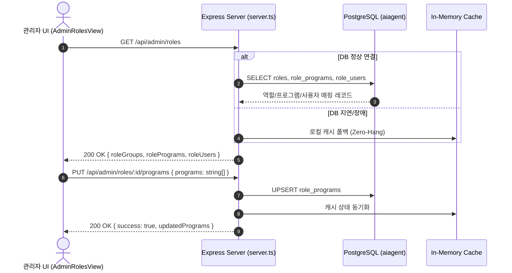

# 05-31. Phase 4 관리자 2단계 API 연동 및 관리자 전 화면 tokens.ts 전면 완결 설계서

> **문서 식별자**: `DOC-DESIGN-05-31`  
> **최초 작성일**: 2026-10-24  
> **최종 갱신일**: 2026-10-24  
> **작성자**: purePDFrend AI Engineering Team (Gemini Flash)  
> **상태**: 승인 완료 (APPROVED)  
> **대상 세션 및 태스크**: `SESSION-0034` / `TASK-0034-01`  
> **관련 백로그**: `BACKLOG-0033-01` (관리자 2단계 API 연동), `BACKLOG-0033-02` (관리자 전 화면 tokens.ts 완결)

---

## 1. 개요 및 설계 목적

본 문서는 `purePDFrend` 플랫폼의 **Phase 4 관리자 2단계 4개 핵심 화면(`PG-ADM-05` ~ `PG-ADM-08`)의 실제 Express/PostgreSQL REST API 연동**과 **관리자 잔여 화면 8종(`PG-ADM-09` ~ `PG-ADM-16`)을 포함한 관리자 16대 전 화면의 디자인 토큰(`tokens.ts`) 전면 대입 및 모바일 반응형 완결**을 위한 기술 설계서입니다.

`SESSION-0033`에서 달성한 사용자 서비스 9대 전 화면(`PG-USR-01` ~ `PG-USR-09`) 100% 토큰화 및 관리자 1단계 4개 화면(`PG-ADM-01` ~ `PG-ADM-04`) REST API 연동에 이어, 관리자 영역 전체의 Mock 상태를 완전히 청산하고 **플랫폼 25개 전 와이어프레임 토큰화 100% 완전 정복**을 달성합니다.

---

## 2. 관리자 2단계 4종 REST API 상세 설계

### 2.1 PG-ADM-05: 역할 및 세부 권한 매핑 API (`/api/admin/roles`)



- **엔드포인트 규격**:
  - `GET /api/admin/roles`: 역할 그룹 목록, 프로그램 매핑, 사용자 배정 목록 일괄 조회
  - `POST /api/admin/roles`: 신규 권한 그룹 추가 (`id`, `name`, `priority`, `desc`)
  - `PUT /api/admin/roles/:id/programs`: 특정 역할의 허용 프로그램 목록 갱신
  - `POST /api/admin/roles/:id/users`: 특정 역할에 사용자 이메일 배정
  - `DELETE /api/admin/roles/:id/users`: 특정 역할에서 사용자 배정 해제

---

### 2.2 PG-ADM-06: 메뉴 및 화면 계층 트리 구조 API (`/api/admin/menus`)

순환 의존성(Cycle) 방지 알고리즘을 탑재하여, 상위 메뉴 지정 시 자신 또는 자신의 하위 메뉴를 부모(`parentId`)로 지정할 수 없도록 강제 검증합니다.

```mermaid
flowchart TD
    Req[PUT /api/admin/menus/:id parentId 변경 요청] --> CheckSelf{parentId == id?}
    CheckSelf -- 예 --> ErrCycle[400 Bad Request: 자기 자신을 부모로 지정 불가]
    CheckSelf -- 아니오 --> CheckDescendant{parentId가 하위 노드에 포함?}
    CheckDescendant -- 예 --> ErrDesc[400 Bad Request: 하위 메뉴를 상위로 지정 불가 - 순환 감지]
    CheckDescendant -- 아니오 --> UpdateTree[메뉴 트리 계층 및 순서 갱신]
    UpdateTree --> Res[200 OK { success: true, menus }]
```

- **엔드포인트 규격**:
  - `GET /api/admin/menus`: 메뉴 계층 트리 및 순서 목록 조회
  - `POST /api/admin/menus`: 신규 메뉴 항목 생성 (`id`, `title`, `order`, `route`, `progId`, `parentId`, `visible`)
  - `PUT /api/admin/menus/:id`: 메뉴 정보 수정 (순환 방지 검증 탑재)
  - `DELETE /api/admin/menus/:id`: 메뉴 삭제 (하위 메뉴 존재 시 선행 정리 안내)

---

### 2.3 PG-ADM-07: 시스템 실시간 접속 및 활동 로그 스트림 API (`/api/admin/logs/audit`)

- **엔드포인트 규격**:
  - `GET /api/admin/logs/audit`: 감사로그 조회 (쿼리 파라미터 `keyword`, `eventType`, `result`)
  - `POST /api/admin/logs/audit`: 감사 이벤트 수기/자동 기록
  - 프론트엔드 CSV 내보내기 연계 및 Table-to-Card 반응형 가드레일

---

### 2.4 PG-ADM-08: 시스템 에러 및 예외 스택 추적 모달 API (`/api/admin/logs/errors`)

- **엔드포인트 규격**:
  - `GET /api/admin/logs/errors`: 에러 로그 목록 조회 (심각도 `FATAL`, `ERROR`, `WARN` 필터)
  - `GET /api/admin/logs/errors/:id`: 단일 에러 상세 정보 및 전체 콜스택 조회
  - `PUT /api/admin/logs/errors/:id/resolve`: 에러 조치 여부(`resolved: boolean`) 토글

---

## 3. 관리자 전 화면(16종) tokens.ts 전면 대입 설계

### 3.1 토큰 대입 아키텍처 및 4모드 가드레일

- `AdminWireframes` 및 `AdminShell`에 `ThemeMode` (`light`, `dark`, `dawn`, `system`) 프로퍼티 바인딩
- `getThemeAdaptiveClasses(resolveThemeMode(themeMode))`를 활용하여:
  - 컨테이너: `themeClasses.container`, `themeClasses.shellBg`
  - 카드/패널: `themeClasses.card`, `themeClasses.panel`
  - 입력폼/선택창: `themeClasses.input`, `min-h-[44px]`
  - 텍스트/보조텍스트: `themeClasses.textMain`, `themeClasses.textMuted`
  - 배지/버튼: `themeClasses.badgeSuccess`, `themeClasses.buttonSecondary`
- **Zero-Pill 규격**: 알약형 배제, 사각 및 세련된 직사각형 반경(`rounded-xl`, `rounded-2xl`) 통일
- **Table-to-Card 반응형**: 모바일 뷰포트에서 가로스크롤 0px 방어 및 카드형 자동 전환

---

## 4. 품질 및 거버넌스 가드레일

1. **단위 테스트**: `tests/wireframe_shells_and_tokens.test.ts` 확장 및 신규 테스트 검증
2. **타입 안전성**: `tsc --noEmit` 정적 린트 0 에러
3. **무결성 헬스체크**: `scripts/service_health_check.ts` 100점 만점 [A+ (PERFECT)] 유지
4. **대화 턴 전수 영속화**: Zero-Loss 규약에 따른 실시간 적재 및 Reconcile
