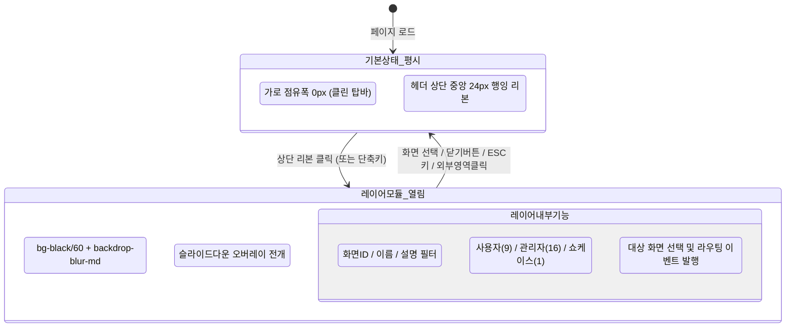

# 상단 리본 접이식 레이어 모듈 네비게이션 설계서 (DOC-05-33)

> **문서 식별자**: `DOC-05-33-TOP-RIBBON-LAYER-NAVIGATION`  
> **표준 코드**: `DESIGN-SPEC-05-33`  
> **버전**: v1.0.0 (2026-10-24)  
> **적용 범위**: 글로벌 헤더(`Navbar.tsx`), 상단 리본 레이어 모듈(`WireframeRibbonLayer.tsx`), 25개 서비스 화면 퀵점프 네비게이션, 4모드 테마 시스템(`tokens.ts`)

---

## 1. 설계 배경 및 목적

### 1.1 배경 및 문제 정의
1. **상단 네비게이션 가로 공간 과밀화 (Visual Clutter)**:
   - 직전 `TASK-0035-01`에서 25개 와이어프레임 화면의 단일 진실 공급원(SSOT) 구축을 위해 글로벌 헤더(`Navbar.tsx`) 중앙에 `WireframeTopDropdown` 버튼을 인라인으로 배치했습니다.
   - 그러나 버튼의 폭(약 240px~280px)이 상시 가로 공간을 점유함에 따라, 3대 시스템 스위처(`PDF 서비스`, `서비스설정`, `에이전트관리`) 및 권한 시뮬레이터와 간격이 협소해지고, 랩탑/태블릿 해상도에서 헤더가 답답해지는 UX 저하가 발생했습니다.
2. **사용자 핵심 피드백**:
   - *"top 영역에 화면이동 모듈이 공간을 차지해서 불편하다."*
   - *"기본상태에서는 감추고 상단 리본을 클릭하면 펼쳐지는 레이어 모듈로 배치해줘"*
   - *"모든화면에 적용해줘 - 평시에는 탑영역 디자인 유지, 펼치면 서비스별 화면이동기능"*

### 1.2 핵심 설계 목적
1. **평시 탑영역 디자인 원형 유지 (Zero Horizontal Clutter)**:
   - 탑바 인라인 내부의 무거운 드롭다운 버튼을 완전히 제거하여 탑바 본연의 정돈되고 널찍한 디자인 레이아웃을 100% 회복.
2. **상단 리본 트리거 (Top Hanging Ribbon Tab)**:
   - 헤더 상단 중앙 경계선에 걸쳐진 우아하고 슬림한 24px 행잉 리본(Hanging Ribbon Tab)을 배치하여 시각적 간섭을 원천 차단하고 직관적인 클릭 인터랙션 제공.
3. **서비스별 화면이동 메가 레이어 모듈 (Mega Navigation Layer)**:
   - 리본 클릭 시 상단에서 부드럽게 전개되는 풀 레이어 모듈 오버레이 구축.
   - 25개 화면을 서비스 도메인별(사용자 도구 9종, 관리자 도구 16종, 쇼케이스 1종)로 구조화된 3컬럼 그리드로 배치.
   - 실시간 통합 검색, 키보드 탐색, ESC 키 닫기, 외부 영역 클릭 닫기 지원.
4. **전 화면(All Screens) 글로벌 일관성 보장**:
   - 최상위 `Navbar`에 마운트되어 서비스 포털(`service`), 설정 스튜디오(`settings`), 에이전트 마스터(`harness`) 등 모든 시스템/화면에 공통 적용.

---

## 2. UI/UX 인터랙션 및 컴포넌트 아키텍처

### 2.1 네비게이션 상태 전이 다이어그램


---

## 3. 세부 컴포넌트 명세

### 3.1 상단 리본 트리거 (`WireframeRibbonTrigger`)
- **배치 위치**: 글로벌 헤더 상단 중앙 (`absolute left-1/2 -translate-x-1/2 top-0`)
- **형태 및 치수**:
  - 높이: `h-6` (24px)
  - 하단 모서리 라운딩: `rounded-b-xl`
  - 패딩: `px-3.5 py-0.5`
- **시각적 디자인**:
  - 테마별 엑센트 보더 (`border-t-0 border-b border-x`)
  - 뱃지 아이콘: `Layers` 또는 `Sparkles`
  - 텍스트: `화면 바로가기` + `(25)` 카운트 뱃지 + `ChevronDown`
  - 호버 인터랙션: 마우스 오버 시 미세한 드롭다운 다운 및 글로우 효과 (`hover:translate-y-0.5 shadow-md`)

### 3.2 메가 네비게이션 레이어 모듈 (`MegaNavLayerModal`)
- **레이어 컨테이너**:
  - 위치: `fixed inset-x-0 top-0 z-[100] max-h-[85vh]` 슬라이드 다운 오버레이
  - 배경: 4모드 적응형 반투명 패널 (`bg-white/98` / `bg-[#0b142d]/98` / `bg-slate-900/98`) + `backdrop-blur-xl` + 대형 드롭 섀도우
- **헤더 영역**:
  - 좌측: 타이틀 `🌐 전체 서비스 & 화면 네비게이션` + `25대 와이어프레임 바로가기` 서브타이틀
  - 중앙: 실시간 통합 검색바 (`Search`, 화면ID/이름/설명 자동 필터링, `ESC` 단축키 안내)
  - 우측: 닫기 버튼 (`X` 아이콘, 44px 터치 타겟)
- **본문 그리드 (서비스별 3대 영역)**:
  1. **📘 사용자 서비스 도구 (PG-USR-01 ~ PG-USR-09, 9종)**:
     - 대시보드(01), 뷰어(02), 편집기(03), 병합/분할(04), OCR(05), 주석(06), 압축(07), 워터마크(08), 전자서명(09)
     - 각 카드별 아이콘, 화면ID 뱃지, 설명 텍스트, 호버 시 하이라이트
  2. **🛡️ 관리자 & 거버넌스 도구 (PG-ADM-01 ~ PG-ADM-16, 16종)**:
     - 4대 기능군(보안/권한, 메뉴/감사, 확장/연동, 시스템/품질) 서브 그룹화
     - 시스템설정(01), 프로그램(02), 스토리지(03), 약관(04), 권한매핑(05), 메뉴트리(06), 감사로그(07), 에러스택(08), 알림센터(09), 외부스토리지(10), API키/웹훅(11), 공지/배너(12), 글꼴(13), 단축키(14), FAQ(15), 배치(16)
  3. **🎨 디자인 시스템 & 쇼케이스 (PG-DS-01)**:
     - PG-DS-01: 디자인 시스템 쇼케이스 (색상 토큰, 타이포그래피, 버튼, 뱃지, 모달 등)
- **하단 푸터 바**:
  - 현재 활성 화면 뱃지 표시 (`현재 화면: PG-USR-01 랜딩 & 서비스 소개`)
  - 키보드 단축키 안내 (`ESC: 닫기`, `클릭: 해당 화면으로 즉시 전환`)

---

## 4. 이벤트 버스 및 라우팅 연동 규약

1. **커스텀 이벤트 발행**:
   - 화면 카드 클릭 시 `purepdfrend-navigate-wireframe` CustomEvent 디스패치:
     ```ts
     window.dispatchEvent(new CustomEvent('purepdfrend-navigate-wireframe', {
       detail: { type: prog.type, progId: prog.id }
     }));
     ```
2. **로컬 스토리지 영속화**:
   - `localStorage.setItem('purepdfrend_selected_wireframe', JSON.stringify({ type, progId }))` 저장.
3. **자동 라우팅 및 레이어 닫힘**:
   - 화면 선택 완료 시 레이어 모듈 자동 닫힘 (`isOpen = false`).
   - 시스템이 `settings`가 아닐 경우, `settings`(서비스설정/와이어프레임) 시스템으로 자동 전환 연동.

---

## 5. 디자인 토큰(tokens.ts) 및 4모드 테마 적응 명세

| 구분 | Light 모드 | Dawn 모드 | Dark 모드 |
| :--- | :--- | :--- | :--- |
| **리본 배경** | `bg-white/95 border-slate-300` | `bg-[#0f1b3d]/95 border-[#223b7a]` | `bg-slate-900/95 border-slate-700` |
| **리본 텍스트** | `text-slate-800 hover:text-sky-600` | `text-sky-200 hover:text-white` | `text-slate-200 hover:text-sky-400` |
| **레이어 배경** | `bg-white/98 text-slate-900` | `bg-[#0b142d]/98 text-slate-100` | `bg-slate-900/98 text-slate-100` |
| **화면 카드 호버** | `bg-sky-50 border-sky-300` | `bg-[#132247] border-sky-600/50` | `bg-slate-800 border-indigo-500/50` |
| **백드롭 딤** | `bg-slate-900/40 backdrop-blur-sm` | `bg-black/60 backdrop-blur-md` | `bg-black/70 backdrop-blur-md` |

---

## 6. 검증 및 품질 가드레일

1. **정적 타입 검사**: `tsc --noEmit` 0건 통과.
2. **모바일 반응형 검증**: 375px 소형 모바일에서 44px 이상 터치 타겟 보장, 가로 스크롤(0px Overflow) 차단.
3. **가로 공간 점유율**: 평시 상태에서 글로벌 헤더 내부 가로 점유율 **0px** 달성.
