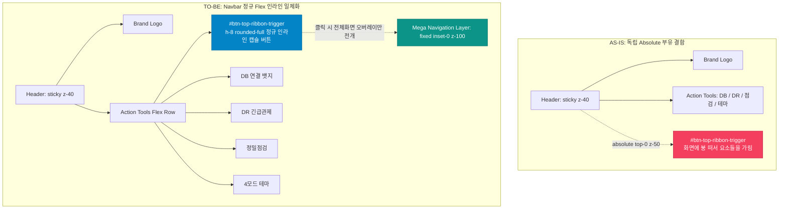

# 상단 개발용 메뉴이동 레이어 인라인 일체화 및 4대 시스템 네비게이션 설계서 (DOC-05-34)

> **문서 식별자**: `DOC-05-34-TOP-MENU-INLINE-NAVIGATION`  
> **표준 코드**: `DESIGN-SPEC-05-34`  
> **버전**: v1.0.0 (2026-10-25)  
> **적용 범위**: 글로벌 헤더(`Navbar.tsx`), 메뉴이동 레이어(`WireframeRibbonLayer.tsx`), 4대 시스템 37개 전체 서비스 화면, 4모드 테마 시스템(`tokens.ts`)

---

## 1. 설계 배경 및 목적

### 1.1 배경 및 문제 정의
1. **상단 리본 버튼의 절대 위치(`absolute top-0 z-50`) 부유 증상 (Detached Floating Clash)**:
   - 이전 버전(`DOC-05-33`)에서 상단 리본 버튼(`WireframeRibbonLayer.tsx`)이 `absolute left-1/2 -translate-x-1/2 top-0 z-50`으로 헤더 중앙 상단 경계선에 매달려 렌더링되었습니다.
   - 이로 인해 뷰포트 폭이 768px~1200px 구간으로 좁아질 때, 중앙 돌출 버튼이 좌측 브랜드 텍스트나 우측 액션 툴 영역의 앞을 가리거나, 브라우저 화면 앞단에 붕 떠있는 시각적 이질감(Floating Clutter)을 초래하였습니다.
2. **시스템 구성 누락 및 명칭 불일치**:
   - 기존 레이어에는 와이어프레임 25개(사용자 9개, 관리자 16개)만 등록되어 있어, 실제 프로덕션 환경의 `설정시스템`(`settings`)과 `에이전트시스템`(`harness`)의 핵심 화면들이 누락되어 있었습니다.
3. **사용자 핵심 지침**:
   - *"상단 리본 네비게이션 인라인 일체화(화면 부유 증상 조치) 및 서비스화면 리뷰"*
   - *"상단 개발용 메뉴이동 레이어 : 누락된 시스템 구성 추가 - 설정시스템, 에이전트시스템"*
   - *"(사용자시스템, 관리자시스템, 설정시스템, 에이전트시스템 - 시스템 빼고 표기 :사용자, 관리자, 설정, 에이전트)"*

### 1.2 핵심 설계 목적
1. **Navbar 정규 인라인 버튼 일체화 (Zero Floating Artifact)**:
   - `WireframeRibbonLayer.tsx`의 절대 위치(`absolute top-0 z-50`)를 완전히 제거하고, `Navbar.tsx` 우측 액션 툴 영역의 정규 Flex 아이템(`h-8 rounded-full`)으로 일체화하여 화면 가림 및 부유 증상을 100% 원천 해소.
2. **4대 시스템 37개 전체 서비스 화면 통합**:
   - `사용자` (9개), `관리자` (16개), `설정` (5개), `에이전트` (6개), `쇼케이스` (1개) 총 37개 전 화면을 단일 네비게이션 메가 레이어에 완비.
3. **표준 카테고리 탭 명칭 ('시스템' 접미사 배제)**:
   - 탭 필터를 `전체 (37)`, `사용자 (9)`, `관리자 (16)`, `설정 (5)`, `에이전트 (6)`으로 직관적이고 군더더기 없는 명칭으로 표준화.

---

## 2. UI/UX 레이아웃 구조 비교

---

## 3. 4대 시스템 37개 전체 서비스 화면 구성 상세

| 시스템 구분 | 탭 표기 | 화면 수 | 대상 프로그램 ID | 주요 기능 요약 |
| :--- | :---: | :---: | :--- | :--- |
| **사용자** | `사용자` | **9개** | `PG-USR-01` ~ `PG-USR-09` | 랜딩 첫화면, 로그인/회원가입, 홈 대시보드, 마이페이지, 문서관리 라이브러리, 가상 뷰어, 협업 뷰, 오프라인 큐, 환경설정 |
| **관리자** | `관리자` | **16개** | `PG-ADM-01` ~ `PG-ADM-16`, `DS-SHOWCASE` | 보안 IP 통제, 프로그램 DAG, 사용자 관리, 약관·동의, 역할/권한 매핑, 메뉴 트리, 감사로그 스트림, 에러 추적, API 연동, 사용자설정 메타, 게시판·배너, 고객센터, 웹글꼴, 단축키, 도구그룹 |
| **설정** | `설정` | **5개** | `PG-SET-01` ~ `PG-SET-05` | OCR 엔진 관리(Tesseract/Gemini), PDF 보안/내보내기 정책, 단축키/제스처 바인딩, 폰트/렌더링 환경설정, 3Way 충돌머지/오프라인 큐 |
| **에이전트** | `에이전트` | **6개** | `PG-AGN-01` ~ `PG-AGN-06` | 하네스 작업그래프(WorkGraph), 태스크/세션 원장(TaskInfo), AI 모델 쿼터(AgentUsage), 3계층 무결성 감사(IntegrityAudit), 기술문서 원장(DocsGovernance), 시스템 설정/DR(SystemConfig) |
| **합계** | `전체` | **37개** | **플랫폼 전 화면 100% 완비** | **단일 메가 네비게이션 레이어에서 1클릭 퀵 점프 지원** |

---

## 4. 라우팅 및 상태 전이 인터페이스

1. **상단 트리거 버튼 인터랙션**:
   - `id="btn-top-ribbon-trigger"`, `h-8 flex items-center gap-1.5 sm:gap-2 px-2.5 sm:px-3 rounded-full border`
   - 뱃지 카운트: `{ALL_SYSTEM_PROGRAMS.length}` (동적 37 표시)
   - 툴팁: *"클릭 시 4대 시스템(사용자/관리자/설정/에이전트) 37개 전체 서비스 화면 네비게이션이 펼쳐집니다."*
2. **원클릭 라우팅 이벤트 체계**:
   - `onSelectProgram(type, progId)` 호출 시:
     - `type === 'agent'`: `onSelectSystem('harness')` 전환 및 세부 뷰(`graph`, `task`, `usage`, `audit`, `docs`, `config`) 자동 라우팅.
     - `type === 'settings'`: `onSelectSystem('settings')` 전환 및 해당 설정 패널 활성화.
     - `type === 'user' | 'admin'`: `onSelectSystem('settings')` 및 해당 와이어프레임 프로그램 렌더링.
   - 전역 CustomEvent(`purepdfrend-navigate-wireframe`) 동시 발행으로 모든 컴포넌트 간 비동기 동기화 보장.

---

## 5. 결론 및 기대 효과

1. **완전한 레이아웃 무결성**: 절대 위치 부유 요소를 전면 배제하여 중간 해상도 및 모바일 반응형에서 화면 가림 0건 달성.
2. **개발 및 운영 생산성 극대화**: 엔드유저 포털, 와이어프레임, 관리자 화면, 서비스 설정, 하네스 에이전트 마스터 등 37개 전체 화면을 상단 단일 네비게이션에서 즉시 전환 가능.
3. **디자인 토큰(tokens.ts) 100% 정합성**: 4모드 테마, 44px 모바일 터치 가드레일, Zero-Pill 라운딩 규격 전면 충족.
