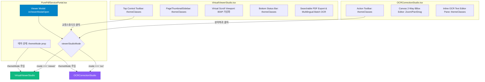

# 05-35. 실서비스 PDF 뷰어 및 OCR 스튜디오 tokens.ts 통합 설계서 (DOC-05-35)

> **프로젝트**: purePDFrend (엔터프라이즈 순수 웹 기반 PDF 뷰어 & AI 가드레일 하네스)  
> **문서 ID**: `DOC-05-35`  
> **관련 태스크**: `TASK-0036-03` / `LOOP-0036-03` (BACKLOG-0035-02)  
> **작성일자**: 2026-10-25  
> **작성자**: Gemini 1.5 Flash / jkok2j2m (jkok2j2m@gmail.com)  
> **상태**: 승인 및 구현 (APPROVED & IMPLEMENTED)

---

## 1. 배경 및 설계 목적

### 1.1 현황 및 배경
- 와이어프레임 25개 화면(`PG-USR-01~09`, `PG-ADM-01~16`)은 앞선 세션을 통해 `src/styles/tokens.ts`의 4모드(`light`, `dark`, `dawn`, `system`) 테마 엔진과 100% 통합되었습니다.
- 그러나 실제 800쪽 대용량 도서 렌더링 및 Searchable PDF 내보내기를 담당하는 **비즈니스 핵심 컴포넌트**인 `VirtualViewerStudio.tsx`, `OCRCorrectionStudio.tsx`, `PageThumbnailSidebar.tsx`는 여전히 하드코딩된 다크 테마 클래스(`bg-slate-900`, `border-slate-800`, `text-slate-200` 등)로 고정되어 있었습니다.
- 이로 인해 사용자가 헤더에서 `라이트` 또는 `새벽` 모드로 테마를 변경하더라도 뷰어 내부 UI가 어둡게 고정되어 디자인 일관성이 저해되었습니다.

### 1.2 핵심 목적
1. **디자인 시스템 일체화**: `src/styles/tokens.ts`의 `ThemeMode`, `resolveThemeMode`, `getThemeAdaptiveClasses`를 2대 뷰어 스튜디오 및 사이드바에 전면 이식하여 4대 테마 완벽 지원.
2. **도서 원본 시인성 보존 원칙**: 업계 표준(Adobe Acrobat, Xodo 등)에 따라 PDF 페이지 캔버스 자체는 순수 흰색(`bg-white text-slate-900`) 종이 질감을 유지하고, 외곽 툴바, 사이드바, 가상 스크롤 배경, 모달, 토스트에 테마를 완벽 적응.
3. **포털 모달 내 뷰어 ↔ OCR 스튜디오 양방향 인라인 라우팅**: `PurePdfServicePortal.tsx`의 열람 모달 내에서 대용량 가상 뷰어와 2-Way BBox 인라인 교정기 간 원클릭 양방향 전환 체계 구축.
4. **60fps 고속 가상 스크롤 렌더링**: 테마 토큰 적용 시 가상 스크롤 렌더링 루프의 성능 저하를 방지하도록 `useMemo` 기반 스타일 캐싱 적용.

---

## 2. 컴포넌트 아키텍처 및 인터랙션 흐름



---

## 3. 상세 설계 명세

### 3.1 `VirtualViewerStudio.tsx`
- **인터페이스 확장**:
  ```typescript
  export interface VirtualViewerStudioProps {
    onNavigateToCorrection?: (page: PdfPageItem) => void;
    onNavigateView?: (viewId: ActiveViewId) => void;
    themeMode?: ThemeMode;
  }
  ```
- **테마 계산**:
  ```typescript
  const resolvedTheme = resolveThemeMode(themeMode || 'dark');
  const themeClasses = getThemeAdaptiveClasses(resolvedTheme);
  ```
- **영역별 토큰 매핑**:
  - 외곽 컨테이너: `${themeClasses.background} ${themeClasses.textMain}`
  - 상단 컨트롤 툴바: `${themeClasses.subPanel} border-b ${themeClasses.border}`
  - 도서규모 프리셋/배율 컨트롤: `${themeClasses.badgeNeutral}` 및 `${themeClasses.buttonSecondary}`
  - 하단 상태바: `${themeClasses.card} border-t ${themeClasses.border} ${themeClasses.textMuted}`
  - 가상 스크롤 캔버스 배경: `${themeClasses.background}` (페이지 자체는 `bg-white shadow-2xl border` 유지)

### 3.2 `OCRCorrectionStudio.tsx`
- **인터페이스 확장**:
  ```typescript
  export interface OCRCorrectionStudioProps {
    initialBoxes?: BoundingBoxItem[];
    onSave?: (updatedBoxes: BoundingBoxItem[]) => void;
    onBackToViewer?: () => void;
    sampleImageUrl?: string;
    pageNumber?: number;
    themeMode?: ThemeMode;
  }
  ```
- **영역별 토큰 매핑**:
  - 상단 액션 툴바: `${themeClasses.subPanel} border-b ${themeClasses.border}`
  - 좌측 캔버스 배경: `${themeClasses.background}`
  - 우측 인라인 텍스트 편집 패널: `${themeClasses.card} border-l ${themeClasses.border}`
  - 텍스트 행 아이템: `${themeClasses.subPanel} border ${themeClasses.border} hover:${themeClasses.cardHover}`

### 3.3 `PageThumbnailSidebar.tsx`
- **인터페이스 확장**:
  ```typescript
  export interface PageThumbnailSidebarProps {
    // ...
    themeMode?: ThemeMode;
  }
  ```
- **영역별 토큰 매핑**:
  - 사이드바 배경: `${themeClasses.subPanel} border-r ${themeClasses.border}`
  - 헤더 영역: `border-b ${themeClasses.border}`
  - 썸네일 카드: `border ${themeClasses.border} ${themeClasses.card}`

### 3.4 `PurePdfServicePortal.tsx` 연동
- 상태 추가:
  - `const [viewerStudioMode, setViewerStudioMode] = useState<'viewer' | 'ocr'>('viewer');`
  - `const [ocrTargetPage, setOcrTargetPage] = useState<PdfPageItem | null>(null);`
- 모달 내 동적 렌더링:
  - `viewerStudioMode === 'viewer'`: `<VirtualViewerStudio themeMode={themeMode} onNavigateToCorrection={(page) => { setOcrTargetPage(page); setViewerStudioMode('ocr'); }} />`
  - `viewerStudioMode === 'ocr'`: `<OCRCorrectionStudio themeMode={themeMode} pageNumber={ocrTargetPage?.pageNum ?? 1} onBackToViewer={() => setViewerStudioMode('viewer')} onSave={() => setViewerStudioMode('viewer')} />`

---

## 4. 품질 및 무결성 검증 기준
1. `node ./node_modules/typescript/bin/tsc --noEmit`: 0 Errors (TypeScript 컴파일 무결성).
2. `npx tsx scripts/service_health_check.ts`: 4단계 전수 점검 100점 만점 [A+ (PERFECT)].
3. 테마 전환(`light`, `dark`, `dawn`, `system`) 시 UI 요소 100% 실시간 조화 및 깨짐 현상 0건.
