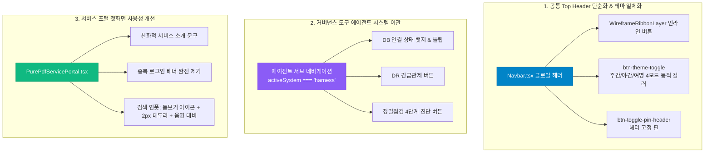

# 서비스화면 UI/UX 리뷰 및 공통 탑바/랜딩 고도화 설계서 (DOC-05-36)

> **문서 식별자**: `DOC-05-36-PORTAL-UX-TOPBAR-LANDING-REFINEMENT`  
> **태스크 ID**: `TASK-0036-04`  
> **루프 ID**: `LOOP-0036-04`  
> **세션 ID**: `SESSION-0036`  
> **작성 일자**: `2026-10-25`  
> **작성자**: `Gemini 1.5 Flash / jkok2j2m (jkok2j2m@gmail.com)`  
> **대상 컴포넌트**: `Navbar.tsx`, `PurePdfServicePortal.tsx`, `tokens.ts`

---

## 1. 개요 및 배경

본 설계서는 서비스 사용자 피드백(2026-10-25 리뷰)에 기반하여 공통 탑바의 불필요한 개발자성 기능 요소를 거버넌스 전용 영역으로 이관하고, 테마 모드별 시각적 일관성을 강화하며, 서비스 포털 첫 화면의 중복 요소를 제거하고 비기술자 친화적인 직관성을 확보하기 위한 UI/UX 고도화 사양을 정의합니다.

---

## 2. 상세 요구사항 및 설계 사양

### 2.1 공통 Top 헤더 개발/거버넌스 버튼 3종 이관 (Navbar.tsx)
- **현황 및 문제점**:
  - 일반 서비스 사용자(GUEST, ROLE_USER)가 사용하는 글로벌 공통 탑바에 `DB 연결 인디케이터`, `DR 긴급관제`, `정밀점검` 3개 버튼이 상시 노출되어 탑바가 복잡해지고 시스템 내부 엔지니어링 도구가 일반 사용자에게 직접 노출되는 문제가 존재함.
- **설계 사양**:
  1. 공통 Top 헤더 우측 유틸리티 영역에서 3개 버튼을 제거.
  2. 에이전트관리 시스템(`activeSystem === 'harness'`) 2단 서브 네비게이션의 우측 영역(기존 `AGENTS.md 준거 거버넌스 활성` 텍스트 자리)으로 3개 버튼을 정규 이관.
  3. 에이전트 관리자가 에이전트 시스템 6대 뷰(`graph`, `task`, `usage`, `audit`, `docs`, `settings`)를 점검할 때만 즉각 접근할 수 있도록 역할 기반 권한 분리 UX 완성.

### 2.2 테마 모드별 동적 버튼 색상 반영 (#btn-theme-toggle)
- **현황 및 문제점**:
  - `#btn-theme-toggle` 버튼이 항상 `bg-slate-900 border-slate-800` 다크 컬러로 고정되어 있어 라이트 모드나 여명 모드 전환 시 시각적 일관성이 훼손됨.
- **설계 사양**:
  - `resolvedTheme`에 따라 3대 테마 모드별 전용 색상 대입:
    - **주간 (`light`)**: `bg-white border-slate-200 hover:border-slate-300 hover:bg-slate-50 text-slate-800 shadow-xs`
    - **야간 (`dark`)**: `bg-slate-900 border-slate-800 hover:border-indigo-500/50 hover:bg-slate-800 text-slate-200 shadow-xs`
    - **여명 (`dawn`)**: `bg-[#0e1a38] border-[#1e3066] hover:border-sky-500/50 hover:bg-[#132247] text-sky-200 shadow-xs`
  - 테마 드롭다운 팝오버 메뉴 및 헤더 핀 토글 버튼도 4모드 테마 클래스와 완벽하게 동기화.

### 2.3 서비스 포털 중복 비로그인 환영 배너 삭제 (PurePdfServicePortal.tsx)
- **현황 및 문제점**:
  - 서비스 포털 상단(Portal v2.0 헤더) 우측에 이미 `로그인 / 권한시뮬` 및 `회원가입` 버튼이 명확히 제공되고 있음에도, 롤링 배너 바로 상단에 동일한 목적의 `비로그인 환영 배너`가 중복 렌더링되어 세로 스크롤을 낭비하고 화면 복잡도를 높임.
- **설계 사양**:
  - `{!isLoggedIn && (
...
)}` 블록을 전면 삭제하여 롤링 프로모션 배너가 첫 화면 최상단에 시원하게 노출되도록 화면 구조 최적화.

### 2.4 비기술자 친화적 서비스 소개 문구 개편
- **기존 문구 (AS-IS)**:
  `"대용량 스캔 PDF 듀얼 OCR, 800쪽 고속 가상화 뷰어 및 7대 핵심 도구 스튜디오"` (기술 용어 중심)
- **개편 문구 (TO-BE, 사용자 승인)**:
  `"편리하게 PDF 문서를 열고, 글자를 추출하며, 안전하게 편집하고 공유할 수 있는 스마트 전자문서 서비스입니다."`
- **의의**:
  - 비전문가 및 일반 업무 사용자도 웹사이트의 핵심 가치를 직관적으로 이해할 수 있는 쉬운 일상어로 전환.

### 2.5 공유 열람 문서 검색 입력창 식별성 및 대비 개선
- **현황 및 문제점**:
  - 입력창의 배경색과 테두리가 감싸고 있는 카드 배경과 유사하여 텍스트 입력 영역의 시각적 식별성(Affordance)이 부족함.
- **설계 사양**:
  1. 입력창 좌측에 `Search(돋보기)` 인라인 아이콘 배치 (`pl-10`).
  2. 2px 두께의 뚜렷한 테두리(`border-2`) 및 음영 대비 강화:
     - 라이트 모드: `bg-slate-50/90 border-slate-300 text-slate-900 focus:bg-white focus:border-blue-500 focus:ring-2 focus:ring-blue-500/20`
     - 다크 모드: `bg-slate-950/90 border-slate-700 text-white focus:border-blue-500 focus:ring-2 focus:ring-blue-500/20`
     - 여명 모드: `bg-[#070e22] border-[#1e3066] text-white focus:border-sky-400 focus:ring-2 focus:ring-sky-400/20`
  3. `shadow-xs` 및 부드러운 트랜지션으로 포커스 시 즉각적인 시각 피드백 제공.

---

## 3. 검증 기준 및 품질 가드레일

1. **정적 타입 무결성**: `tsc --noEmit` 실행 시 오류 0건 통과.
2. **서비스 전수 정밀점검**: `scripts/service_health_check.ts` 4단계 헬스체크 100점 만점 [A+ (PERFECT)] 유지.
3. **기능 검증**:
   - 일반 공통 탑바에서 3개 버튼 미노출 확인.
   - 에이전트 시스템(`harness`) 진입 시 서브바 우측에 DB 인디케이터, DR 버튼, 정밀점검 버튼 정상 마운트 및 모달 오픈 확인.
   - 테마 모드 전환 시 `#btn-theme-toggle`의 배경 및 테두리 색상 즉각 동적 반응 확인.
   - 서비스 포털 첫화면에서 중복 배너 삭제 확인 및 새 소개 문구 확인.
   - 검색 입력창 돋보기 아이콘 및 명확한 테두리 대비 확인.
