# 05-37. 30대 표준 원자/분자 컴포넌트 및 인터랙티브 디자인시스템 쇼케이스 설계서

> **문서 ID**: `DOC-05-37-DESIGN-SYSTEM-SHOWCASE-30-COMPONENTS`  
> **세션 ID**: `SESSION-0036`  
> **태스크 ID**: `TASK-0036-05`  
> **작성 일자**: `2026-10-25`  
> **작성자**: `Gemini 1.5 Flash / jkok2j2m (jkok2j2m@gmail.com)`  
> **버전**: `v1.0.0`  
> **관련 문서**:  
> - `docs/03.정책/03-23_통합_디자인_시스템_및_컴포넌트_풀_표준_가이드.md`  
> - `docs/07.로드맵/07-02_화면별_디자인_토큰_적용현황_및_단계별_로드맵.md`  
> - `src/styles/tokens.ts`  
> - `src/ppdf/views/wireframes/DesignSystemShowcase.tsx`  
> - `src/shared/components/ui/showcaseData.ts`  
> - `src/shared/components/ui/ShowcaseComponentsPool.tsx`  

---

## 1. 개요 및 배경

purePDFrend 플랫폼은 4대 시스템(사용자, 관리자, 설정, 에이전트) 37개 화면으로 확장됨에 따라, UI 일관성과 유지보수성을 극대화하기 위해 기존 8대 Primitive UI 중심의 프로토타입 쇼케이스에서 **30대 표준 원자/분자 컴포넌트를 총망라한 고도화된 인터랙티브 디자인 시스템 쇼케이스(`DS-SHOWCASE`)**로의 전면 도약이 요구되었습니다.

본 설계서는 정책 03-23 및 07-02 로드맵에 의거하여, 화면 레이아웃부터 폼 컨트롤, 인터랙션 분자, 오버레이, 모바일 제스처 도크까지 30대 표준 컴포넌트 풀을 체계화하고, 실시간 검색, 코드 토글 및 복사, 옵션/상태 제어, 4모드 테마 실시간 바인딩, 사용화면 ID 점프 링크를 일체형으로 제공하는 아키텍처를 정의합니다.

---

## 2. 30대 표준 원자/분자 컴포넌트 분류 체계

```mermaid
graph TD
    DS[30대 표준 컴포넌트 풀] --> C1[1. 레이아웃 & 쉘: 4종]
    DS --> C2[2. 입력 및 폼 필드: 6종]
    DS --> C3[3. 선택 및 스위치: 4종]
    DS --> C4[4. 뱃지 및 인디케이터: 4종]
    DS --> C5[5. 고급 인터랙션 분자: 4종]
    DS --> C6[6. 팝오버 및 오버레이: 4종]
    DS --> C7[7. 컨테이너 & 도크: 4종]

    C1 --> C1_1[TopHeaderLayer]
    C1 --> C1_2[ContentBodyLayer]
    C1 --> C1_3[FooterLayer]
    C1 --> C1_4[BreadcrumbTitleArea]

    C2 --> C2_1[InputField]
    C2 --> C2_2[SearchInputField]
    C2 --> C2_3[SelectDropdown]
    C2 --> C2_4[RealtimeFilterList]
    C2 --> C2_5[IconSelectComboBox]
    C2 --> C2_6[RadioButtonGroup]

    C3 --> C3_1[FilterSelectChip]
    C3 --> C3_2[CheckboxControl]
    C3 --> C3_3[ToggleSwitch]
    C3 --> C3_4[TabNavigation]

    C4 --> C4_1[CountBadge]
    C4 --> C4_2[StatusBadge]
    C4 --> C4_3[OfflineIndicatorBar]
    C4 --> C4_4[InlineSemanticBanner]

    C5 --> C5_1[DraggableCategoryTree]
    C5 --> C5_2[ProfileAvatarEditable]
    C5 --> C5_3[HorizontalStatusStepper]
    C5 --> C5_4[SlideDragWheel]

    C6 --> C6_1[LongPressTooltipCopy]
    C6 --> C6_2[InfoHelpPopoverLayer]
    C6 --> C6_3[MobileBottomSheetModal]
    C6 --> C6_4[FloatingToastFeedbackLayer]

    C7 --> C7_1[BentoCardContainer]
    C7 --> C7_2[ResponsiveLabelValueRow]
    C7 --> C7_3[FloatingQuickDock]
    C7 --> C7_4[MobileBottomNavbar]
```



---

## 3. 7대 핵심 인터랙티브 기능 설계

1. **실시간 요소 검색 엔진 (화면 타이틀 직하단)**:
   - 검색창에 키워드 입력 시 30대 컴포넌트의 한글명, 영문명, ID(`COMP-01`), 설명, 사용화면 ID(`PG-USR-01` 등)를 즉각 교차 매칭하여 실시간 필터링.
2. **구현 코드 토글 및 원클릭 복사 (`< > 코드 보기`)**:
   - 각 컴포넌트 카드 상단에 토글 버튼 배치. 클릭 시 실제 프로덕션에서 즉시 사용 가능한 JSX 및 Tailwind 클래스 스니펫 제공.
   - `navigator.clipboard` 기반 원클릭 코드 복사 및 2초간 시각 피드백 제공.
3. **글로벌 상태(State) & 크기(Size) 인터랙티브 컨트롤러**:
   - 상태: `Default`, `Hover`, `Active`, `Focus`, `Disabled`, `Error` 실시간 시뮬레이션.
   - 크기: `Small (sm: 32px)`, `Medium (md: 40px)`, `Large (lg: 44px 터치 가드레일)`.
4. **4모드 테마 실시간 바인딩**:
   - 주간(`light`), 야간(`dark`), 여명(`dawn`), 시스템(`system`) 전환 시 모든 30대 컴포넌트의 배경, 테두리, 텍스트 대비가 WCAG AA 4.5:1 기준으로 동적 렌더링.
5. **사용화면 ID 표시 & 1클릭 화면 점프 링크**:
   - 각 컴포넌트 하단에 활용 화면 ID 배지(`[PG-USR-01]`, `[PG-ADM-03]` 등) 배치.
   - 클릭 시 `purepdfrend-navigate-wireframe` 커스텀 이벤트를 발송하여 실제 해당 서비스 화면으로 즉시 라우팅.
6. **텍스트 전수 선택 가능 보장 (`select-text`)**:
   - 쇼케이스 내의 라벨, 코드, 설명 등 모든 텍스트 영역에 `select-text`를 명시하여 텍스트 드래그 및 복사 자유도 100% 보장.
7. **Zero-Pill 규율 및 4pt 그리드 엄격 유지**:
   - 직사각형 컨테이너에 `rounded-full` 알약형 사용을 전면 배제하고, `rounded-xl`, `rounded-2xl` 사각 둥글기 표준 고수.

---

## 4. 고난도 인터랙션 분자 로직 구현 상세

### 4.1 슬라이드 드래그휠 (`COMP-22`)
```tsx
onWheel={(e) => {
  const el = e.currentTarget;
  const atLeft = el.scrollLeft === 0 && e.deltaY < 0;
  const atRight = el.scrollLeft + el.clientWidth >= el.scrollWidth - 1 && e.deltaY > 0;
  if (!atLeft && !atRight) {
    // 내부 가로 스크롤 범위 내에서는 이벤트 전파를 차단하여 세로 화면 덜컹거림 방어
    e.stopPropagation();
    el.scrollLeft += e.deltaY;
  }
  // 좌/우 경계에 도달한 초과 휠 동작 시에는 부모 화면의 상하 스크롤로 자연스럽게 폴백
}}
```

### 4.2 카테고리 트리 드래그 앵커 & 인라인 수정 (`COMP-16`)
- `GripVertical` 핸들을 통한 HTML5 DnD 구현.
- 드래그 항목이 호버된 대상 항목 위에 올라섰을 때 타겟 앵커선(`border-dashed border-blue-500`) 시각화.
- 드롭 완료 시 재배치 피드백 토스트 호출.
