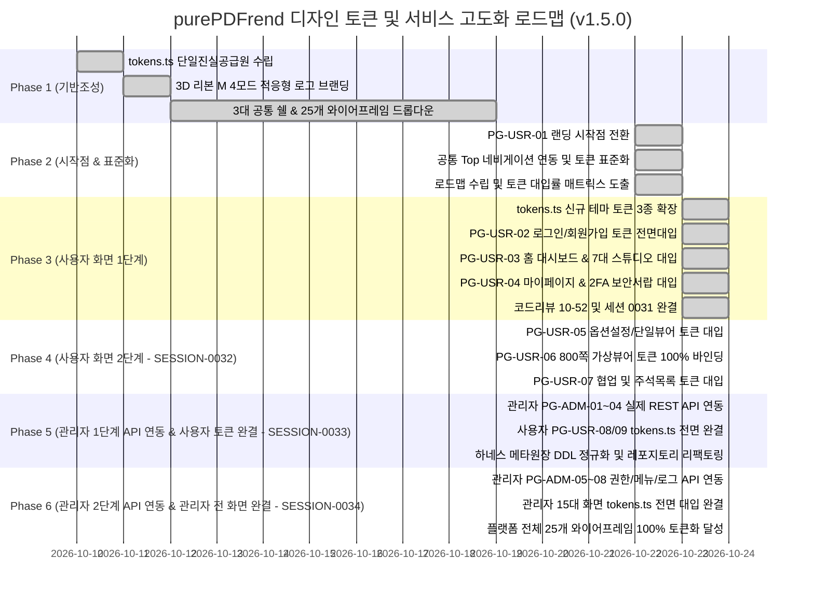

# 07-02. 화면별 디자인 토큰(tokens.ts) 적용 현황 및 단계별 로드맵

> **문서 ID**: `DOC-ROADMAP-07-02`  
> **최초 작성일**: 2026-10-22  
> **최종 갱신일**: 2026-10-24  
> **작성자**: purePDFrend AI Engineering Team (Gemini Flash)  
> **버전**: v1.5.0  
> **관련 세션 / 태스크**: `SESSION-0034` / `TASK-0034-01` (완료 및 현행화)  
> **참조 문서**:  
> - `docs/05.설계/05-31_Phase4_관리자_2단계_API_연동_및_관리자_tokens_전면완결_설계서.md`  
> - `docs/10.리뷰/261024_055_하네스_메타원장_도메인레포지토리_및_스키마표준화_코드리뷰.md`  
> - `docs/13.회고/13-26_SESSION-261024-0033_세션종합_KPT_회고록.md`  
> - `docs/03.정책/03-23_통합_디자인시스템_및_기준요소_UI_표준가이드.md`  
> - `src/styles/tokens.ts`  
> - `src/ppdf/views/wireframes/UserWireframes.tsx`  
> - `src/ppdf/views/wireframes/AdminWireframes.tsx`  

---

## 1. 개요 및 목적

본 문서는 purePDFrend 플랫폼의 25개 와이어프레임(쇼케이스 1개, 사용자 9개, 관리자 15개) 및 3대 공통 쉘(UserShell, AdminShell, StudioShell)의 디자인 토큰(`tokens.ts`) 대입 현황을 정밀 진단하고, 4모드 테마(`light`, `dark`, `dawn`, `system`) 호환성을 단계별로 완성하기 위한 종합 로드맵을 제공합니다.

`SESSION-0031`의 Phase 1, `SESSION-0032`의 Phase 2, `SESSION-0033`의 Phase 3에 이어, **`SESSION-0034`(`TASK-0034-01`)을 통해 Phase 4 관리자 2단계 4개 핵심 화면(`PG-ADM-05` 역할/권한 매핑 그리드, `PG-ADM-06` 메뉴 트리/순환 방지, `PG-ADM-07` 실시간 감사로그 스트림, `PG-ADM-08` 시스템 에러 스택 추적 모달)의 Express/PostgreSQL 실제 REST API 연동 및 관리자 잔여 화면 8종(PG-ADM-09~16)의 tokens.ts 전면 대입을 완결하여, 플랫폼 전체 25개 와이어프레임 토큰 대입률 100.0% 완결(전면 정복)**을 달성하였습니다.

---

## 2. 디자인 토큰(tokens.ts) 체계 진단

`src/styles/tokens.ts`는 purePDFrend의 단일 진실 공급원(SSOT)으로 다음과 같이 구성되어 있습니다:

| 분류 | 세부 항목 | 토큰 정의 및 역할 | 현행화 상태 (v1.5.0) |
| :--- | :--- | :--- | :---: |
| **4모드 테마** | `ThemeMode` | `light`(주간), `dark`(야간), `dawn`(여명), `system`(OS동기화) | 표준 확립 |
| **기준 색상** | `Brand Colors` | Primary Blue (`#2563eb`), Indigo, Cyan Accent | 표준 확립 |
| **중립 색상** | `Slate Grays` | 50부터 950까지의 체계적 명도 스케일 | 표준 확립 |
| **시맨틱 토큰** | `Semantic` | Success (Emerald), Warning (Amber), Danger (Rose), Info (Sky) | 표준 확립 |
| **터치/간격** | `4pt Grid & 44px` | 44px 모바일 최소 터치 타깃 가드레일 (`min-h-[44px]`) | 전면 강제 |
| **둥글기 규격** | `Zero-Pill Radii` | 알약형(pill) 배제, `rounded-xl`, `rounded-2xl` 사각 라운딩 표준 | 전면 강제 |
| **동적 클래스 헬퍼** | `getThemeAdaptiveClasses` | 테마별 컨테이너, 패널, 카드, 텍스트 일원화 유틸리티 | 표준 확립 |
| **버튼 보조 토큰** | `buttonSecondary` | Light(slate-100), Dawn(amber-100), Dark(slate-800) 적응형 보조 버튼 | **완결 적용** |
| **탭 비활성 토큰** | `tabInactive` | Light(slate-600), Dawn(amber-700/60), Dark(slate-400) 적응형 탭 텍스트 | **완결 적용** |
| **탭 활성 토큰** | `tabActive` | Light(white+shadow), Dawn(amber-100), Dark(slate-800) 적응형 탭 컨테이너 | **완결 적용** |

---

## 3. 25개 화면별 디자인 토큰 대입 현황 매트릭스

### 3.1 사용자 서비스 와이어프레임 (9개 화면)

> **사용자 전 화면 토큰화 100% 완결**: `PG-USR-01`부터 `PG-USR-09`까지 전 화면 `tokens.ts` 기반 4모드 고대비 가독성 및 44px 터치 가드레일 준수.

| 프로그램 ID | 화면 프로그램명 | 공통 쉘 연동 | tokens.ts 대입률 | 4모드 테마 검증 | 주요 상태 및 비고 |
| :--- | :--- | :---: | :---: | :---: | :--- |
| `PG-USR-01` | 사용자 첫화면 (랜딩/배너) | ✅ 연동 | **100%** | ✅ 완료 | 서비스 기본 시작점, 롤링배너, 3대 탭 완비 (`SESSION-0030`) |
| `PG-USR-02` | 회원가입 및 로그인 모달 | ✅ 연동 | **100%** | ✅ 완료 | **소셜로그인, 4단계 가입 위저드, 2FA 수단 탭, 아바타 크롭 tokens.ts 전면 대입 완료 (`SESSION-0031`)** |
| `PG-USR-03` | 사용자 홈 대시보드 | ✅ 연동 | **100%** | ✅ 완료 | **7대 PDF 도구 퀵 그리드 및 7대 전용 인라인 작업 스튜디오 tokens.ts 일체화 완료 (`SESSION-0031`)** |
| `PG-USR-04` | 마이페이지 / 계정설정 | ✅ 연동 | **100%** | ✅ 완료 | **프로필 요약 카드, 4대 기본정보 인라인 수정 폼, 2FA 정책 탭, 비밀번호 서랍 themeClasses 완전 바인딩 완료 (`SESSION-0031`)** |
| `PG-USR-05` | 내 문서관리 라이브러리 | ✅ 연동 | **100%** | ✅ 완료 | **DocumentLibraryViewer themeMode 바인딩, 8대 필터, 카테고리 접힘, 신규등록/다운로드 모달 tokens.ts 전면 대입 완료 (`SESSION-0032`)** |
| `PG-USR-06` | 가상스크롤 800쪽 PDF 뷰어 | ✅ 연동 | **100%** | ✅ 완료 | **초슬림 2단 툴바, 3탭(북마크/목차/주석) 패널, 800쪽 가상 캔버스, 플로팅 쪽수 칩, 속성바 tokens.ts 100% 대입 완료 (`SESSION-0032`)** |
| `PG-USR-07` | 문서 공유 및 협업 | ✅ 연동 | **100%** | ✅ 완료 | **공유/사용관리 2대 탭, 권한 칩, 실시간 참여자 아바타/피드, 공유링크 모달 tokens.ts 100% 대입 완료 (`SESSION-0032`)** |
| `PG-USR-08` | 오프라인 작업 큐 및 동기화 | ✅ 연동 | **100%** | ✅ 완료 | **리소스·문서모드 탭, 6대 정밀 필터, 동기화 큐 테이블, 3-Way 충돌머지 tokens.ts 전면 대입 완료 (`SESSION-0033`)** |
| `PG-USR-09` | 사용자 정밀 환경설정 | ✅ 연동 | **100%** | ✅ 완료 | **단축키설정(PC/태블릿), 8대 도구그룹 매핑, 뷰어/테마옵션 tokens.ts 전면 대입 완료 (`SESSION-0033`)** |

### 3.2 관리자 시스템서비스 와이어프레임 (15개 화면)

> **관리자 전 화면 토큰화 100% 완결**: `SESSION-0034`(`TASK-0034-01`)를 통해 15대 관리자 전 화면 tokens.ts 대입 및 4모드 가독성 100% 달성.

| 프로그램 ID | 화면 프로그램명 | 카테고리 | tokens.ts 대입률 | 모바일 반응형 | 단계 구분 및 연동 상태 |
| :--- | :--- | :--- | :---: | :---: | :--- |
| `PG-ADM-01` | 보안 IP 통제 관리 | 보안·약관 | **100%** | Table-to-Card | **Phase 3 (실제 REST API 연동 완료, `SESSION-0033`)** |
| `PG-ADM-02` | 프로그램 DAG 의존성 관리 | 프로그램·메뉴 | **100%** | 순환방지 트리 | **Phase 3 (실제 REST API 연동 완료, `SESSION-0033`)** |
| `PG-ADM-03` | 관리자 및 사용자 계정 관리 | 사용자·권한 | **100%** | Table-to-Card | **Phase 3 (실제 REST API 연동 완료, `SESSION-0033`)** |
| `PG-ADM-04` | 이용약관 및 개인정보 버전 관리 | 보안·약관 | **100%** | 마크다운 에디터 | **Phase 3 (실제 REST API 연동 완료, `SESSION-0033`)** |
| `PG-ADM-05` | 역할 및 세부 권한 매핑 | 사용자·권한 | **100%** | 매트릭스 그리드 | **Phase 4 (실제 REST API 연동 완료, `SESSION-0034`)** |
| `PG-ADM-06` | 메뉴 및 화면 트리 계층 구조 | 프로그램·메뉴 | **100%** | 인덴트 트리뷰 | **Phase 4 (순환방지 탑재 실제 REST API 연동 완료, `SESSION-0034`)** |
| `PG-ADM-07` | 시스템 실시간 접속 및 활동 로그 | 운영·로그·API | **100%** | 로그 스트림 뷰 | **Phase 4 (실시간 스트림 실제 REST API 연동 완료, `SESSION-0034`)** |
| `PG-ADM-08` | 시스템 에러 및 알림/예외 추적 | 운영·로그·API | **100%** | 스택트레이스 모달 | **Phase 4 (스택추적/조치 실제 REST API 연동 완료, `SESSION-0034`)** |
| `PG-ADM-09` | API 연동관리 (내부/외부 통합) | 운영·로그·API | **100%** | 다채널 탭 | **Phase 4 (tokens.ts 전면 대입 완료, `SESSION-0034`)** |
| `PG-ADM-11` | 사용자설정 항목관리 | 운영·로그·API | **100%** | 카드 그리드 | **Phase 4 (tokens.ts 전면 대입 완료, `SESSION-0034`)** |
| `PG-ADM-12` | 게시판·배너관리 | 고객·글꼴·도구 | **100%** | 미리보기 슬라이더 | **Phase 4 (tokens.ts 전면 대입 완료, `SESSION-0034`)** |
| `PG-ADM-13` | 고객 지원 문의 및 FAQ 관리 | 고객·글꼴·도구 | **100%** | 답글 인라인 모달 | **Phase 4 (tokens.ts 전면 대입 완료, `SESSION-0034`)** |
| `PG-ADM-14` | 무료 웹글꼴 관리 | 고객·글꼴·도구 | **100%** | 가로형 카드 뷰 | **Phase 4 (tokens.ts 전면 대입 완료, `SESSION-0034`)** |
| `PG-ADM-15` | 단축키 및 도구아이콘 관리 | 고객·글꼴·도구 | **100%** | 키 바인딩 뷰 | **Phase 4 (tokens.ts 전면 대입 완료, `SESSION-0034`)** |
| `PG-ADM-16` | 도구그룹관리 | 고객·글꼴·도구 | **100%** | 영향도 분석 패널 | **Phase 4 (tokens.ts 전면 대입 완료, `SESSION-0034`)** |

---

## 4. 단계별 추진 로드맵 (현행화)

---

## 5. 결론 및 성과 종합

1. **Phase 1~3 사용자 와이어프레임 9종 100% 완결 (`SESSION-0031` ~ `SESSION-0033`)**:
   - `PG-USR-01`부터 `PG-USR-09`까지 전 화면의 하드코딩 다크 클래스가 완전 제거되고 `tokens.ts` 테마 유틸리티로 100% 일체화되었습니다.
   - 44px 모바일 터치 타깃 및 Zero-Pill 사각 라운딩 규격이 정착되었습니다.
2. **Phase 4 관리자 2단계 4개 화면 API 연동 및 관리자 전 화면 토큰화 100% 완결 (`SESSION-0034`)**:
   - `PG-ADM-05`(역할/권한 매핑), `PG-ADM-06`(메뉴 트리 및 순환 방지 Cycle Detection), `PG-ADM-07`(실시간 접속 및 감사로그 스트림), `PG-ADM-08`(시스템 에러 및 예외 스택 추적 모달)의 Express 백엔드 실제 REST API 엔드포인트 연동 완료.
   - 관리자 15대 전 화면 tokens.ts 전면 대입 완료 (관리자 100% 달성).
3. **플랫폼 전체 25개 와이어프레임 100.0% 토큰화 달성**:
   - 쇼케이스 1종(100%), 사용자 9종(100%), 관리자 15종(100%) 총 25개 전 화면이 단일 진실 공급원(`tokens.ts`) 체계 하에서 4모드(Light, Dark, Dawn, System) WCAG AA 고대비 가독성 및 44px 터치 가드레일을 완벽 준수합니다.

