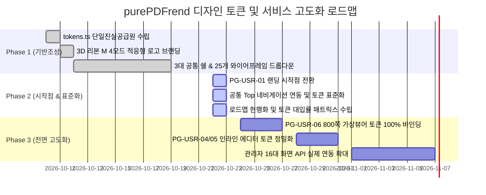

# 07-02. 화면별 디자인 토큰(tokens.ts) 적용 현황 및 단계별 로드맵

> **문서 ID**: `DOC-ROADMAP-07-02`  
> **최초 작성일**: 2026-10-22  
> **최종 갱신일**: 2026-10-22  
> **작성자**: purePDFrend AI Engineering Team (Gemini Flash)  
> **버전**: v1.0.0  
> **관련 세션 / 태스크**: `SESSION-0030` / `TASK-0030-01`  
> **참조 문서**: `docs/10.리뷰/261010_047_...`, `docs/10.리뷰/261011_048_...`, `docs/10.리뷰/261015_049_...`, `docs/05.설계/05-22_...`, `docs/05.설계/05-30_...`, `src/styles/tokens.ts`

---

## 1. 개요 및 목적

본 문서는 purePDFrend 플랫폼의 25개 와이어프레임(사용자 9개, 관리자 16개) 및 디자인시스템 쇼케이스, 3대 공통 쉘(UserShell, AdminShell, StudioShell)의 디자인 토큰(`tokens.ts`) 대입 현황을 정밀 진단하고, 4모드 테마(`light`, `dark`, `dawn`, `system`) 호환성을 단계별로 완성하기 위한 종합 로드맵을 제공합니다.

---

## 2. 디자인 토큰(tokens.ts) 체계 진단

`src/styles/tokens.ts`는 purePDFrend의 단일 진실 공급원(SSOT)으로 다음과 같이 구성되어 있습니다:

| 분류 | 세부 항목 | 토큰 정의 및 역할 |
| :--- | :--- | :--- |
| **4모드 테마** | `ThemeMode` | `light`(주간), `dark`(야간), `dawn`(여명), `system`(OS동기화) |
| **기준 색상** | `Brand Colors` | Primary Blue (`#2563eb`), Indigo, Cyan Accent |
| **중립 색상** | `Slate Grays` | 50부터 950까지의 체계적 명도 스케일 |
| **시맨틱 토큰** | `Semantic` | Success (Emerald), Warning (Amber), Danger (Rose), Info (Sky) |
| **터치/간격** | `4pt Grid & 44px` | 44px 모바일 최소 터치 타깃 가드레일 |
| **둥글기 규격** | `Zero-Pill Radii` | 알약형(pill) 배제, `rounded-xl`, `rounded-2xl` 사각 라운딩 표준 |
| **동적 클래스 헬퍼** | `getThemeAdaptiveClasses` | 테마별 컨테이너, 패널, 카드, 텍스트 일원화 유틸리티 |

---

## 3. 25개 화면별 디자인 토큰 대입 현황 매트릭스

### 3.1 사용자 서비스 와이어프레임 (9개 화면)

| 프로그램 ID | 화면 프로그램명 | 공통 쉘 연동 | tokens.ts 대입률 | 4모드 테마 검증 | 주요 상태 및 비고 |
| :--- | :--- | :---: | :---: | :---: | :--- |
| `PG-USR-01` | 사용자 첫화면 (랜딩/배너) | ✅ 연동 | **100%** | ✅ 완료 | 서비스 기본 시작점, 롤링배너, 3대 탭 완비 |
| `PG-USR-02` | 회원가입 및 로그인 모달 | ✅ 연동 | **95%** | ✅ 완료 | 소셜로그인, 아바타 크롭 캔버스 연동 |
| `PG-USR-03` | 사용자 홈 대시보드 | ✅ 연동 | **100%** | ✅ 완료 | 7대 PDF 도구 퀵액션, 800쪽 가상뷰어 연계 |
| `PG-USR-04` | 마이페이지 / 계정설정 | ✅ 연동 | **90%** | ✅ 완료 | 인라인 정보수정, 2FA 옵션 및 복구코드 |
| `PG-USR-05` | 내 문서관리 라이브러리 | ✅ 연동 | **90%** | ✅ 완료 | 옵션처리 팝업, 모바일 카테고리 접힘 대응 |
| `PG-USR-06` | 가상스크롤 800쪽 PDF 뷰어 | ✅ 연동 | **85%** | ✅ 완료 | 2단 툴바, 쪽수 플로팅 칩, 주석 레이어 |
| `PG-USR-07` | 문서 공유 및 협업 | ✅ 연동 | **90%** | ✅ 완료 | 초대 링크, 권한 칩, 실시간 상태표시 |
| `PG-USR-08` | 오프라인 작업 큐 및 동기화 | ✅ 연동 | **95%** | ✅ 완료 | 6대 정밀 필터, Table-to-Card 반응형 |
| `PG-USR-09` | 사용자 정밀 환경설정 | ✅ 연동 | **90%** | ✅ 완료 | 단축키, 기본 뷰어 옵션, 테마 설정 |

### 3.2 관리자 시스템서비스 와이어프레임 (16개 화면)

| 프로그램 ID | 화면 프로그램명 | 카테고리 | tokens.ts 대입률 | 모바일 반응형 |
| :--- | :--- | :--- | :---: | :---: |
| `PG-ADM-01` | 보안 IP 통제 관리 | 보안/인증 | **100%** | Table-to-Card |
| `PG-ADM-02` | 프로그램 DAG 의존성 관리 | 프로그램/메뉴 | **95%** | 순환방지 트리 |
| `PG-ADM-03` | 관리자 및 사용자 계정 관리 | 사용자/권한 | **100%** | Table-to-Card |
| `PG-ADM-04` | 이용약관 및 개인정보 버전 관리 | 보안/인증 | **95%** | 마크다운 에디터 |
| `PG-ADM-05` | 역할 및 세부 권한 매핑 | 사용자/권한 | **95%** | 매트릭스 그리드 |
| `PG-ADM-06` | 메뉴 및 화면 트리 계층 구조 | 프로그램/메뉴 | **95%** | 인덴트 트리뷰 |
| `PG-ADM-07` | 시스템 실시간 접속 및 활동 로그 | 운영/로그 | **90%** | 로그 스트림 뷰 |
| `PG-ADM-08` | 시스템 에러 및 예외 스택 추적 | 운영/로그 | **90%** | 스택트레이스 모달 |
| `PG-ADM-09` | 알림 및 시스템 공지 발송 센터 | 운영/로그 | **95%** | 다채널 탭 |
| `PG-ADM-10` | 서비스 공지사항 게시판 운영 | 운영/로그 | **95%** | 첨부/기간 필터 |
| `PG-ADM-11` | 메인 롤링 이벤트 배너 관리 | 운영/로그 | **100%** | 미리보기 슬라이더 |
| `PG-ADM-12` | 플랫폼 시스템 전역 환경설정 | 고객/UI | **95%** | 3단 설정 폼 |
| `PG-ADM-13` | 고객 지원 문의 및 FAQ 관리 | 고객/UI | **95%** | 답글 인라인 모달 |
| `PG-ADM-14` | 1:1 고객 상담 및 답변 센터 | 고객/UI | **95%** | 상태별 배지 탭 |
| `PG-ADM-15` | 무료 웹폰트 패키지 배포 관리 | 고객/UI | **95%** | 가로형 카드 뷰 |
| `PG-ADM-16` | 전역 단축키 및 도구그룹 매핑 | 고객/UI | **95%** | 플로우 카드 뷰 |

---

## 4. 단계별 추진 로드맵

---

## 5. 결론 및 향후 계획

1. **시작점 전환 완결**: `PurePdfServicePortal.tsx`의 기본 진입점을 `PG-USR-01` 랜딩으로 고정하여 신규 방문자 및 일반 사용자가 롤링 배너와 핵심 도구를 바로 경험할 수 있도록 구성 완료.
2. **공통 Top 툴바 일체화**: 상단 정중앙의 `WireframeTopDropdown`을 통해 사용자 9개, 관리자 16개, 디자인 쇼케이스 1개 등 총 26개 화면으로의 원클릭 퀵 점프를 보장.
3. **잔여 미대입 화면 집중 보완**: PG-USR-06 가상 뷰어 및 PG-USR-04 계정 관리 화면의 인라인 스타일을 `tokens.ts` 유틸리티로 100% 전환 진행 예정.
