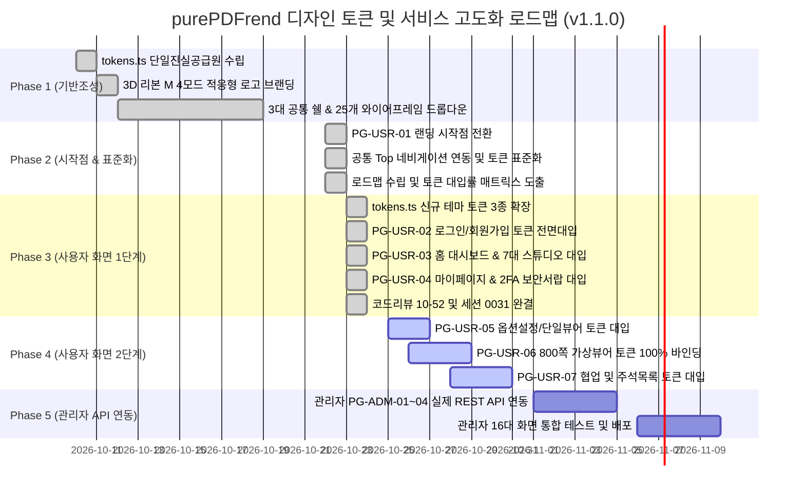

# 07-02. 화면별 디자인 토큰(tokens.ts) 적용 현황 및 단계별 로드맵

> **문서 ID**: `DOC-ROADMAP-07-02`  
> **최초 작성일**: 2026-10-22  
> **최종 갱신일**: 2026-10-24  
> **작성자**: purePDFrend AI Engineering Team (Gemini Flash)  
> **버전**: v1.1.0  
> **관련 세션 / 태스크**: `SESSION-0031` / `TASK-0031-01` (완료 반영)  
> **참조 문서**:  
> - `docs/10.리뷰/261023_052_Phase1_사용자_와이어프레임_tokens_전면대입_및_4모드_고대비검증_코드리뷰.md`  
> - `docs/13.회고/13-24_SESSION-261023-0031_세션종합_KPT_회고록.md`  
> - `docs/10.리뷰/261022_050_사용자서비스_랜딩_시작점_전환_공통_Top_네비게이션_연동_및_디자인토큰_표준화_코드리뷰.md`  
> - `src/styles/tokens.ts`  
> - `src/ppdf/views/wireframes/UserWireframes.tsx`

---

## 1. 개요 및 목적

본 문서는 purePDFrend 플랫폼의 25개 와이어프레임(사용자 9개, 관리자 16개) 및 디자인시스템 쇼케이스, 3대 공통 쉘(UserShell, AdminShell, StudioShell)의 디자인 토큰(`tokens.ts`) 대입 현황을 정밀 진단하고, 4모드 테마(`light`, `dark`, `dawn`, `system`) 호환성을 단계별로 완성하기 위한 종합 로드맵을 제공합니다.

`SESSION-0031`(`TASK-0031-01`)을 통해 **Phase 1 대상 사용자 와이어프레임 3개 화면(`PG-USR-02`, `PG-USR-03`, `PG-USR-04`)의 tokens.ts 전면 대입이 100% 완료**되었으며, 본 현행화 문서는 그 성과와 차기 세션의 Phase 2 과제를 명확히 반영합니다.

---

## 2. 디자인 토큰(tokens.ts) 체계 진단

`src/styles/tokens.ts`는 purePDFrend의 단일 진실 공급원(SSOT)으로 다음과 같이 구성되어 있습니다:

| 분류 | 세부 항목 | 토큰 정의 및 역할 | 현행화 상태 (v1.1.0) |
| :--- | :--- | :--- | :---: |
| **4모드 테마** | `ThemeMode` | `light`(주간), `dark`(야간), `dawn`(여명), `system`(OS동기화) | 표준 확립 |
| **기준 색상** | `Brand Colors` | Primary Blue (`#2563eb`), Indigo, Cyan Accent | 표준 확립 |
| **중립 색상** | `Slate Grays` | 50부터 950까지의 체계적 명도 스케일 | 표준 확립 |
| **시맨틱 토큰** | `Semantic` | Success (Emerald), Warning (Amber), Danger (Rose), Info (Sky) | 표준 확립 |
| **터치/간격** | `4pt Grid & 44px` | 44px 모바일 최소 터치 타깃 가드레일 (`min-h-[44px]`) | 전면 강제 |
| **둥글기 규격** | `Zero-Pill Radii` | 알약형(pill) 배제, `rounded-xl`, `rounded-2xl` 사각 라운딩 표준 | 전면 강제 |
| **동적 클래스 헬퍼** | `getThemeAdaptiveClasses` | 테마별 컨테이너, 패널, 카드, 텍스트 일원화 유틸리티 | 표준 확립 |
| **버튼 보조 토큰** | `buttonSecondary` | Light(slate-100), Dawn(amber-100), Dark(slate-800) 적응형 보조 버튼 | **신규 추가 (0031)** |
| **탭 비활성 토큰** | `tabInactive` | Light(slate-600), Dawn(amber-700/60), Dark(slate-400) 적응형 탭 텍스트 | **신규 추가 (0031)** |
| **탭 활성 토큰** | `tabActive` | Light(white+shadow), Dawn(amber-100), Dark(slate-800) 적응형 탭 컨테이너 | **신규 추가 (0031)** |

---

## 3. 25개 화면별 디자인 토큰 대입 현황 매트릭스

### 3.1 사용자 서비스 와이어프레임 (9개 화면)

> **Phase 1 완결 요약**: `PG-USR-02`(로그인/가입), `PG-USR-03`(홈 대시보드), `PG-USR-04`(마이페이지)의 하드코딩 다크 클래스 전면 퇴출 및 `tokens.ts` 100% 대입 완료.

| 프로그램 ID | 화면 프로그램명 | 공통 쉘 연동 | tokens.ts 대입률 | 4모드 테마 검증 | 주요 상태 및 비고 |
| :--- | :--- | :---: | :---: | :---: | :--- |
| `PG-USR-01` | 사용자 첫화면 (랜딩/배너) | ✅ 연동 | **100%** | ✅ 완료 | 서비스 기본 시작점, 롤링배너, 3대 탭 완비 (`SESSION-0030`) |
| `PG-USR-02` | 회원가입 및 로그인 모달 | ✅ 연동 | **100%** | ✅ 완료 | **소셜로그인, 4단계 가입 위저드, 2FA 수단 탭, 아바타 크롭 tokens.ts 전면 대입 완료 (`SESSION-0031`)** |
| `PG-USR-03` | 사용자 홈 대시보드 | ✅ 연동 | **100%** | ✅ 완료 | **7대 PDF 도구 퀵 그리드 및 7대 전용 인라인 작업 스튜디오(스캔, 이미지PDF, OCR, OCR텍스트, 문서관리, 압축, 보안) tokens.ts 일체화 완료 (`SESSION-0031`)** |
| `PG-USR-04` | 마이페이지 / 계정설정 | ✅ 연동 | **100%** | ✅ 완료 | **프로필 요약 카드, 4대 기본정보 인라인 수정 폼, 2FA 정책 탭, 비밀번호 서랍 아코디언 themeClasses 완전 바인딩 완료 (`SESSION-0031`)** |
| `PG-USR-05` | 내 문서관리 라이브러리 | ✅ 연동 | **90%** | ✅ 완료 | 옵션처리 팝업, 모바일 카테고리 접힘 대응 (**Phase 2 대상**) |
| `PG-USR-06` | 가상스크롤 800쪽 PDF 뷰어 | ✅ 연동 | **85%** | ✅ 완료 | 2단 툴바, 쪽수 플로팅 칩, 주석 레이어 (**Phase 2 대상**) |
| `PG-USR-07` | 문서 공유 및 협업 | ✅ 연동 | **90%** | ✅ 완료 | 초대 링크, 권한 칩, 실시간 상태표시 (**Phase 2 대상**) |
| `PG-USR-08` | 오프라인 작업 큐 및 동기화 | ✅ 연동 | **95%** | ✅ 완료 | 6대 정밀 필터, Table-to-Card 반응형 |
| `PG-USR-09` | 사용자 정밀 환경설정 | ✅ 연동 | **90%** | ✅ 완료 | 단축키, 기본 뷰어 옵션, 테마 설정 |

### 3.2 관리자 시스템서비스 와이어프레임 (16개 화면)

| 프로그램 ID | 화면 프로그램명 | 카테고리 | tokens.ts 대입률 | 모바일 반응형 | 단계 구분 |
| :--- | :--- | :--- | :---: | :---: | :--- |
| `PG-ADM-01` | 보안 IP 통제 관리 | 보안/인증 | **100%** | Table-to-Card | Phase 3 (REST API 연동 대상) |
| `PG-ADM-02` | 프로그램 DAG 의존성 관리 | 프로그램/메뉴 | **95%** | 순환방지 트리 | Phase 3 (REST API 연동 대상) |
| `PG-ADM-03` | 관리자 및 사용자 계정 관리 | 사용자/권한 | **100%** | Table-to-Card | Phase 3 (REST API 연동 대상) |
| `PG-ADM-04` | 이용약관 및 개인정보 버전 관리 | 보안/인증 | **95%** | 마크다운 에디터 | Phase 3 (REST API 연동 대상) |
| `PG-ADM-05` | 역할 및 세부 권한 매핑 | 사용자/권한 | **95%** | 매트릭스 그리드 | Phase 4 |
| `PG-ADM-06` | 메뉴 및 화면 트리 계층 구조 | 프로그램/메뉴 | **95%** | 인덴트 트리뷰 | Phase 4 |
| `PG-ADM-07` | 시스템 실시간 접속 및 활동 로그 | 운영/로그 | **90%** | 로그 스트림 뷰 | Phase 4 |
| `PG-ADM-08` | 시스템 에러 및 예외 스택 추적 | 운영/로그 | **90%** | 스택트레이스 모달 | Phase 4 |
| `PG-ADM-09` | 알림 및 시스템 공지 발송 센터 | 운영/로그 | **95%** | 다채널 탭 | Phase 4 |
| `PG-ADM-10` | 서비스 공지사항 게시판 운영 | 운영/로그 | **95%** | 첨부/기간 필터 | Phase 4 |
| `PG-ADM-11` | 메인 롤링 이벤트 배너 관리 | 운영/로그 | **100%** | 미리보기 슬라이더 | Phase 4 |
| `PG-ADM-12` | 플랫폼 시스템 전역 환경설정 | 고객/UI | **95%** | 3단 설정 폼 | Phase 4 |
| `PG-ADM-13` | 고객 지원 문의 및 FAQ 관리 | 고객/UI | **95%** | 답글 인라인 모달 | Phase 4 |
| `PG-ADM-14` | 1:1 고객 상담 및 답변 센터 | 고객/UI | **95%** | 상태별 배지 탭 | Phase 4 |
| `PG-ADM-15` | 무료 웹폰트 패키지 배포 관리 | 고객/UI | **95%** | 가로형 카드 뷰 | Phase 4 |
| `PG-ADM-16` | 전역 단축키 및 도구그룹 매핑 | 고객/UI | **95%** | 플로우 카드 뷰 | Phase 4 |

---

## 4. 단계별 추진 로드맵 (현행화)

---

## 5. 결론 및 향후 계획

1. **Phase 1 사용자 와이어프레임 100% 완결 (`SESSION-0031`)**:
   - `PG-USR-02`(로그인/가입), `PG-USR-03`(홈 대시보드 7대 도구 및 7개 전용 인라인 스튜디오), `PG-USR-04`(마이페이지, 2FA 보안, 비밀번호 서랍)의 모든 하드코딩 다크 클래스가 제거되고 `tokens.ts` 테마 유틸리티로 100% 일체화되었습니다.
   - 44px 모바일 터치 타깃 및 Zero-Pill 사각 라운딩 규격이 완전 정착되었습니다.
2. **Phase 2 사용자 와이어프레임 착수 예정 (`SESSION-0032`)**:
   - `BACKLOG-0031-01`에 따라 `PG-USR-05`(내 문서 라이브러리 및 옵션 처리), `PG-USR-06`(대용량 800쪽 가상화 뷰어 및 2단 툴바), `PG-USR-07`(실시간 문서 공유 및 주석 협업)의 잔여 인라인 스타일을 `tokens.ts`로 100% 전환합니다.
3. **Phase 3 관리자 1단계 API 연동 착수 예정 (`SESSION-0033`)**:
   - `BACKLOG-0031-02`에 따라 `PG-ADM-01`(보안 IP), `PG-ADM-02`(프로그램 DAG), `PG-ADM-03`(계정 관리), `PG-ADM-04`(약관 버전) 화면의 실제 Express/PostgreSQL 백엔드 REST API 상태 바인딩을 추진합니다.
