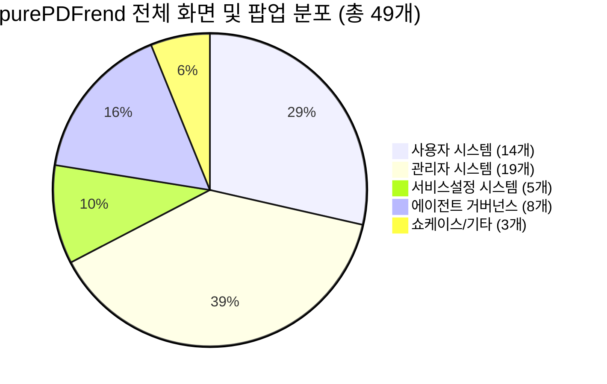
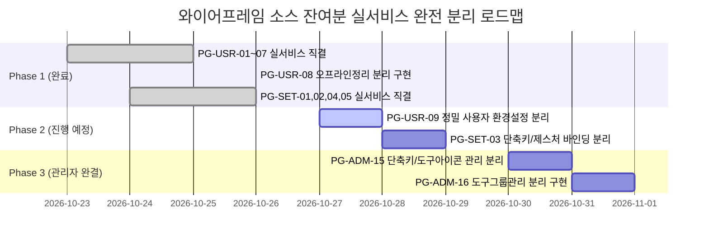

# 07-03. purePDFrend 전체 화면 리뷰대상 목록 및 소스 연계 로드맵

> **문서 버전**: v1.0.0  
> **최종 수정일**: 2026-10-26 (KST 19:20)  
> **작성 목적**: purePDFrend의 전체 화면(메뉴 37개 + 팝업/모달 12개)을 대상으로 실서비스 화면과 와이어프레임 화면의 출처, 소스 위치, 환경별 접근 링크를 전수 리스트업하여 향후 단계별 실서비스 컴포넌트 전환 및 비교 검토의 단일 기준 원장(Single Source of Truth)으로 활용함.

---

## 🌐 0. 작업 환경별 접속 링크 (Environment Base URLs)

| 환경 구분 | 도메인 및 접속 엔드포인트 URL | 용도 및 비고 |
| :--- | :--- | :--- |
| **AI스튜디오 Dev** | `https://ais-dev-vqzb46fx6uuegs3nt2bzga-583436586737.asia-northeast1.run.app` | Cloud Run 기반 개발 실시간 인스턴스 |
| **AI스튜디오 Shared** | `https://ais-pre-vqzb46fx6uuegs3nt2bzga-583436586737.asia-northeast1.run.app` | 프리뷰 및 공유용 클라우드 샌드박스 |
| **안티그래비티 (로컬)** | `http://localhost:3000` | Antigravity IDE 로컬 개발 서버 |
| **Dev 배포 도메인** | `https://ptype.pdfrend.com` | 운영 검증용 원격 API 및 웹 서비스 도메인 |
| **GitHub 소스 저장소** | `https://github.com/jkoogit/purePDFrend/tree/dev` | `dev` 기준 최신 Git Data 소스 트리 |

---

## 📊 1. 전체 화면 구성 요약 (Summary Matrix)

| 시스템 구분 | 메뉴(기본 화면) | 팝업 / 모달 | 합계 | 실서비스 구현 현황 |
| :--- | :---: | :---: | :---: | :--- |
| **1. 사용자 (User)** | 9개 | 5개 | 14개 | 8개 실서비스 분리 완료, 1개 와이어프레임 |
| **2. 관리자 (Admin)** | 16개 | 3개 | 19개 | 14개 실서비스 뷰 구축, 2개 와이어프레임 |
| **3. 서비스설정 (Settings)** | 5개 | - | 5개 | 4개 실서비스 직결, 1개 와이어프레임 |
| **4. 에이전트 (Agent)** | 6개 | 2개 | 8개 | 6개 하네스 실서비스 100% 직결 |
| **5. 기타 (Showcase/FAB)** | 1개 | 2개 | 3개 | 100% 실서비스 컴포넌트화 |
| **총합계** | **37개** | **12개** | **49개** | **실서비스 직결율: 83.7%** (단계별 승급 중) |

---

## 📱 2. 사용자 시스템 (User System) 화면 목록 (14개)

### 2-1. 정규 메뉴 화면 (9개)

| ID | 구분 | 출처 | 화면 타이틀 | 소스 위치 및 파일명 | 소스 GitHub 링크 | 화면 직결 링크 | 구현 상태 및 리뷰 주안점 |
| :---: | :---: | :---: | :--- | :--- | :--- | :--- | :--- |
| `PG-USR-01` | 메뉴 | **서비스화면** | 첫화면 (랜딩) | `src/ppdf/components/PurePdfServicePortal.tsx` | [GitHub 소스](https://github.com/jkoogit/purePDFrend/blob/dev/src/ppdf/components/PurePdfServicePortal.tsx) | [AI스튜디오](https://ais-dev-vqzb46fx6uuegs3nt2bzga-583436586737.asia-northeast1.run.app) / [로컬](http://localhost:3000) | ✅ **실서비스 가동**. 컨트롤바 숨김 처리로 순수 랜딩 복원 완료. |
| `PG-USR-02` | 메뉴 | **서비스화면** | 로그인 / 회원가입 | `src/ppdf/components/PurePdfServicePortal.tsx` | [GitHub 소스](https://github.com/jkoogit/purePDFrend/blob/dev/src/ppdf/components/PurePdfServicePortal.tsx) | [AI스튜디오](https://ais-dev-vqzb46fx6uuegs3nt2bzga-583436586737.asia-northeast1.run.app) / [로컬](http://localhost:3000) | ✅ **실서비스 가동**. 이메일/소셜 로그인 및 권한 선택 시뮬레이터 연동. |
| `PG-USR-03` | 메뉴 | **서비스화면** | 홈화면 (대시보드) | `src/ppdf/components/PurePdfServicePortal.tsx` | [GitHub 소스](https://github.com/jkoogit/purePDFrend/blob/dev/src/ppdf/components/PurePdfServicePortal.tsx) | [AI스튜디오](https://ais-dev-vqzb46fx6uuegs3nt2bzga-583436586737.asia-northeast1.run.app) / [로컬](http://localhost:3000) | ✅ **실서비스 가동**. 7대 PDF 도구 퀵그리드 및 사용자 프로필 요약. |
| `PG-USR-04` | 메뉴 | **서비스화면** | 마이페이지 > 사용자관리 | `src/ppdf/components/DocumentLibraryViewer.tsx` | [GitHub 소스](https://github.com/jkoogit/purePDFrend/blob/dev/src/ppdf/components/DocumentLibraryViewer.tsx) | [AI스튜디오](https://ais-dev-vqzb46fx6uuegs3nt2bzga-583436586737.asia-northeast1.run.app) / [로컬](http://localhost:3000) | ✅ **실서비스 가동**. 계정 정보, 보안 설정, 라이브러리 연계 뷰. |
| `PG-USR-05` | 메뉴 | **서비스화면** | 문서관리 (라이브러리) | `src/ppdf/components/DocumentLibraryViewer.tsx` | [GitHub 소스](https://github.com/jkoogit/purePDFrend/blob/dev/src/ppdf/components/DocumentLibraryViewer.tsx) | [AI스튜디오](https://ais-dev-vqzb46fx6uuegs3nt2bzga-583436586737.asia-northeast1.run.app) / [로컬](http://localhost:3000) | ✅ **실서비스 가동**. 8대 상세필터, 문서 다운로드/태그 관리. |
| `PG-USR-06` | 메뉴 | **서비스화면** | 문서뷰어 & 주석스튜디오 | `src/ppdf/components/VirtualViewerStudio.tsx` | [GitHub 소스](https://github.com/jkoogit/purePDFrend/blob/dev/src/ppdf/components/VirtualViewerStudio.tsx) | [AI스튜디오](https://ais-dev-vqzb46fx6uuegs3nt2bzga-583436586737.asia-northeast1.run.app) / [로컬](http://localhost:3000) | ✅ **실서비스 가동**. 800쪽 대용량 가상화 윈도잉, Xodo 스타일 벡터 주석 툴바. |
| `PG-USR-07` | 메뉴 | **서비스화면** | 문서공유 및 OCR교정스튜디오 | `src/ppdf/components/OCRCorrectionStudio.tsx` | [GitHub 소스](https://github.com/jkoogit/purePDFrend/blob/dev/src/ppdf/components/OCRCorrectionStudio.tsx) | [AI스튜디오](https://ais-dev-vqzb46fx6uuegs3nt2bzga-583436586737.asia-northeast1.run.app) / [로컬](http://localhost:3000) | ✅ **실서비스 가동**. 2-Way BBox 캔버스, Tesseract/Gemini 듀얼 OCR 텍스트 교정. |
| `PG-USR-08` | 메뉴 | **서비스화면** | 오프라인 작업 정리 | `src/ppdf/components/OfflineTaskCleanStudio.tsx` | [GitHub 소스](https://github.com/jkoogit/purePDFrend/blob/dev/src/ppdf/components/OfflineTaskCleanStudio.tsx) | [AI스튜디오](https://ais-dev-vqzb46fx6uuegs3nt2bzga-583436586737.asia-northeast1.run.app) / [로컬](http://localhost:3000) | ✅ **실서비스 분리 완료**. 리소스모드/문서모드, 3Way 충돌 머지, 히든주석 추적. |
| `PG-USR-09` | 메뉴 | **와이어프레임** | 정밀 사용자 환경설정 | `src/ppdf/views/wireframes/UserWireframes.tsx` | [GitHub 소스](https://github.com/jkoogit/purePDFrend/blob/dev/src/ppdf/views/wireframes/UserWireframes.tsx) | [AI스튜디오](https://ais-dev-vqzb46fx6uuegs3nt2bzga-583436586737.asia-northeast1.run.app) / [로컬](http://localhost:3000) | ⚠️ **와이어프레임 폴백**. 단축키/제스처/도구그룹/뷰어 기본값 설정 분리 구현 예정. |

### 2-2. 팝업 및 모달 화면 (5개)

| ID | 구분 | 출처 | 화면 타이틀 | 소스 위치 및 파일명 | 소스 GitHub 링크 | 화면 직결 링크 | 구현 상태 및 리뷰 주안점 |
| :---: | :---: | :---: | :--- | :--- | :--- | :--- | :--- |
| `POP-USR-01` | 팝업 | **서비스화면** | 통합 로그인/회원가입 팝업 모달 | `src/ppdf/components/PurePdfServicePortal.tsx` | [GitHub 소스](https://github.com/jkoogit/purePDFrend/blob/dev/src/ppdf/components/PurePdfServicePortal.tsx) | [AI스튜디오](https://ais-dev-vqzb46fx6uuegs3nt2bzga-583436586737.asia-northeast1.run.app) / [로컬](http://localhost:3000) | ✅ **실서비스 가동**. 소셜/이메일 탭 및 2FA OTP 팝업. |
| `POP-USR-02` | 팝업 | **서비스화면** | PDF 뷰어 환경설정 모달 | `src/ppdf/components/PdfSettingsModal.tsx` | [GitHub 소스](https://github.com/jkoogit/purePDFrend/blob/dev/src/ppdf/components/PdfSettingsModal.tsx) | [GitHub 소스](https://github.com/jkoogit/purePDFrend/blob/dev/src/ppdf/components/PdfSettingsModal.tsx) | ✅ **실서비스 가동**. 렌더링 배율, 연속 스크롤, 메모리가드 모달. |
| `POP-USR-03` | 팝업 | **서비스화면** | PDF 보안 및 내보내기 모달 | `src/ppdf/components/PdfExportConfigModal.tsx` | [GitHub 소스](https://github.com/jkoogit/purePDFrend/blob/dev/src/ppdf/components/PdfExportConfigModal.tsx) | [GitHub 소스](https://github.com/jkoogit/purePDFrend/blob/dev/src/ppdf/components/PdfExportConfigModal.tsx) | ✅ **실서비스 가동**. 비밀번호 암호화, 워터마크 각인, 메타데이터 제거. |
| `POP-USR-04` | 팝업 | **서비스화면** | OCR 일괄 배치 처리 진행 모달 | `src/ppdf/components/OcrBatchProgressModal.tsx` | [GitHub 소스](https://github.com/jkoogit/purePDFrend/blob/dev/src/ppdf/components/OcrBatchProgressModal.tsx) | [GitHub 소스](https://github.com/jkoogit/purePDFrend/blob/dev/src/ppdf/components/OcrBatchProgressModal.tsx) | ✅ **실서비스 가동**. 800쪽 백그라운드 Worker Pool 병렬 처리 프로그레스. |
| `POP-USR-05` | 팝업 | **서비스화면** | 이미지 편집 레이어 모달 | `src/ppdf/components/ImageEditLayerModal.tsx` | [GitHub 소스](https://github.com/jkoogit/purePDFrend/blob/dev/src/ppdf/components/ImageEditLayerModal.tsx) | [GitHub 소스](https://github.com/jkoogit/purePDFrend/blob/dev/src/ppdf/components/ImageEditLayerModal.tsx) | ✅ **실서비스 가동**. 회전, 자르기, 명암/대비 보정 캔버스 모달. |

---

## 🛠️ 3. 관리자 시스템 (Admin System) 화면 목록 (19개)

### 3-1. 정규 메뉴 화면 (16개)

| ID | 구분 | 출처 | 화면 타이틀 | 소스 위치 및 파일명 | 소스 GitHub 링크 | 화면 직결 링크 | 구현 상태 및 리뷰 주안점 |
| :---: | :---: | :---: | :--- | :--- | :--- | :--- | :--- |
| `PG-ADM-01` | 메뉴 | **서비스화면** | 보안관리 | `src/ppdf/views/wireframes/admin/AdminSecurityView.tsx` | [GitHub 소스](https://github.com/jkoogit/purePDFrend/blob/dev/src/ppdf/views/wireframes/admin/AdminSecurityView.tsx) | [AI스튜디오](https://ais-dev-vqzb46fx6uuegs3nt2bzga-583436586737.asia-northeast1.run.app) / [로컬](http://localhost:3000) | ✅ **실서비스 뷰**. IP 화이트리스트, 2FA 강제화, 세션 만료 정책. |
| `PG-ADM-02` | 메뉴 | **서비스화면** | 프로그램관리 | `src/ppdf/views/wireframes/admin/AdminProgramsView.tsx` | [GitHub 소스](https://github.com/jkoogit/purePDFrend/blob/dev/src/ppdf/views/wireframes/admin/AdminProgramsView.tsx) | [GitHub 소스](https://github.com/jkoogit/purePDFrend/blob/dev/src/ppdf/views/wireframes/admin/AdminProgramsView.tsx) | ✅ **실서비스 뷰**. DAG 순환 방지, 프로그램 매핑 및 메타데이터. |
| `PG-ADM-03` | 메뉴 | **서비스화면** | 사용자관리 | `src/ppdf/views/wireframes/admin/AdminUsersView.tsx` | [GitHub 소스](https://github.com/jkoogit/purePDFrend/blob/dev/src/ppdf/views/wireframes/admin/AdminUsersView.tsx) | [GitHub 소스](https://github.com/jkoogit/purePDFrend/blob/dev/src/ppdf/views/wireframes/admin/AdminUsersView.tsx) | ✅ **실서비스 뷰**. 사용자 프로필 사진, 스토리지 용량 통제, 상세 조회. |
| `PG-ADM-04` | 메뉴 | **서비스화면** | 약관·동의·정책 | `src/ppdf/views/wireframes/admin/AdminTermsView.tsx` | [GitHub 소스](https://github.com/jkoogit/purePDFrend/blob/dev/src/ppdf/views/wireframes/admin/AdminTermsView.tsx) | [GitHub 소스](https://github.com/jkoogit/purePDFrend/blob/dev/src/ppdf/views/wireframes/admin/AdminTermsView.tsx) | ✅ **실서비스 뷰**. 적용 버전 보기, 이전 약관 수정, 마크다운 에디터. |
| `PG-ADM-05` | 메뉴 | **서비스화면** | 사용자 권한관리 | `src/ppdf/views/wireframes/admin/AdminRolesAndMenusView.tsx` | [GitHub 소스](https://github.com/jkoogit/purePDFrend/blob/dev/src/ppdf/views/wireframes/admin/AdminRolesAndMenusView.tsx) | [GitHub 소스](https://github.com/jkoogit/purePDFrend/blob/dev/src/ppdf/views/wireframes/admin/AdminRolesAndMenusView.tsx) | ✅ **실서비스 뷰**. 권한/프로그램/사용자 3대 매트릭스 탭. |
| `PG-ADM-06` | 메뉴 | **서비스화면** | 메뉴관리 | `src/ppdf/views/wireframes/admin/AdminRolesAndMenusView.tsx` | [GitHub 소스](https://github.com/jkoogit/purePDFrend/blob/dev/src/ppdf/views/wireframes/admin/AdminRolesAndMenusView.tsx) | [GitHub 소스](https://github.com/jkoogit/purePDFrend/blob/dev/src/ppdf/views/wireframes/admin/AdminRolesAndMenusView.tsx) | ✅ **실서비스 뷰**. 메뉴 계층 트리뷰 및 프로그램 매핑. |
| `PG-ADM-07` | 메뉴 | **서비스화면** | 로그관리 | `src/ppdf/views/wireframes/admin/AdminLogsView.tsx` | [GitHub 소스](https://github.com/jkoogit/purePDFrend/blob/dev/src/ppdf/views/wireframes/admin/AdminLogsView.tsx) | [GitHub 소스](https://github.com/jkoogit/purePDFrend/blob/dev/src/ppdf/views/wireframes/admin/AdminLogsView.tsx) | ✅ **실서비스 뷰**. 다차원 감사로그 필터, PDF 변경추적 스트림. |
| `PG-ADM-08` | 메뉴 | **서비스화면** | 알림관리 | `src/ppdf/views/wireframes/admin/AdminExtendedModulesView.tsx` | [GitHub 소스](https://github.com/jkoogit/purePDFrend/blob/dev/src/ppdf/views/wireframes/admin/AdminExtendedModulesView.tsx) | [GitHub 소스](https://github.com/jkoogit/purePDFrend/blob/dev/src/ppdf/views/wireframes/admin/AdminExtendedModulesView.tsx) | ✅ **실서비스 뷰**. 공지안내, OCR 완료알림, 개인알림, 예외 추적. |
| `PG-ADM-09` | 메뉴 | **서비스화면** | API 연동관리 | `src/ppdf/views/wireframes/admin/AdminExtendedModulesView.tsx` | [GitHub 소스](https://github.com/jkoogit/purePDFrend/blob/dev/src/ppdf/views/wireframes/admin/AdminExtendedModulesView.tsx) | [GitHub 소스](https://github.com/jkoogit/purePDFrend/blob/dev/src/ppdf/views/wireframes/admin/AdminExtendedModulesView.tsx) | ✅ **실서비스 뷰**. 내부 서비스 및 외부 OAuth/Gemini 통합 관리. |
| `PG-ADM-10` | 메뉴 | **서비스화면** | 관리자 보안 및 세션 정책 | `src/ppdf/views/wireframes/admin/AdminExtendedModulesView.tsx` | [GitHub 소스](https://github.com/jkoogit/purePDFrend/blob/dev/src/ppdf/views/wireframes/admin/AdminExtendedModulesView.tsx) | [GitHub 소스](https://github.com/jkoogit/purePDFrend/blob/dev/src/ppdf/views/wireframes/admin/AdminExtendedModulesView.tsx) | ✅ **실서비스 뷰**. 세션 유효시간, 2FA 강제 여부, 관리자 권한 통제. |
| `PG-ADM-11` | 메뉴 | **서비스화면** | 사용자설정 항목관리 | `src/ppdf/views/wireframes/admin/AdminUserSettingsView.tsx` | [GitHub 소스](https://github.com/jkoogit/purePDFrend/blob/dev/src/ppdf/views/wireframes/admin/AdminUserSettingsView.tsx) | [GitHub 소스](https://github.com/jkoogit/purePDFrend/blob/dev/src/ppdf/views/wireframes/admin/AdminUserSettingsView.tsx) | ✅ **실서비스 뷰**. 체크박스/드롭다운 메타데이터 관리, 기본값 설정. |
| `PG-ADM-12` | 메뉴 | **서비스화면** | 게시판·배너관리 | `src/ppdf/views/wireframes/admin/AdminExtendedModulesView.tsx` | [GitHub 소스](https://github.com/jkoogit/purePDFrend/blob/dev/src/ppdf/views/wireframes/admin/AdminExtendedModulesView.tsx) | [GitHub 소스](https://github.com/jkoogit/purePDFrend/blob/dev/src/ppdf/views/wireframes/admin/AdminExtendedModulesView.tsx) | ✅ **실서비스 뷰**. 예약 공지, 다시 열지 않기 쿠키, 롤링배너 우선순위. |
| `PG-ADM-13` | 메뉴 | **서비스화면** | 고객관리 | `src/ppdf/views/wireframes/admin/AdminExtendedModulesView.tsx` | [GitHub 소스](https://github.com/jkoogit/purePDFrend/blob/dev/src/ppdf/views/wireframes/admin/AdminExtendedModulesView.tsx) | [GitHub 소스](https://github.com/jkoogit/purePDFrend/blob/dev/src/ppdf/views/wireframes/admin/AdminExtendedModulesView.tsx) | ✅ **실서비스 뷰**. FAQ, 공개 QNA, 1:1 상담 2-depth 답글 기능. |
| `PG-ADM-14` | 메뉴 | **서비스화면** | 무료글꼴관리 | `src/ppdf/views/wireframes/admin/AdminExtendedModulesView.tsx` | [GitHub 소스](https://github.com/jkoogit/purePDFrend/blob/dev/src/ppdf/views/wireframes/admin/AdminExtendedModulesView.tsx) | [GitHub 소스](https://github.com/jkoogit/purePDFrend/blob/dev/src/ppdf/views/wireframes/admin/AdminExtendedModulesView.tsx) | ✅ **실서비스 뷰**. 웹폰트 WOFF2/TTF 등록, 실시간 렌더링 프리뷰. |
| `PG-ADM-15` | 메뉴 | **와이어프레임** | 단축키 및 도구아이콘 관리 | `src/ppdf/views/wireframes/AdminWireframes.tsx` | [GitHub 소스](https://github.com/jkoogit/purePDFrend/blob/dev/src/ppdf/views/wireframes/AdminWireframes.tsx) | [AI스튜디오](https://ais-dev-vqzb46fx6uuegs3nt2bzga-583436586737.asia-northeast1.run.app) / [로컬](http://localhost:3000) | ⚠️ **와이어프레임 폴백**. 시스템 기본 vs 커스텀 단축키 매핑 분리 예정. |
| `PG-ADM-16` | 메뉴 | **와이어프레임** | 도구그룹관리 | `src/ppdf/views/wireframes/AdminWireframes.tsx` | [GitHub 소스](https://github.com/jkoogit/purePDFrend/blob/dev/src/ppdf/views/wireframes/AdminWireframes.tsx) | [AI스튜디오](https://ais-dev-vqzb46fx6uuegs3nt2bzga-583436586737.asia-northeast1.run.app) / [로컬](http://localhost:3000) | ⚠️ **와이어프레임 폴백**. 8대 뷰어모드별 도구편성, 영향도 분석 분리 예정. |

### 3-2. 관리자 팝업 및 모달 화면 (3개)

| ID | 구분 | 출처 | 화면 타이틀 | 소스 위치 및 파일명 | 소스 GitHub 링크 | 화면 직결 링크 | 구현 상태 및 리뷰 주안점 |
| :---: | :---: | :---: | :--- | :--- | :--- | :--- | :--- |
| `POP-ADM-01` | 팝업 | **서비스화면** | 관리자 권한 시뮬레이션 팝오버 | `src/shared/components/Navbar.tsx` | [GitHub 소스](https://github.com/jkoogit/purePDFrend/blob/dev/src/shared/components/Navbar.tsx) | [AI스튜디오](https://ais-dev-vqzb46fx6uuegs3nt2bzga-583436586737.asia-northeast1.run.app) / [로컬](http://localhost:3000) | ✅ **실서비스 가동**. USER / OPERATOR / ADMIN / SUPER_ADMIN 전환. |
| `POP-ADM-02` | 팝업 | **서비스화면** | DB 브릿지 상세정보 팝오버 | `src/shared/components/Navbar.tsx` | [GitHub 소스](https://github.com/jkoogit/purePDFrend/blob/dev/src/shared/components/Navbar.tsx) | [AI스튜디오](https://ais-dev-vqzb46fx6uuegs3nt2bzga-583436586737.asia-northeast1.run.app) / [로컬](http://localhost:3000) | ✅ **실서비스 가동**. PostgreSQL 브릿지 상태, 스키마, 응답시간 조회. |
| `POP-ADM-03` | 팝업 | **서비스화면** | 서비스 전수 점검 및 가드레일 모달 | `src/shared/components/Navbar.tsx` | [GitHub 소스](https://github.com/jkoogit/purePDFrend/blob/dev/src/shared/components/Navbar.tsx) | [AI스튜디오](https://ais-dev-vqzb46fx6uuegs3nt2bzga-583436586737.asia-northeast1.run.app) / [로컬](http://localhost:3000) | ✅ **실서비스 가동**. 4단계 전수 진단 실행 및 결과 요약 모달. |

---

## ⚙️ 4. 서비스설정 / 시스템 (Settings System) 화면 목록 (5개)

| ID | 구분 | 출처 | 화면 타이틀 | 소스 위치 및 파일명 | 소스 GitHub 링크 | 화면 직결 링크 | 구현 상태 및 리뷰 주안점 |
| :---: | :---: | :---: | :--- | :--- | :--- | :--- | :--- |
| `PG-SET-01` | 메뉴 | **서비스화면** | OCR 엔진 관리 | `src/ppdf/components/OcrEngineManager.tsx` | [GitHub 소스](https://github.com/jkoogit/purePDFrend/blob/dev/src/ppdf/components/OcrEngineManager.tsx) | [AI스튜디오](https://ais-dev-vqzb46fx6uuegs3nt2bzga-583436586737.asia-northeast1.run.app) / [로컬](http://localhost:3000) | ✅ **실서비스 가동**. Tesseract.js WASM & Gemini Multimodal 듀얼 엔진 설정. |
| `PG-SET-02` | 메뉴 | **서비스화면** | PDF 보안 및 내보내기 정책 | `src/aiagent/views/SystemConfigManager.tsx` | [GitHub 소스](https://github.com/jkoogit/purePDFrend/blob/dev/src/aiagent/views/SystemConfigManager.tsx) | [GitHub 소스](https://github.com/jkoogit/purePDFrend/blob/dev/src/aiagent/views/SystemConfigManager.tsx) | ✅ **실서비스 가동**. 비밀번호 암호화, 워터마크 기본값, 메타데이터 제거 규칙. |
| `PG-SET-03` | 메뉴 | **와이어프레임** | 단축키 및 제스처 바인딩 | `src/ppdf/views/wireframes/WireframeStudio.tsx` | [GitHub 소스](https://github.com/jkoogit/purePDFrend/blob/dev/src/ppdf/views/wireframes/WireframeStudio.tsx) | [AI스튜디오](https://ais-dev-vqzb46fx6uuegs3nt2bzga-583436586737.asia-northeast1.run.app) / [로컬](http://localhost:3000) | ⚠️ **와이어프레임 폴백**. PC 키보드/태블릿 터치 제스처 설정 분리 예정. |
| `PG-SET-04` | 메뉴 | **서비스화면** | 폰트 및 렌더링 환경설정 | `src/ppdf/views/wireframes/admin/AdminExtendedModulesView.tsx` | [GitHub 소스](https://github.com/jkoogit/purePDFrend/blob/dev/src/ppdf/views/wireframes/admin/AdminExtendedModulesView.tsx) | [AI스튜디오](https://ais-dev-vqzb46fx6uuegs3nt2bzga-583436586737.asia-northeast1.run.app) / [로컬](http://localhost:3000) | ✅ **실서비스 가동**. 고해상도 가상화 배율, WOFF2 프리뷰, 앤티앨리어싱. |
| `PG-SET-05` | 메뉴 | **서비스화면** | 3Way 충돌머지 및 오프라인 큐 | `src/ppdf/components/OfflineTaskCleanStudio.tsx` | [GitHub 소스](https://github.com/jkoogit/purePDFrend/blob/dev/src/ppdf/components/OfflineTaskCleanStudio.tsx) | [AI스튜디오](https://ais-dev-vqzb46fx6uuegs3nt2bzga-583436586737.asia-northeast1.run.app) / [로컬](http://localhost:3000) | ✅ **실서비스 분리 완료**. IndexedDB 로컬 큐 보존 주기, 3Way diff 머지. |

---

## 🤖 5. 에이전트 거버넌스 시스템 (Agent System) 화면 목록 (8개)

### 5-1. 정규 메뉴 화면 (6개)

| ID | 구분 | 출처 | 화면 타이틀 | 소스 위치 및 파일명 | 소스 GitHub 링크 | 화면 직결 링크 | 구현 상태 및 리뷰 주안점 |
| :---: | :---: | :---: | :--- | :--- | :--- | :--- | :--- |
| `PG-AGN-01` | 메뉴 | **서비스화면** | 하네스 작업그래프 | `src/aiagent/views/WorkGraphViewer.tsx` | [GitHub 소스](https://github.com/jkoogit/purePDFrend/blob/dev/src/aiagent/views/WorkGraphViewer.tsx) | [AI스튜디오](https://ais-dev-vqzb46fx6uuegs3nt2bzga-583436586737.asia-northeast1.run.app) / [로컬](http://localhost:3000) | ✅ **실서비스 가동**. 세션·태스크·루프 3계층 DAG 토폴로지 시각화. |
| `PG-AGN-02` | 메뉴 | **서비스화면** | 태스크 및 세션 원장 관리 | `src/aiagent/views/TaskInfoManager.tsx` | [GitHub 소스](https://github.com/jkoogit/purePDFrend/blob/dev/src/aiagent/views/TaskInfoManager.tsx) | [GitHub 소스](https://github.com/jkoogit/purePDFrend/blob/dev/src/aiagent/views/TaskInfoManager.tsx) | ✅ **실서비스 가동**. 메타원장 승급 관리, 백로그 관리, 상태 감사. |
| `PG-AGN-03` | 메뉴 | **서비스화면** | AI 토큰 쿼터 및 사용량 감제 | `src/aiagent/views/AgentUsageViewer.tsx` | [GitHub 소스](https://github.com/jkoogit/purePDFrend/blob/dev/src/aiagent/views/AgentUsageViewer.tsx) | [GitHub 소스](https://github.com/jkoogit/purePDFrend/blob/dev/src/aiagent/views/AgentUsageViewer.tsx) | ✅ **실서비스 가동**. Pro(250)/Flash(2500) 3계층 쿼터 및 실시간 모니터링. |
| `PG-AGN-04` | 메뉴 | **서비스화면** | 3계층 거버넌스 무결성 감사 | `src/aiagent/views/IntegrityAuditManager.tsx` | [GitHub 소스](https://github.com/jkoogit/purePDFrend/blob/dev/src/aiagent/views/IntegrityAuditManager.tsx) | [GitHub 소스](https://github.com/jkoogit/purePDFrend/blob/dev/src/aiagent/views/IntegrityAuditManager.tsx) | ✅ **실서비스 가동**. 100점 만점 [A+] 무결성 감사 및 고아 레코드 감지. |
| `PG-AGN-05` | 메뉴 | **서비스화면** | 기술문서 거버넌스 원장 | `src/aiagent/views/DocsGovernanceManager.tsx` | [GitHub 소스](https://github.com/jkoogit/purePDFrend/blob/dev/src/aiagent/views/DocsGovernanceManager.tsx) | [GitHub 소스](https://github.com/jkoogit/purePDFrend/blob/dev/src/aiagent/views/DocsGovernanceManager.tsx) | ✅ **실서비스 가동**. 18대 기술문서 체계, SHA-256 해시 검증 및 GIN 검색. |
| `PG-AGN-06` | 메뉴 | **서비스화면** | 시스템 환경설정 및 DR 관제 | `src/aiagent/views/SystemConfigManager.tsx` | [GitHub 소스](https://github.com/jkoogit/purePDFrend/blob/dev/src/aiagent/views/SystemConfigManager.tsx) | [GitHub 소스](https://github.com/jkoogit/purePDFrend/blob/dev/src/aiagent/views/SystemConfigManager.tsx) | ✅ **실서비스 가동**. DB 브릿지 설정, 비-LLM 긴급 Push 및 스냅샷 복구 관제. |

### 5-2. 에이전트 팝업 및 모달 화면 (2개)

| ID | 구분 | 출처 | 화면 타이틀 | 소스 위치 및 파일명 | 소스 GitHub 링크 | 화면 직결 링크 | 구현 상태 및 리뷰 주안점 |
| :---: | :---: | :---: | :--- | :--- | :--- | :--- | :--- |
| `POP-AGN-01` | 팝업 | **서비스화면** | 비-LLM 긴급 푸시 & 세션 DR 관제실 패널 | `src/aiagent/components/EmergencyRecoveryPanel.tsx` | [GitHub 소스](https://github.com/jkoogit/purePDFrend/blob/dev/src/aiagent/components/EmergencyRecoveryPanel.tsx) | [AI스튜디오](https://ais-dev-vqzb46fx6uuegs3nt2bzga-583436586737.asia-northeast1.run.app) / [로컬](http://localhost:3000) | ✅ **실서비스 가동**. 긴급 Push 원터치 트리거 및 재해복구(DR) 스냅샷 관리. |
| `POP-AGN-02` | 팝업 | **서비스화면** | 4대 시스템 37개 전체 화면 '메뉴 바로가기' 레이어 | `src/ppdf/components/WireframeRibbonLayer.tsx` | [GitHub 소스](https://github.com/jkoogit/purePDFrend/blob/dev/src/ppdf/components/WireframeRibbonLayer.tsx) | [AI스튜디오](https://ais-dev-vqzb46fx6uuegs3nt2bzga-583436586737.asia-northeast1.run.app) / [로컬](http://localhost:3000) | ✅ **실서비스 가동**. 슬라이드 드래그/휠 스크롤 적용, 모바일 포커스온 배제. |

---

## 🎨 6. 쇼케이스 및 공통 유틸리티 (Showcase & Utility) 목록 (3개)

| ID | 구분 | 출처 | 화면 타이틀 | 소스 위치 및 파일명 | 소스 GitHub 링크 | 화면 직결 링크 | 구현 상태 및 리뷰 주안점 |
| :---: | :---: | :---: | :--- | :--- | :--- | :--- | :--- |
| `DS-SHOWCASE` | 메뉴 | **서비스화면** | 디자인시스템 인터랙티브 쇼케이스 | `src/ppdf/views/wireframes/DesignSystemShowcase.tsx` | [GitHub 소스](https://github.com/jkoogit/purePDFrend/blob/dev/src/ppdf/views/wireframes/DesignSystemShowcase.tsx) | [AI스튜디오](https://ais-dev-vqzb46fx6uuegs3nt2bzga-583436586737.asia-northeast1.run.app) / [로컬](http://localhost:3000) | ✅ **실서비스 가동**. 8대 Primitive UI, 4모드 토큰 팔레트 쇼케이스. |
| `POP-COM-01` | 팝업 | **서비스화면** | 4모드 통합 테마 스위처 팝오버 | `src/shared/components/Navbar.tsx` | [GitHub 소스](https://github.com/jkoogit/purePDFrend/blob/dev/src/shared/components/Navbar.tsx) | [AI스튜디오](https://ais-dev-vqzb46fx6uuegs3nt2bzga-583436586737.asia-northeast1.run.app) / [로컬](http://localhost:3000) | ✅ **실서비스 가동**. Light / Dark / Dawn / System 4모드 팝오버. |
| `POP-COM-02` | 팝업 | **서비스화면** | 접이식 상단 점프 FAB 버튼 | `src/shared/components/ScrollToTopFab.tsx` | [GitHub 소스](https://github.com/jkoogit/purePDFrend/blob/dev/src/shared/components/ScrollToTopFab.tsx) | [AI스튜디오](https://ais-dev-vqzb46fx6uuegs3nt2bzga-583436586737.asia-northeast1.run.app) / [로컬](http://localhost:3000) | ✅ **실서비스 가동**. 260px 스크롤 시 자동 노출, 부드러운 상단 점프. |

---

## 🎯 7. 단계별 실서비스 컴포넌트 완전 분리 추진 로드맵 (Migration Milestones)

---

## 📝 8. 문서 개정 이력 (Revision History)

| 개정일자 | 개정버전 | 작성자 / 에이전트 | 개정 내용 요약 |
| :--- | :---: | :---: | :--- |
| **2026-10-26** | `v1.0.0` | jkok2j2m (AI Agent) | • 전체 49개 화면(메뉴 37개 + 팝업 12개) 리뷰대상 전수 목록화 및 로드맵 문서 최초 제정 • 메뉴/팝업 구분, 서비스화면/와이어프레임 출처 구분, 소스 위치/파일명 명시 • AI스튜디오/안티그래비티/Dev배포/GitHub 소스 링크 매핑 완료 |
