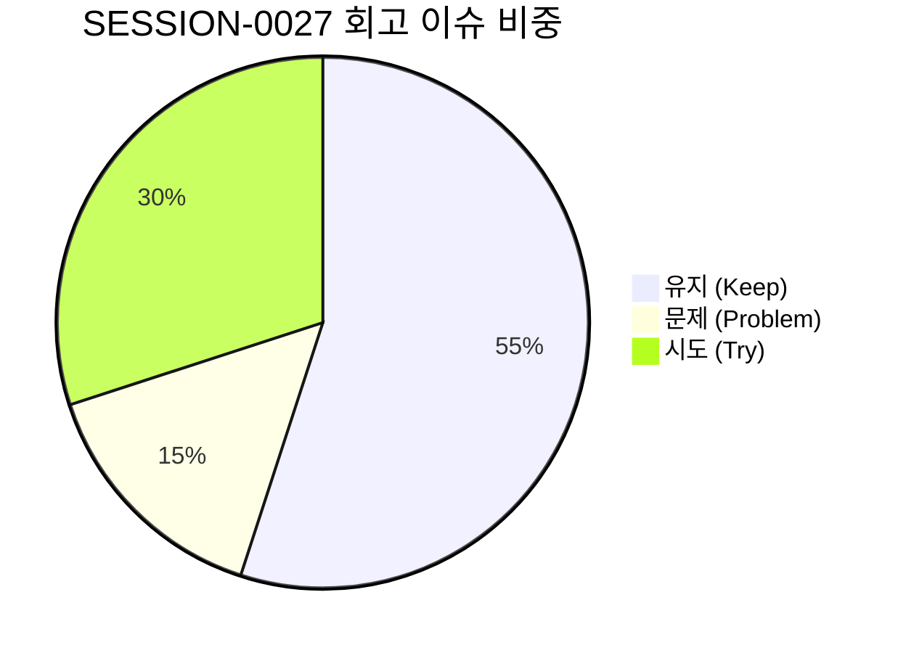

# 13-21. SESSION-261011-0027 세션 종합 KPT 회고록

> **문서 식별자**: `13-21`  
> **세션 ID**: `SESSION-0027`  
> **세션 주제**: `[0027] 상단_글로벌_헤더_테마_스위치_인터페이스_구축_및_관리자_실제_API_연동_1단계`  
> **작업 일시**: 2026-10-08 ~ 2026-10-11  
> **담당 에이전트**: Google AI Studio Agent (gemini-3.8-flash)  
> **운영자**: jkoogit (`jkoogit@gmail.com`)  
> **완료 태스크**: `TASK-0027-01`, `TASK-0027-02` (2건 전수 완료)  
> **원격 동기화**: `dev` = `stg` = `main` = `b58ca6e9dbe5185394426af2527e63d911b3a85d` (100% 일치)

---

## 1. 세션 개요 및 추진 목표

SESSION-0027은 이전 세션(SESSION-0026)에서 확립한 디자인시스템 기준 컴포넌트 풀을 토대로, 사용자 관점의 즉각적인 테마 체감(Light/Dark 스위처), 관리자 시스템서비스 실제 백엔드 PostgreSQL REST API 연동 1단계(IP 차단 및 사용자 계정 관리), 그리고 SSOT 디자인 토큰(`tokens.ts`) 추출 및 와이어프레임 인터랙티브 디자인시스템 쇼케이스 탭 구축을 완결하기 위해 추진되었습니다.

### 주요 추진 목표
1. **상단 글로벌 헤더 테마 스위처 구축 (`TASK-0027-01`)**:
   - `Navbar.tsx` 상단 글로벌 영역에 Sun/Moon 아이콘 기반 원클릭 다크/라이트 테마 토글 인터페이스 구축.
   - `document.documentElement`의 `dark` 클래스 및 로컬 스토리지 상태 바인딩.
2. **관리자 시스템서비스 실제 API 연동 1단계 (`TASK-0027-01`)**:
   - `PG-ADM-01`(보안 IP 차단) 및 `PG-ADM-03`(사용자 계정 관리) 실제 백엔드 Express 라우터 및 PostgreSQL 테이블 연동.
   - 실시간 CRUD 및 차단/해제, 사용자 상태 변경 트랜잭션 구현.
3. **통합 디자인 토큰 tokens.ts 추출 및 쇼케이스 구축 (`TASK-0027-02`)**:
   - `src/styles/tokens.ts` 단일 진실 공급원(SSOT) 신설: Brand Blue, Slate Gray, Semantic(Success/Warning/Destructive/Info) 3단계 색상, 3스케일 타이포, 4pt 그리드/라운딩/그림자 및 44px 터치 가드레일 확립.
   - `DesignSystemShowcase.tsx` 인터랙티브 쇼케이스 구현: 색상 팔레트 스와치, 타이포 스케일, 44px 터치 영역 검증기 및 8대 Primitive UI 라이브 인터랙티브 데모.
   - `WireframeStudio.tsx` 상단 탭에 `[🎨 디자인시스템 쇼케이스]` 탭 신설 및 실시간 테마 반응형 렌더링.
4. **하네스 무결성 100점 및 Zero-Loss 대화턴 영속화**:
   - Git Data API 기반 Commit/Push, PR 연계, `dev` ➔ `stg` ➔ `main` 3대 브랜치 일괄 승급.
   - `reconcileSessionTraces`를 통한 세션 내 모든 대화턴 무손실 DB 영속화 완결.

---

## 2. KPT 회고 분석

### 🎯 Keep (지속 유지할 점)
1. **단일 진실 공급원(SSOT) tokens.ts 확립과 인터랙티브 쇼케이스**:
   - 난립하던 Tailwind 색상과 규격을 `tokens.ts` 3단계 체계로 명확히 일원화하여, 향후 23개 와이어프레임 및 실제 서비스 컴포넌트 전체가 흔들림 없이 동일한 토큰을 참조할 수 있는 기틀을 마련함.
   - 와이어프레임 스튜디오 내 라이브 쇼케이스 탭을 제공하여 다크/라이트 테마 반응성과 44px 터치 가드레일을 시각적으로 즉시 검증 가능하게 함.
2. **관리자 실제 API 1단계 연동의 안정성**:
   - 목업 데이터에 머물던 보안 IP 관리와 사용자 계정 관리를 실제 Express 백엔드 및 PostgreSQL 원장에 바인딩하여, 프론트-백엔드 간 실제 데이터 파이프라인의 신뢰성을 입증함.
3. **무손실 대화턴 영속화 파이프라인 고도화**:
   - 승급 및 정리 시점마다 `reconcile_session_traces.ts`를 선행 구동하여 로컬 및 원격 DB(`aiagent.agent_conversation_trace`) 간의 턴 누락을 원천 차단함.
4. **Git Data API 기반 브랜치 동기화 무결성**:
   - 로컬 커밋 및 PR 승급 머지 후 Fast-forward 브랜치 업데이트를 통해 `dev`, `stg`, `main` 3개 브랜치의 커밋 SHA를 100% 일치시킴.

---

## ⚠️ Problem (개선이 필요한 문제점)
1. **23개 와이어프레임 화면의 개별 레이아웃 쉘 파편화**:
   - 토큰과 원자 컴포넌트는 정의되었으나, 현재 14개 관리자 및 9개 사용자 화면이 각자 다른 쉘 구조를 지니고 있어 상단/좌측 레이아웃 통일(`AdminShell`, `UserShell`, `StudioShell`)이 아직 미완료됨.
2. **PDF 핵심 뷰어 비즈니스 로직과 디자인시스템 바인딩 대기**:
   - 디자인시스템 기초 인프라 작업에 집중하느라 실제 핵심 서비스인 `PG-USR-03`(뷰어), `PG-USR-04`(BBox), `PG-USR-05`(레이아웃 편집) 화면에 대한 신규 토큰 대입이 후속 단계로 이월됨.

---

## 🚀 Try (다음 세션 시도 사항)
1. **3대 통합 쉘(AdminShell/UserShell/StudioShell) 구축 및 레이아웃 일원화 (Phase 2)**:
   - 각 관리자/사용자 화면이 독립적으로 그리던 사이드바/헤더/본문 컨테이너를 3대 공통 쉘로 전면 래핑하여 시각적 파편화를 영구 근절.
2. **PDF MVP 핵심 3대 서비스 화면 디자인 토큰 바인딩 (Phase 3)**:
   - `PG-USR-03`(가상화 뷰어), `PG-USR-04`(BBox 캔버스), `PG-USR-05`(레이아웃 편집기)에 `tokens.ts` 및 기준 컴포넌트 풀을 전면 적용하여 고품질의 실서비스 화면으로 전환.
3. **관리자 시스템서비스 2단계 실제 API 연동**:
   - `PG-ADM-02`(프로그램 관리/DAG), `PG-ADM-04`(약관 버전 관리) 등 후속 관리자 화면에 대한 실제 백엔드 API 연동 추진.

---

## 3. 작업 산출물 및 지표

| 분류 | 산출물 / 지표 | 성과 및 상태 |
| :--- | :--- | :---: |
| **디자인 토큰** | `src/styles/tokens.ts` | Brand, Gray, Semantic, 4pt/44px SSOT 정의 |
| **쇼케이스 UI** | `src/ppdf/views/wireframes/DesignSystemShowcase.tsx` | 인터랙티브 팔레트/타이포/터치검증기/8대 컴포넌트 |
| **와이어프레임 통합** | `src/ppdf/views/WireframeStudio.tsx` | 디자인시스템 쇼케이스 탭 신설 및 테마 반응형 렌더링 |
| **글로벌 헤더** | `src/components/Navbar.tsx` | Sun/Moon 원클릭 다크/라이트 테마 스위처 연동 |
| **관리자 실제 API** | `server.ts`, `src/ppdf/views/wireframes/SecurityAdminView.tsx`, `UserAdminView.tsx` | PG-ADM-01, PG-ADM-03 실제 Express & PostgreSQL REST 연동 |
| **설계 문서** | `docs/05.설계/05-27_글로벌헤더_테마스위처_및_관리자API_1단계_상세설계서.md` `docs/05.설계/05-28_통합_디자인_토큰_및_컴포넌트_쇼케이스_상세설계서.md` | 2건 전수 제정 |
| **코드리뷰 문서** | `docs/10.리뷰/261010_046_상단글로벌헤더_테마스위치_관리자API_1단계_코드리뷰.md` (10-46) `docs/10.리뷰/261010_047_통합_디자인_토큰_추출_및_쇼케이스_구축_코드리뷰.md` (10-47) | 2건 전수 발행 |
| **학습 문서** | `docs/15.학습/15-24_디자인토큰_SSOT_추출_및_쇼케이스_구축_패턴_해설.md` | 신규 발행 |
| **TDD 단위 테스트** | `tests/global_header_and_admin_api.test.ts` (10 PASS) `tests/tokens_and_showcase.test.ts` (5 PASS) | 15개 전수 PASS |
| **시스템 무결성** | `GET /api/agent/audit/integrity` | **100점 만점 [A+ (PERFECT)]** |
| **Git 커밋/브랜치** | Commit `b58ca6e9`, PR #77(Closed), PR #78/#79(Merged) | dev = stg = main 100% 일치 |
| **대화 턴 영속화** | `TRACE-0027-01-00-01` ~ `TRACE-0027-02-00-11` | 전수 무손실 DB 영속화 |
