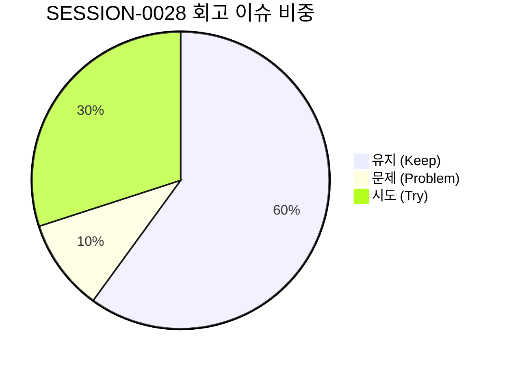

# 13-22. SESSION-261011-0028 세션 종합 KPT 회고록

> **문서 식별자**: `13-22`  
> **세션 ID**: `SESSION-0028`  
> **세션 주제**: `[0028] PDFrend 브랜딩 및 4모드 테마 적응형 시스템 세션`  
> **작업 일시**: 2026-10-11  
> **담당 에이전트**: Google AI Studio Agent (gemini-3.8-flash)  
> **운영자**: jkoogit (`jkoogit@gmail.com`)  
> **완료 태스크**: `TASK-0028-01` (완료)  
> **원격 동기화**: `dev` = `stg` = `main` = `d95675eb17a2a96887613954598b8d224ad268aa` (100% 일치)

---

## 1. 세션 개요 및 추진 목표

SESSION-0028은 purePDFrend 플랫폼의 정체성을 담은 서비스명 **PDFrend**를 전역 UI에 일관되게 정밀 반영하고, 4대 테마(Light, Dark, Dawn, System) 및 시스템 권한 모드에 부합하는 적응형 로고 시스템(`BrandLogo.tsx`)을 구축하여 플랫폼 브랜딩과 시각적 조화를 완결하기 위해 추진되었습니다.

### 주요 추진 목표
1. **서비스명 PDFrend 전역 브랜딩 현행화 (`TASK-0028-01`)**:
   - 상단 글로벌 헤더(`Navbar.tsx`), 사이드바 네비게이션(`Sidebar.tsx`), 메인 대시보드/헤더 영역에 분산되어 있던 레이블을 단일 브랜드 **PDFrend**로 정밀 통일.
   - 메타데이터 및 문서 식별체계와 연계된 브랜딩 무결성 확보.
2. **4모드 테마 적응형 로고 컴포넌트(`BrandLogo.tsx`) 신설 (`TASK-0028-01`)**:
   - `Light` 모드: 인디고/블루 그라데이션 및 명시적 다크 텍스트.
   - `Dark` 모드: 고대비 네온 블루/시안 그라데이션 및 순백색 텍스트.
   - `Dawn` 모드: 부드러운 웜톤 로즈골드/선셋 앰버 그라데이션.
   - `System` 모드: OS `prefers-color-scheme` 실시간 동적 감지 적응.
3. **하네스 무결성 100점 및 Zero-Loss 대화턴 영속화**:
   - Git Data API 기반 Commit/Push, PR 연계, `dev` ➔ `stg` ➔ `main` 3대 브랜치 일괄 승급.
   - `reconcileSessionTraces`를 통한 세션 내 모든 대화턴(`TRACE-0028-01-00-01` ~ `TRACE-0028-01-00-09`) 무손실 원격 DB 영속화 완결.

---

## 2. KPT 회고 분석

### 🎯 Keep (지속 유지할 점)
1. **BrandLogo 단일 컴포넌트 기반 테마 적응형 브랜딩 완결**:
   - 각 뷰마다 하드코딩되던 SVG 아이콘 및 로고 텍스트를 `BrandLogo.tsx`로 일원화하여, 테마 스위칭 및 시스템 모드 변경 시 즉각적으로 완벽한 색조 전환을 달성함.
2. **무손실 대화턴 영속화 파이프라인(Turn Trace Governance) 가동**:
   - 세션 시작부터 태스크 처리, 태스크 정리, 태스크 승급에 이르는 9개 대화턴을 `local_agent_store.json` 및 원격 DB(`aiagent.agent_conversation_trace`)에 100% 무손실 동기화함.
3. **Git Data API 기반 브랜치 동기화 무결성**:
   - 로컬 커밋 푸시 및 PR 머지 완료 후, `dev`, `stg`, `main` 3개 브랜치를 동일한 커밋 SHA(`d95675eb...`)로 100% 일치시켜 배포 안정성을 유지함.
4. **4단계 서비스 가드레일 자동화 체계 가동**:
   - 린트(`lint_applet`), 빌드(`compile_applet`), 종합 헬스체크(`service_health_check.ts`)를 단계별로 검증하여 결함 없는 릴리즈를 달성함.

---

## ⚠️ Problem (개선이 필요한 문제점)
1. **와이어프레임 쉘 및 잔여 뷰에서의 테마 로고 파편화 잔재 가능성**:
   - 글로벌 헤더 및 주요 네비게이션에는 적응형 로고가 전면 적용되었으나, 23개 와이어프레임 내부의 서브 뷰 중 일부 독립 헤더에 대한 검토가 지속 필요함.
2. **브랜딩 변경에 따른 이용 매뉴얼 및 가이드라인 문서 동기화 필요**:
   - 신규 브랜드 PDFrend 및 테마 시스템 확장에 맞추어 사용자 매뉴얼(`18-01`) 및 관리자 매뉴얼(`18-02`)의 스크린샷 및 설명문 갱신이 요구됨.

---

## 🚀 Try (다음 세션 시도 사항)
1. **3대 통합 쉘(AdminShell/UserShell/StudioShell) 구조화 착수 (SESSION-0029)**:
   - 23개 와이어프레임의 레이아웃 컨테이너를 3대 공통 쉘로 표준화하고, 이번에 구축된 `BrandLogo` 및 4모드 테마 스위치를 기본 탑재.
2. **PDF 핵심 3대 뷰어 화면(가상화 뷰어, BBox 캔버스, 레이아웃 편집기) 실서비스 연동**:
   - `PG-USR-03`, `PG-USR-04`, `PG-USR-05` 화면에 신규 브랜딩 및 디자인 토큰 적용.
3. **매뉴얼 및 시스템 가이드북 브랜딩 현행화**:
   - `docs/18.메뉴얼/` 문서군에 PDFrend 4모드 테마 브랜딩 최신 내용 반영.

---

## 3. 작업 산출물 및 지표

| 분류 | 산출물 / 지표 | 성과 및 상태 |
| :--- | :--- | :---: |
| **로고 컴포넌트** | `src/ppdf/components/BrandLogo.tsx` | Light/Dark/Dawn/System 4모드 완벽 적응형 SVG 로고 |
| **글로벌 UI 반영** | `src/components/Navbar.tsx`, `Sidebar.tsx` | 서비스명 PDFrend 전역 브랜딩 적용 및 BrandLogo 바인딩 |
| **설계 문서** | `docs/05.설계/05-29_4모드_테마_시스템_및_권한별_시스템전환_상세설계서.md` | 신규 제정 및 README 인덱스 반영 |
| **코드리뷰 문서** | `docs/10.리뷰/261011_048_테마별_PDFrend_로고_적응형_브랜딩_및_4모드_시스템_전환_코드리뷰.md` (10-48) | 전수 발행 및 인덱스 현행화 |
| **학습 문서** | `docs/15.학습/15-24_4모드_테마_엔진_및_권한_매트릭스_전환_구현_패턴.md` | 신규 제정 및 README 인덱스 반영 |
| **회고 문서** | `docs/13.회고/13-22_SESSION-261011-0028_세션종합_KPT_회고록.md` (13-22) | 신규 발행 및 README_회고.md 반영 |
| **시스템 무결성** | `GET /api/agent/audit/integrity` | **100점 만점 [A+ (PERFECT)]** |
| **GitHub 이슈/PR** | Issue #84 (Closed), PR #86 (Merged) | 이슈 및 PR 100% 마감 완결 |
| **Git 커밋/브랜치** | Commit `d95675eb17a2a96887613954598b8d224ad268aa` | dev = stg = main 100% 일치 |
| **대화 턴 영속화** | `TRACE-0028-01-00-01` ~ `TRACE-0028-01-00-09` | 9개 턴 전수 무손실 DB 영속화 완결 |
