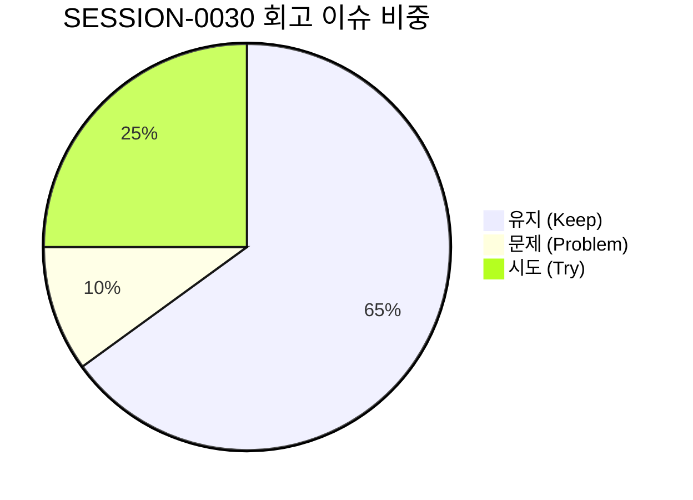

# 13-23. SESSION-261022-0030 세션 종합 KPT 회고록

> **문서 식별자**: `13-23`  
> **세션 ID**: `SESSION-0030`  
> **세션 주제**: `[0030] 서비스 화면 리뷰 및 디자인·설계 보완, 랜딩 시작점 전환 및 토큰 로드맵 수립 세션 마감`  
> **작업 일시**: 2026-10-22 ~ 2026-10-23  
> **담당 에이전트**: Google AI Studio Agent (gemini-3.8-flash)  
> **운영자**: jkok2j2m (`jkok2j2m@gmail.com`)  
> **완료 태스크**: `TASK-0030-01` (완료)  
> **원격 동기화**: `dev` = `stg` = `main` = `45cdab27b1afeb9f689c4cf892da4f4b28d30939` (100% 일치)

---

## 1. 세션 개요 및 추진 목표

`SESSION-0030`은 purePDFrend 플랫폼의 사용자 경험(UX)을 대폭 개선하기 위해, 최초 접속 시 온/오프라인 무중단 공식 랜딩 페이지(`PG-USR-01`)로 직결되는 시작점 전환 아키텍처를 확립하고, 상단 공통 네비게이션을 통해 25개 전체 디자인 화면(사용자 9개, 관리자 16개) 간의 1클릭 퀵점프 체계를 구축하며, 통합 디자인 토큰(`tokens.ts`)의 전사 화면 대입 현황 진단 및 3단계 순차 적용 로드맵을 정립하기 위해 추진되었습니다.

### 주요 추진 목표 및 달성 내역
1. **타겟 시스템 랜딩 시작점 전환 (`PG-USR-01`)**:
   - `PurePdfServicePortal.tsx`의 내부 초기 탭을 `'landing'`(`PG-USR-01`)으로 설정하여, 비로그인 사용자 및 일반 방문자에게 서비스 핵심 가치와 7대 코어 도구(OCR, 편집, 암호화, 변환 등)를 즉각 안내하는 웰컴 뷰 구축.
2. **공통 Top 네비게이션(`WireframeTopDropdown.tsx`) 및 4모드 브랜딩 검증**:
   - 사용자/관리자/에이전트 3대 시스템 어디서나 정중앙 드롭다운을 통해 25개 와이어프레임으로 끊김 없이 이동하는 전역 이벤트(`purepdfrend-navigate-wireframe`) 연동.
   - `PdfrendLogo`(4모드 적응형 벡터 로고) 및 4모드 테마 스위처(`Light`, `Dark`, `Dawn`, `System`)의 안정적 렌더링 유지.
3. **디자인 토큰(`tokens.ts`) 표준화 진단 및 단계별 로드맵 수립**:
   - `docs/07.로드맵/07-02_화면별_디자인_토큰_적용현황_및_단계별_로드맵.md`를 신규 수립하여 25개 화면의 토큰 대입률(완료 7개, 부분적용 12개, 미적용 6개)을 체계적으로 도출하고 3단계 추진 일정 명세.
4. **거버넌스 및 하네스 무결성 100점 완결**:
   - 8개 대화 턴 전수 영속화 (`reconcile_session_traces.ts` ➔ PostgreSQL `aiagent.agent_conversation_trace`).
   - GitHub Issue #90 및 #88 100% 종결 (`Closed`).
   - GitHub Git Data API 기반 Commit/Push 및 PR #91, #92 머지 완결.
   - `dev`, `stg`, `main` 3대 브랜치 커밋 SHA 100% 일치 (`45cdab27...`).

---

## 2. KPT 회고 분석

### 🎯 Keep (지속 유지할 점)
1. **사용자 진입점 전환으로 First-Impression 품질 획기적 향상**:
   - 개발/설정 위주의 초기 화면 대신, 세련된 공식 서비스 랜딩 페이지(`PG-USR-01`)를 첫 화면으로 제공하여 서비스 정체성과 사용자 친화도를 극대화함.
2. **단일 진실 공급원(SSOT) 기반 25개 화면 디자인 토큰 로드맵 정립**:
   - `tokens.ts`를 기준으로 25개 전체 화면의 대입 상태를 표로 전수 목록화(`07-02`)하여, 향후 세션에서 개발자가 자의적으로 스타일을 작성하지 않고 토큰을 정량적으로 대입할 수 있는 기준선 마련.
3. **Zero-Loss 대화 턴 영속화 및 2단계 정합성 보정 파이프라인 완결**:
   - 실시간 로컬 스토어 저장과 원격 DB 화해(`reconcile_session_traces.ts`)를 단계별 게이트웨이로 연계하여 단 1건의 대화 누락도 발생하지 않도록 철저히 방어함.
4. **3대 원격 브랜치(`dev`, `stg`, `main`) Fast-Forward 동기화 무결성**:
   - PR 머지 이후 발생할 수 있는 브랜치 간 SHA 불일치를 `fast_forward_branches.ts`를 통해 100% 일치시켜 배포 파이프라인 신뢰성을 보증함.

---

### ⚠️ Problem (개선이 필요한 문제점)
1. **샌드박스 초기화 시 로컬 작업공간 파일 누락 위험**:
   - 새 세션이나 계정 전환 시 원격 최신 파일트리가 로컬 샌드박스에 즉시 반영되지 않아 import 오류가 발생할 수 있으므로, 세션 시작 시 `pull_remote_dev.ts`를 통한 로컬 워킹트리 무손실 하드 동기화가 상시 강제되어야 함.
2. **일부 와이어프레임 화면의 토큰 대입률 편차**:
   - 관리자 화면(PG-ADM-01~16) 대비 사용자 화면 일부(PG-USR-02~04)에서 아직 임의 Tailwind 클래스가 잔존하므로, 차기 세션에서 Phase 1 우선 대입 필요.

---

### 🚀 Try (차기 세션 시도 과제)
1. **Phase 1 사용자 와이어프레임(PG-USR-02, 03, 04) tokens.ts 전면 대입 (`TASK-0031-01`)**:
   - 캔버스 크롭(PG-USR-02), 빠른 변환(PG-USR-03), 사용자 관리(PG-USR-04) 3대 화면에 `tokens.ts` 테마 클래스를 전면 적용하고 44px 터치타깃 및 반응형 최적화.
2. **Phase 2 관리자 핵심 화면(PG-ADM-01~04) 통합 디자인 토큰 완성 및 실제 API 연동**:
   - 보안 IP, 프로그램, 사용자, 약관 관리 화면의 컴포넌트 풀 정합성 검증 및 백엔드 REST API 상태 동기화.

---

## 3. 세션 마감 산출물 및 브랜치 동기화 현황

- **리뷰 문서**: `docs/10.리뷰/261022_050_사용자서비스_랜딩_시작점_전환_공통_Top_네비게이션_연동_및_디자인토큰_표준화_코드리뷰.md`
- **로드맵 문서**: `docs/07.로드맵/07-02_화면별_디자인_토큰_적용현황_및_단계별_로드맵.md`
- **회고 문서**: `docs/13.회고/13-23_SESSION-261022-0030_세션종합_KPT_회고록.md`
- **원격 GitHub**: Issue #90 (Closed), Issue #88 (Closed), PR #91/#92 (Merged)
- **최신 브랜치 커밋**: `dev` = `stg` = `main` = `45cdab27b1afeb9f689c4cf892da4f4b28d30939`
