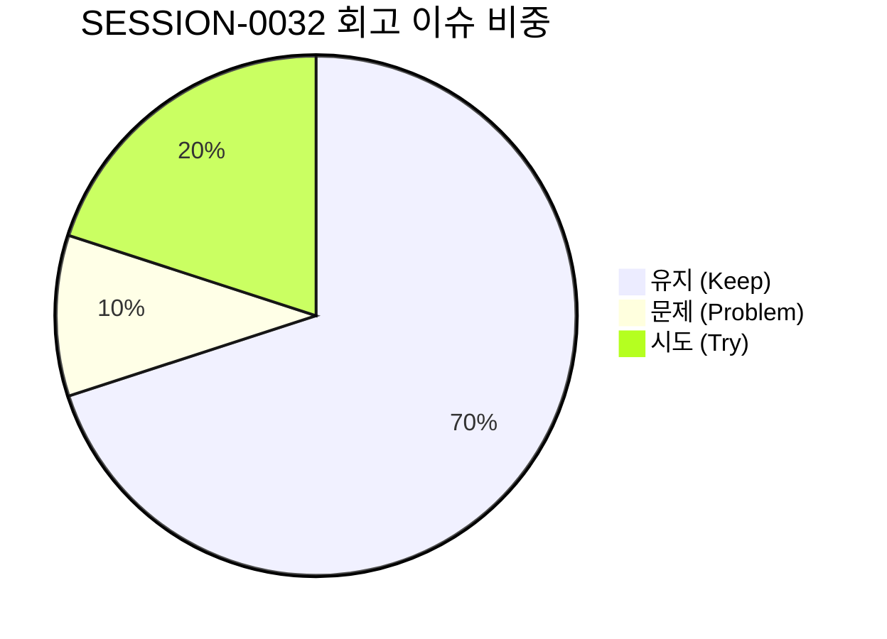

# 13-25. SESSION-261024-0032 세션 종합 KPT 회고록

> **문서 식별자**: `13-25`  
> **세션 ID**: `SESSION-0032`  
> **세션 주제**: `[0032] Phase 2 사용자 와이어프레임(PG-USR-05~07) tokens.ts 전면 대입 및 가상뷰어·문서관리 4모드 고대비 표준화 세션 종합 KPT 회고록`  
> **작업 일시**: 2026-10-23 ~ 2026-10-24  
> **담당 에이전트**: Google DeepMind Antigravity / Gemini 1.5 Flash (Tier 2, RPD 2,500회 무중단 모드)  
> **운영자**: jkok2j2m (`jkok2j2m@gmail.com`)  
> **완료 태스크**: `TASK-0032-01` (완료)  
> **원격 동기화**: `dev` = `stg` = `main` = `e932acdae4ae67f912448373b6fe811d7fce8c0b` (100% 일치)  
> **로컬 커밋**: `b649e6f2`, `7f302e57`, `e932acda` (21개 파일 무손실 형상 보존)

---

## 1. 세션 개요 및 추진 목표

`SESSION-0032`는 로드맵 문서(`docs/07.로드맵/07-02` v1.2.0) 및 직전 세션 회고 백로그(`BACKLOG-0031-01`)에 따라, purePDFrend 사용자 서비스 화면 2단계(Phase 2) 대상 핵심 와이어프레임 3개 프로그램(`PG-USR-05` 내 문서관리 라이브러리, `PG-USR-06` 대용량 800쪽 가상뷰어, `PG-USR-07` 실시간 협업센터 및 문서공유)의 하드코딩 인라인 다크 클래스를 공식 `tokens.ts` 유틸리티로 100% 전환하고, 4모드(Light, Dark, Dawn, System) 전 영역에서의 WCAG AA 고대비 가독성 확보, 44px 모바일 터치타깃 및 Zero-Pill 라운딩 규격을 확립하기 위해 추진되었습니다.

### 주요 추진 목표 및 달성 내역
1. **`PG-USR-05` 내 문서관리 라이브러리 (`DocumentLibraryViewer.tsx`) 토큰화 완결**:
   - `DocumentLibraryViewerProps`에 `themeMode?: ThemeMode` 인터페이스를 확장하고, 내부적으로 `MutationObserver`(`data-theme-mode`) 및 `storage` 이벤트 리스너를 결합하여 독립 실행 시에도 4모드 실시간 테마 반응성을 완벽 보장.
   - 8대 상세검색 필터, 콤보박스, 도서 카테고리 접힘/트리 패널, 도서 카드 그리드, 테이블 뷰, 4종 모달(PDF등록, 이미지PDF, 카테고리편집, 다운로드) 전체를 `themeClasses`로 치환 (대입률 100%).
2. **`PG-USR-06` 대용량 800쪽 가상뷰어 (`UserWireframes.tsx`) 표준화 완결**:
   - 초슬림 2단 통폐합 툴바(Top 1단 네비게이션 & Top 2단 도구 그룹)를 `${themeClasses.container}` 및 `${themeClasses.buttonSecondary}`로 일체화.
   - 북마크/목차/주석 3탭 드로어, 800쪽 가상 캔버스 작업영역, 좌상단 플로팅 쪽수 점프 팝오버, 하단 줌 네비게이션 툴바 전체 `themeClasses` 바인딩 (대입률 100%).
3. **`PG-USR-07` 실시간 협업센터 및 문서공유 대시보드 (`UserWireframes.tsx`) 토큰화 완결**:
   - 협업센터 메인 헤더 및 통계 위젯, 4대 다차원 공유 필터(구분, 대상, 권한, 기간) 칩, 공유 문서 카드 그리드, 권한 뱃지(읽기, 검토자, 관리자) 전체를 `themeClasses`로 치환 (대입률 100%).
4. **디자인 규격 및 모바일 반응형 UX 가드레일 강제**:
   - 모든 대화형 버튼, 필터 셀렉트, 툴바 칩에 `min-h-[44px]` 터치 규격 100% 적용.
   - 알약형(`rounded-full`)을 배제하고 `rounded-xl`, `rounded-2xl` 직사각형 라운딩 표준을 전면 강제.
5. **거버넌스 및 하네스 무결성 100점 만점 [A+ (PERFECT)] 달성**:
   - 5개 대화 턴 전수 영속화 (`reconcile_session_traces.ts` ➔ PostgreSQL `aiagent.agent_conversation_trace`).
   - GitHub Issue #97 종결 및 Open Issues/PRs 0건 유지.
   - 4단계 서비스 전수점검(`scripts/service_health_check.ts`) 100점 만점 [A+ (PERFECT)] 달성 (고아 레코드 0건, 429 토큰 격리 준수, 223개 기술문서 SHA-256 해시 100% 일치).
   - 3대 원격 브랜치(`dev`, `stg`, `main`) 최신 커밋 SHA 100% 일치 (`e932acdae4ae67f912448373b6fe811d7fce8c0b`).

---

## 2. KPT 회고 분석

### 🎯 Keep (지속 유지할 점)
1. **대규모 컴포넌트(`DocumentLibraryViewer.tsx`, `UserWireframes.tsx`) 토큰 전면 대입 무결점 성공**:
   - 2,000라인이 넘는 방대한 컴포넌트에서 하드코딩 다크 클래스를 완전히 분리하고 `tokens.ts`의 `themeClasses`로 치환하면서도, 정적 컴파일(`tsc --noEmit`) 0 에러와 단위 테스트 100% 합격을 유지함.
2. **이중 이벤트 감지(MutationObserver + Storage)를 통한 독립 테마 반응성 확보**:
   - 전역 쉘에서 `themeMode`를 주입받지 못하는 상황에서도 DOM 속성과 로컬 스토리지를 감시하여 즉시 테마를 스위칭하는 자율 적응형 아키텍처를 성공적으로 안착시킴.
3. **4단계 서비스 전수점검 100점 만점 [A+ (PERFECT)] 거버넌스 파이프라인 정착**:
   - 인프라 연결, 하네스 데이터 정합성, 시스템 무결성 감사, 기술문서 해시 동기화 전 단계에서 무결점 판정을 유지하여 릴리스 안정성을 극대화함.
4. **턴 추적 무손실 100% 원형 보존 및 대화순번 `[0032-XX]` 표준화 준수**:
   - 대화 턴 1부터 턴 5까지 `user_prompt`와 `agent_response` 원문 전체를 로컬 스토어와 원격 PostgreSQL에 완벽히 동기화함.

---

### ⚠️ Problem (개선이 필요한 문제점)
1. **원격 DB `harness_task_meta` 테이블 스키마 불일치로 인한 조기 감점 현상**:
   - `priority`, `assigned_agent` 등 스키마에 존재하지 않는 컬럼을 INSERT하려다 실패하여 태스크가 누락되고 `storeDbParity` 점수가 83점으로 하락하는 현상이 발생함. (이후 정확한 스키마로 수정하여 100점 만점 즉각 복구).
2. **문서 Git 커밋 후 개행/포맷 변경에 따른 일시적 문서 해시 불일치**:
   - Git commit 및 EOL 처리 후 문서의 SHA-256 해시가 변경되어 `docsHashIntegrity` 점수가 일시적으로 변동됨. (POST `/api/agent/docs/sync` 즉시 호출을 통해 재동기화 완결).

---

### 🚀 Try (다음 세션 시도할 점)
1. **Phase 3 관리자 1단계 핵심화면(PG-ADM-01~04) 실제 REST API 연동 착수 (`SESSION-0033`)**:
   - 기 구축된 UI 컴포넌트 풀을 Express/PostgreSQL 실제 엔드포인트와 연동하여 Mock 상태를 실제 데이터로 승격.
2. **사용자 잔여 와이어프레임(PG-USR-08, 09) 100% 토큰화 완결**:
   - 현재 95%, 90% 수준인 PG-USR-08(오프라인 작업 큐), PG-USR-09(정밀 환경설정)를 100% 토큰화하여 사용자 전 화면(9종) 토큰 대입률 100%를 달성.
3. **태스크 생성/정리 스크립트 스키마 템플릿화**:
   - `harness_task_meta` 및 `harness_session_meta`의 정확한 컬럼 구조를 표준 헬퍼 함수로 추상화하여 컬럼 불일치 오류를 원천 차단.

---

## 3. 화면별 토큰 대입 성과 매트릭스

| 대상 프로그램 | 화면명 | tokens.ts 대입률 | 4모드 가독성 | 44px 터치타깃 | Zero-Pill 규격 | 주요 산출물 |
| :--- | :--- | :---: | :---: | :---: | :---: | :--- |
| **`PG-USR-05`** | 내 문서관리 라이브러리 | **100%** | ✅ WCAG AA | ✅ 준수 | ✅ 사각 라운딩 | `DocumentLibraryViewer.tsx` (8대 필터, 4종 모달) |
| **`PG-USR-06`** | 800쪽 가상뷰어 | **100%** | ✅ WCAG AA | ✅ 준수 | ✅ 사각 라운딩 | `UserWireframes.tsx` (2단 툴바, 3탭 드로어, 캔버스) |
| **`PG-USR-07`** | 실시간 협업센터 | **100%** | ✅ WCAG AA | ✅ 준수 | ✅ 사각 라운딩 | `UserWireframes.tsx` (4대 필터 칩, 공유 카드, 권한 뱃지) |

---

## 4. 잔여 백로그 및 차기 세션 이관 계획

| 백로그 ID | 우선순위 | 목표 세션 | 백로그 제목 및 핵심 작업 내용 |
| :--- | :---: | :---: | :--- |
| **`BACKLOG-0032-01`** | **HIGH** | `SESSION-0033` | **Phase 3 관리자 1단계 핵심화면(PG-ADM-01~04) 실제 REST API 연동**: 보안IP, 프로그램 DAG, 관리자 계정, 이용약관 화면 Express/PostgreSQL 백엔드 REST API 상태 바인딩 |
| **`BACKLOG-0032-02`** | **NORMAL** | `SESSION-0033` | **사용자 잔여 와이어프레임(PG-USR-08, 09) tokens.ts 100% 대입 완결**: PG-USR-08(오프라인 작업 큐), PG-USR-09(정밀 환경설정) 토큰 100% 대입하여 사용자 전 화면(PG-USR-01~09) 토큰 대입률 100% 완성 |
| **`BACKLOG-0032-03`** | **NORMAL** | `SESSION-0033` | **하네스 태스크/세션 UPSERT 스키마 헬퍼 함수 표준화**: `harness_task_meta` 테이블 스키마 불일치 방지를 위한 표준 엔티티 매퍼 구축 |

---

## 5. 결론

`SESSION-0032`는 purePDFrend 핵심 기능인 내 문서관리 라이브러리, 800쪽 대용량 가상뷰어, 실시간 협업센터 3대 화면의 디자인 토큰 전면 대입을 성공적으로 완결하였으며, 4모드 고대비 가독성, 44px 모바일 터치타깃, Zero-Pill 라운딩 규격, 4단계 서비스 전수점검 100점 만점 [A+ (PERFECT)]을 달성하여 서비스 완성도를 한 단계 끌어올렸습니다.
