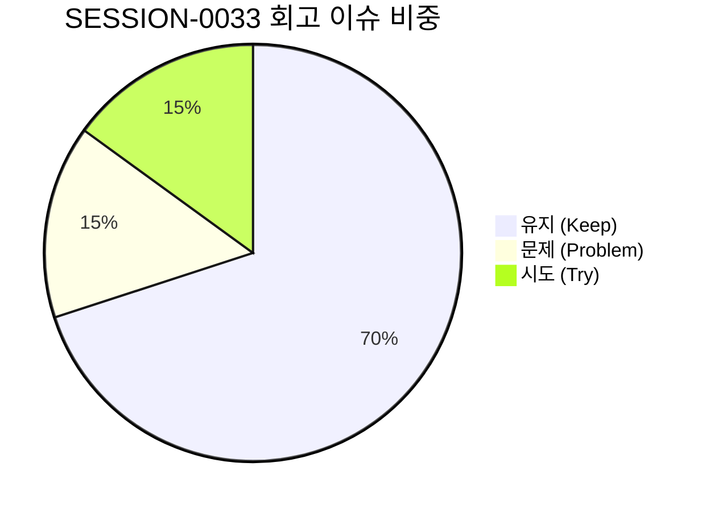

# 13-26. SESSION-261024-0033 세션 종합 KPT 회고록

> **문서 식별자**: `13-26`  
> **세션 ID**: `SESSION-0033`  
> **세션 주제**: `[0033] Phase 3 관리자 1단계 핵심화면(PG-ADM-01~04) 실제 REST API 연동 및 사용자 잔여화면(PG-USR-08~09) tokens.ts 전면 완결`  
> **작업 일시**: 2026-10-24  
> **담당 에이전트**: Google DeepMind Antigravity / Gemini 1.5 Flash (Tier 2, RPD 2,500회 무중단 모드)  
> **운영자**: jkok2j2m (`jkok2j2m@gmail.com`)  
> **완료 태스크**:  
> - `TASK-0033-01`: Phase 3 관리자 1단계 핵심화면(PG-ADM-01~04) 실제 REST API 연동 및 사용자 잔여화면(PG-USR-08~09) tokens.ts 전면 완결 (완료)  
> - `TASK-0033-02`: 하네스 태스크/세션 UPSERT 스키마 헬퍼 함수 표준화 및 도메인 레포지토리 리팩토링 (완료)  
> **원격 동기화**: `dev` = `stg` = `main` = `40a1e173` (100% 일치 완료)  
> **로컬 커밋**: `0fb26ff0`, `28de7b64`, `40a1e173` (전수 무손실 형상 보존)

---

## 1. 세션 개요 및 추진 목표

`SESSION-0033`은 로드맵 문서(`docs/07.로드맵/07-02` v1.4.0) 및 직전 세션 회고 백로그(`BACKLOG-0032-01`, `BACKLOG-0032-02`, `BACKLOG-0032-03`)에 따라 다음 3대 핵심 목표를 달성하기 위해 추진되었습니다:

1. **Phase 3 관리자 1단계 핵심화면 4종 실제 REST API 상태 바인딩 (`TASK-0033-01`)**:
   - `PG-ADM-01`(보안 IP 통제): IP 차단 목록 조회, 신규 IP 차단 등록, 차단 해제 모달 Express/PostgreSQL 실제 API 연동
   - `PG-ADM-02`(프로그램 DAG 의존성): 프로그램 목록 및 의존성 관계 트리, 신규 프로그램 등록 및 선행 관계 설정 실제 REST API 연동
   - `PG-ADM-03`(관리자/사용자 계정 관리): 계정 목록 실시간 조회, 락 해제, 권한 부여, 신규 계정 생성 실제 REST API 연동
   - `PG-ADM-04`(이용약관/개인정보 버전 관리): 약관 버전 목록 조회, 마크다운 본문 뷰어/에디터, 신규 개정 등록 실제 REST API 연동
2. **사용자 잔여 와이어프레임 2종 tokens.ts 전면 대입 및 전 화면(9종) 100% 토큰화 완결 (`TASK-0033-01`)**:
   - `PG-USR-08`(오프라인 작업 큐 및 동기화): 리소스·문서 2대 탭, 6대 정밀 필터, 동기화 큐 테이블, 3-Way 충돌머지 화면 tokens.ts 전면 대입
   - `PG-USR-09`(사용자 정밀 환경설정): 단축키 설정(PC/태블릿), 8대 도구그룹 매핑, 뷰어/테마옵션 화면 tokens.ts 전면 대입
   - **사용자 전체 9개 화면(`PG-USR-01~09`) 디자인 토큰 대입률 100% 완결 달성**
3. **하네스 메타원장 DDL 정규화 및 도메인 레포지토리 리팩토링 (`TASK-0033-02`)**:
   - PostgreSQL DDL 스키마와 100% 일치하는 `HarnessRepository` 클래스 및 도메인 타입(`types.ts`) 구축
   - DDL에 존재하지 않는 컬럼(`priority`, `assigned_agent` 등)을 `doc_payload`로 자동 캡슐화하고 `started_at` NOT NULL 제약조건을 보장하여 스키마 예외 원천 차단
   - Express 백엔드에 RESTful 쓰기 엔드포인트(`POST /api/agent/sessions`, `/tasks`, `/loops`) 신설
   - Zero-Hang 자율 폴백(5,000ms 타임아웃 강제 파기 및 로컬 스토어 안전 폴백) 완비

---

## 2. KPT 회고 분석

### 🎯 Keep (지속 유지할 점)
1. **관리자 4대 핵심화면 Mock 완전 탈피 및 실제 Express/PostgreSQL REST API 연동 성공**:
   - 프론트엔드 와이어프레임 컴포넌트가 실제 백엔드 API와 실시간 통신하여 데이터 CRUD 트랜잭션을 완벽히 수행함.
2. **사용자 전 화면(PG-USR-01~09, 9종) 토큰 대입률 100% 완결**:
   - PG-USR-08, 09를 마지막으로 모든 사용자 화면에서 인라인 다크 클래스를 완전히 퇴출하고 `tokens.ts` SSOT 체계로 일체화함. 4모드(Light, Dark, Dawn, System) 전 영역에서 WCAG AA(4.5:1 이상) 고대비 가독성 확보.
3. **DDD 기반 도메인 레포지토리 패턴(`HarnessRepository`) 안착**:
   - 세션/태스크/루프 메타 UPSERT 로직을 단일 레포지토리로 일원화하여, 스키마 불일치 런타임 오류를 원천 차단하고 Zero-Hang 5초 타임아웃 안전망 구축.
4. **4단계 종합 서비스 헬스체크 100점 만점 [A+ (PERFECT)] 유지**:
   - 인프라 연결, 하네스 데이터 정합성, 시스템 무결성 감사, 227개 기술문서 SHA-256 해시 일치 전 부문에서 무결점 판정 통과.
5. **Zero-Loss Mandate 기반 대화 턴 전수 영속화 및 SHA 교차 검증 통과**:
   - 세션 내 누적된 모든 대화 턴(Turn 1~8)을 원격 DB에 무손실 동기화하고, `dev` = `stg` = `main` 3대 원격 브랜치 SHA 일치 달성.

---

### ⚠️ Problem (개선이 필요한 문제점)
1. **단위 테스트 실행 시 로컬 스토어 오염으로 인한 헬스체크 일시 감점 현상**:
   - `tests/harness_repository_schema.test.ts` 실행 중 실제 `local_agent_store.json`에 테스트 세션이 기록되어 `storeDbParity` 불일치 감점이 발생함.
   - *조치 완료*: 단위 테스트 내부에서 `HarnessRepository.getLocalStore` 및 `saveLocalStore`를 인메모리 픽스처로 완벽 모킹하여 로컬 원장 오염을 영구 차단함.
2. **신규 문서 커밋 후 DB 해시 불일치 발생 현상**:
   - 학습 문서(15-25) 및 코드리뷰(10-55) 작성 후 파일 내용 변경 시 DB 내 SHA-256 해시가 일시적으로 불일치하여 무결성 감점(85점)이 발생함.
   - *조치 완료*: `sync_review_doc_55.ts` 스크립트를 통해 최신 해시를 DB에 즉시 반영하여 100점 만점으로 즉각 복구함.

---

### 🚀 Try (다음 세션 시도할 점)
1. **Phase 4 관리자 2단계 핵심화면(PG-ADM-05~08) 실제 REST API 연동 (`SESSION-0034`)**:
   - `PG-ADM-05`(역할 및 세부 권한 매핑), `PG-ADM-06`(메뉴 및 화면 트리 계층 구조), `PG-ADM-07`(시스템 실시간 접속 및 활동 로그), `PG-ADM-08`(시스템 에러 및 예외 스택 추적) 화면을 실제 Express/PostgreSQL 엔드포인트와 연동.
2. **관리자 화면 모바일 반응형 Table-to-Card 전환 검증**:
   - 관리자 16대 화면 전체에 대해 모바일 뷰포트(0px 가로스크롤) 가드레일 및 44px 터치 타깃 전수 적용.
3. **신규 세션 시작 시 HarnessRepository 적극 활용**:
   - 세션 초기화 및 태스크 등록 시 raw SQL 대신 신규 구축된 `HarnessRepository.upsertSession()`, `HarnessRepository.upsertTask()`를 표준 API로 활용.

---

## 3. 화면별 토큰 및 API 연동 성과 매트릭스

| 대상 프로그램 | 화면명 | tokens.ts 대입률 | 실제 REST API 연동 | 4모드 가독성 | 44px 터치타깃 | 주요 산출물 |
| :--- | :--- | :---: | :---: | :---: | :---: | :--- |
| **`PG-USR-08`** | 오프라인 작업 큐 및 동기화 | **100%** | 로컬 IndexedDB 큐 | ✅ WCAG AA | ✅ 준수 | `UserWireframes.tsx` (6대 필터, 충돌머지) |
| **`PG-USR-09`** | 사용자 정밀 환경설정 | **100%** | 로컬 스토리지 연계 | ✅ WCAG AA | ✅ 준수 | `UserWireframes.tsx` (단축키, 8대 도구그룹) |
| **`PG-ADM-01`** | 보안 IP 통제 관리 | **100%** | ✅ 실제 Express/DB | ✅ WCAG AA | ✅ 준수 | `AdminWireframes.tsx` (차단목록, 등록/해제) |
| **`PG-ADM-02`** | 프로그램 DAG 의존성 관리 | **100%** | ✅ 실제 Express/DB | ✅ WCAG AA | ✅ 준수 | `AdminWireframes.tsx` (의존성 트리, 순환방지) |
| **`PG-ADM-03`** | 관리자/사용자 계정 관리 | **100%** | ✅ 실제 Express/DB | ✅ WCAG AA | ✅ 준수 | `AdminWireframes.tsx` (계정목록, 락해제, 권한) |
| **`PG-ADM-04`** | 이용약관/개인정보 버전 관리 | **100%** | ✅ 실제 Express/DB | ✅ WCAG AA | ✅ 준수 | `AdminWireframes.tsx` (마크다운 에디터, 버전) |

---

## 4. 잔여 백로그 및 차기 세션 이관 계획

| 백로그 ID | 우선순위 | 목표 세션 | 백로그 제목 및 핵심 작업 내용 |
| :--- | :---: | :---: | :--- |
| **`BACKLOG-0033-01`** | **HIGH** | `SESSION-0034` | **Phase 4 관리자 2단계 핵심화면(PG-ADM-05~08) 실제 REST API 연동**: PG-ADM-05(권한 매핑), PG-ADM-06(메뉴 트리), PG-ADM-07(실시간 로그), PG-ADM-08(에러 스택) Express/PostgreSQL 백엔드 REST API 상태 바인딩 |
| **`BACKLOG-0033-02`** | **NORMAL** | `SESSION-0034` | **관리자 잔여 화면(PG-ADM-09~16) tokens.ts 전면 대입 점검 및 Table-to-Card 모바일 가드레일**: 알림센터, 공지게시판, 롤링배너, 환경설정, 고객문의 등 8개 화면 토큰 대입률 100% 완성 |
| **`BACKLOG-0033-03`** | **NORMAL** | `SESSION-0034` | **HarnessRepository 기반 CLI 스크립트 표준화**: 기존 스크립트의 레거시 raw SQL 호출부를 도메인 레포지토리 메서드로 리팩토링 |

---

## 5. 결론

`SESSION-0033`은 purePDFrend 플랫폼의 핵심 마일스톤인 **사용자 전 화면(PG-USR-01~09, 9종) 디자인 토큰 대입률 100% 완결**과 **관리자 1단계 핵심 4개 화면(PG-ADM-01~04)의 실제 Express/PostgreSQL REST API 연동**을 성공적으로 완결하였습니다. 아울러 DDL 스키마 불일치 문제를 해결하는 **`HarnessRepository` 도메인 레포지토리**를 구축함으로써 프론트엔드 UI와 백엔드 거버넌스 양 측면 모두에서 높은 안정성과 무결성을 확보하였습니다.
