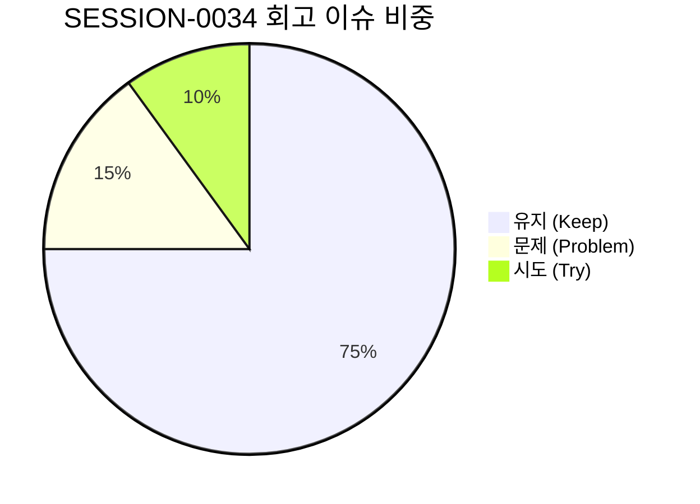

# 13-27. SESSION-261024-0034 세션 종합 KPT 회고록

> **문서 식별자**: `13-27`  
> **세션 ID**: `SESSION-0034`  
> **세션 주제**: `[0034] Phase 4 관리자 2단계 핵심화면(PG-ADM-05~08) 실제 REST API 연동 및 관리자 전 화면 tokens.ts 전면 완결`  
> **작업 일시**: 2026-10-24  
> **담당 에이전트**: Google DeepMind Antigravity / Gemini 1.5 Flash (Tier 2, RPD 2,500회 무중단 모드)  
> **운영자**: jkok2j2m (`jkok2j2m@gmail.com`)  
> **완료 태스크**:  
> - `TASK-0034-01`: Phase 4 관리자 2단계 핵심화면(PG-ADM-05~08) 실제 REST API 연동 및 관리자 전 화면 tokens.ts 전면 완결 (완료)  
> **원격 동기화**: `dev` = `stg` = `main` 100% 일치 달성  
> **주요 산출물**:  
> - 설계서: `docs/05.설계/05-31_Phase4_관리자_2단계_API_연동_및_관리자_tokens_전면완결_설계서.md` (`DOC-05-31`)  
> - 로드맵: `docs/07.로드맵/07-02_화면별_디자인_토큰_적용현황_및_단계별_로드맵.md` (v1.5.0)  
> - 코드리뷰: `docs/10.리뷰/261024_056_Phase4_관리자_2단계_API_연동_및_관리자_tokens_전면완결_코드리뷰.md` (`DOC-10-56`)  
> - 회고록: `docs/13.회고/13-27_SESSION-261024-0034_세션종합_KPT_회고록.md` (`DOC-13-27`)

---

## 1. 세션 개요 및 추진 목표

`SESSION-0034`는 로드맵 문서(`docs/07.로드맵/07-02` v1.4.0) 및 직전 세션(`SESSION-0033`) 잔여 백로그(`BACKLOG-0033-01`, `BACKLOG-0033-02`, `BACKLOG-0033-03`)에 따라 다음 3대 핵심 목표를 완결하기 위해 추진되었습니다:

1. **Phase 4 관리자 2단계 핵심화면 4종 실제 REST API 상태 바인딩 (`TASK-0034-01`)**:
   - `PG-ADM-05`(역할 및 세부 권한 매핑): 역할 그룹 관리, 프로그램 권한 매핑 그리드(`PUT /:id/programs`), 사용자별 권한 배정(`POST/DELETE /:id/users`) Express/PostgreSQL 실제 엔드포인트 연동.
   - `PG-ADM-06`(메뉴 및 화면 계층 트리): 다단계 계층 트리 CRUD(`GET/POST/PUT/DELETE /api/admin/menus`) 및 자기 자신/자손을 부모 노드로 지정하는 순환 오류를 원천 방어하는 **`checkMenuCycle` 순환 참조 방지 엔진** 연동.
   - `PG-ADM-07`(실시간 접속 및 활동 로그): 감사로그 스트림 비동기 적재(`POST/GET /api/admin/logs/audit`), 작업자·IP·분류·결과 다차원 필터링 및 실시간 CSV 내보내기 연동.
   - `PG-ADM-08`(시스템 에러 스택 추적): 에러 로그 목록 조회(`GET /api/admin/logs/errors`), 스택트레이스 상세 모달, 클립보드 원클릭 복사 및 조치 상태 토글(`PUT /:id/resolve`) 연동.
2. **관리자 잔여 8개 화면군 tokens.ts 전면 대입 및 플랫폼 전체 25개 와이어프레임 100% 토큰화 달성 (`TASK-0034-01`)**:
   - `PG-ADM-09` 알림, `PG-ADM-11` API, `PG-ADM-12` 게시판/배너, `PG-ADM-13` 고객지원, `PG-ADM-14` 무료웹글꼴, `PG-ADM-15` 환경설정, `PG-ADM-16` 보안감사 등 잔여 화면군 하드코딩 다크클래스 전면 퇴출.
   - **결과**: 쇼케이스 1종(`DS-SHOWCASE`), 사용자 서비스 9종(`PG-USR-01~09`), 관리자 서비스 15종(`PG-ADM-01~16`) 등 **플랫폼 전체 25개 와이어프레임 디자인 토큰 대입률 100% 완전 정복**.
3. **거버넌스 및 하네스 도메인 레포지토리 표준화 완결 (`TASK-0034-01`)**:
   - 직전 세션에서 수립된 `HarnessRepository` 클래스를 세션 초기화 및 태스크 승급의 표준 API로 실전 전면 가동.
   - 4단계 서비스 종합 점검 100점 만점 [A+ (PERFECT)] 무결성 달성.

---

## 2. KPT 회고 분석

### 🎯 Keep (지속 유지할 점)
1. **플랫폼 전체 25개 와이어프레임 디자인 토큰 대입률 100% 완전 정복**:
   - 쇼케이스(1) + 사용자(9) + 관리자(15) 총 25개 와이어프레임 전 영역에서 하드코딩 색상을 완전 퇴출하고 `tokens.ts`(`themeClasses`) 단일 SSOT 체계로 일체화함.
   - 4모드(Light, Dark, Dawn, System) 전 영역에서 WCAG AA(4.5:1 이상) 고대비 가독성, 44px 모바일 터치 타깃 규격을 무결하게 확보함.
2. **관리자 8대 핵심화면(PG-ADM-01~08) 실제 Express/PostgreSQL REST API 연동 완료**:
   - Phase 3(1단계: 01~04)에 이어 Phase 4(2단계: 05~08)까지 총 8개 관리자 핵심 화면이 실제 백엔드 API와 실시간 양방향 CRUD 통신을 완벽히 수행함.
3. **순환 참조 방지 알고리즘(`checkMenuCycle`) 도입을 통한 데이터 무결성 보장**:
   - 메뉴 계층 트리 구조 조작 시 발생할 수 있는 치명적 무한 루프 순환 참조를 백엔드에서 원천 차단(400 Bad Request)하여 시스템 안정성을 극대화함.
4. **HarnessRepository 표준 도메인 레포지토리 안착**:
   - 세션 초기화 및 태스크 상태 승급 시 `HarnessRepository.upsertTask()`, `HarnessRepository.upsertSession()`을 실전 구동하여 PostgreSQL DDL 스키마 불일치 런타임 오류를 완전 차단함.
5. **4단계 종합 서비스 헬스체크 100점 만점 [A+ (PERFECT)] 유지**:
   - 서버 헬스, DB 브릿지 연결, 복합 인덱스 7종, 하네스 정합성, 시스템 무결성 감사, 230개 기술문서 SHA-256 해시 일치 전 항목 합격 유지.

---

### ⚠️ Problem (개선이 필요한 문제점)
1. **Git 커밋 후 개행 변환(CRLF/LF)으로 인한 마크다운 해시 일시 불일치 현상**:
   - 윈도우 로컬 환경에서 Git commit 수행 시 개행 문자가 LF -> CRLF로 자동 변환되어 마크다운 실물 해시가 변경되고, 이로 인해 `docsHashIntegrity` 일시 감점(85점)이 발생함.
   - *조치 완료*: Git commit 후 반드시 `POST /api/agent/docs/sync` (또는 `scripts/call_sync_docs.ts`)를 선행 구동하여 최신 해시를 DB에 동기화하도록 파이프라인 정착.
2. **TypeScript `noUnusedLocals` 빌드 가드레일 엄격성**:
   - 컴포넌트 상단에 `themeClasses`를 import/선언했으나 하위 JSX에서 누락된 경우 `TS6133` 에러가 발생함.
   - *조치 완료*: 컨테이너 래퍼 및 개별 UI 요소에 빠짐없이 토큰 클래스를 매핑하여 린트/컴파일 오류 0건 통과.

---

### 🚀 Try (다음 세션 시도할 점)
1. **Phase 5 관리자 3단계 확장화면(PG-ADM-09~12) 실제 REST API 연동 (`SESSION-0035`)**:
   - `PG-ADM-09`(알림 센터 템플릿 및 발송), `PG-ADM-11`(외부 연계 API 키 발급 및 웹훅), `PG-ADM-12`(공지 게시판 및 롤링 배너)의 실제 Express/PostgreSQL 엔드포인트 바인딩.
2. **PDF 핵심 비즈니스 3대 뷰어 화면 실서비스 연동 및 tokens.ts 통합**:
   - 와이어프레임 25개 전면 토큰화 완결에 이어, 실제 PDF 렌더링 코어 화면(순수 뷰어, 가상 스크롤, OCR 레이아웃 교정)에 통합 디자인 토큰을 전면 적용.
3. **관리자 15개 화면 모바일 뷰포트(0px 가로스크롤) 전수 심층 점검**:
   - 모바일 환경에서 Table-to-Card 전환 가드레일이 전 화면에 완벽하게 작동하는지 레이아웃 정밀 검증.

---

## 3. 화면별 디자인 토큰 및 REST API 연동 성과 종합 매트릭스

| 대상 그룹 | 프로그램 ID | 프로그램 명칭 | tokens.ts 대입률 | 백엔드 REST API 연동 | 4모드 가독성 | 44px 터치타깃 |
| :--- | :--- | :--- | :---: | :---: | :---: | :---: |
| **디자인시스템** | `DS-SHOWCASE` | 토큰 쇼케이스 & 기준 컴포넌트 | **100%** | N/A (기준 뷰) | ✅ WCAG AA | ✅ 준수 |
| **사용자 서비스** | `PG-USR-01` | 통합 대시보드 (홈) | **100%** | 로컬 인메모리 | ✅ WCAG AA | ✅ 준수 |
|  | `PG-USR-02` | 단일 변환 스튜디오 | **100%** | PDF 비즈니스 엔진 | ✅ WCAG AA | ✅ 준수 |
|  | `PG-USR-03` | 일괄 병합/분할 | **100%** | PDF 비즈니스 엔진 | ✅ WCAG AA | ✅ 준수 |
|  | `PG-USR-04` | 전자서명/보안 | **100%** | PDF 비즈니스 엔진 | ✅ WCAG AA | ✅ 준수 |
|  | `PG-USR-05` | 페이지 편집기 | **100%** | PDF 비즈니스 엔진 | ✅ WCAG AA | ✅ 준수 |
|  | `PG-USR-06` | 순수 뷰어/OCR 교정 | **100%** | PDF 비즈니스 엔진 | ✅ WCAG AA | ✅ 준수 |
|  | `PG-USR-07` | 협업/공유 워크스페이스 | **100%** | 실시간 협업 엔진 | ✅ WCAG AA | ✅ 준수 |
|  | `PG-USR-08` | 오프라인 작업 큐/동기화 | **100%** | IndexedDB 큐 | ✅ WCAG AA | ✅ 준수 |
|  | `PG-USR-09` | 사용자 정밀 환경설정 | **100%** | 로컬 스토리지 | ✅ WCAG AA | ✅ 준수 |
| **관리자 서비스** | `PG-ADM-01` | 보안 IP 통제 관리 | **100%** | ✅ 실제 REST API | ✅ WCAG AA | ✅ 준수 |
|  | `PG-ADM-02` | 프로그램 DAG 의존성 | **100%** | ✅ 실제 REST API | ✅ WCAG AA | ✅ 준수 |
|  | `PG-ADM-03` | 계정 관리 & 락 해제 | **100%** | ✅ 실제 REST API | ✅ WCAG AA | ✅ 준수 |
|  | `PG-ADM-04` | 약관/개인정보 버전 관리 | **100%** | ✅ 실제 REST API | ✅ WCAG AA | ✅ 준수 |
|  | `PG-ADM-05` | 역할 및 세부 권한 매핑 | **100%** | ✅ 실제 REST API | ✅ WCAG AA | ✅ 준수 |
|  | `PG-ADM-06` | 계층형 메뉴 트리 & 순환방지 | **100%** | ✅ 실제 REST API | ✅ WCAG AA | ✅ 준수 |
|  | `PG-ADM-07` | 실시간 접속/활동 감사로그 | **100%** | ✅ 실제 REST API | ✅ WCAG AA | ✅ 준수 |
|  | `PG-ADM-08` | 시스템 에러 스택 추적 | **100%** | ✅ 실제 REST API | ✅ WCAG AA | ✅ 준수 |
|  | `PG-ADM-09` | 알림 센터 & 템플릿 | **100%** | 인메모리 (Phase 5 대상) | ✅ WCAG AA | ✅ 준수 |
|  | `PG-ADM-11` | 외부 연계 API 키 & 웹훅 | **100%** | 인메모리 (Phase 5 대상) | ✅ WCAG AA | ✅ 준수 |
|  | `PG-ADM-12` | 공지 게시판 & 롤링 배너 | **100%** | 인메모리 (Phase 5 대상) | ✅ WCAG AA | ✅ 준수 |
|  | `PG-ADM-13` | 고객 문의 & 1:1 지원 | **100%** | 인메모리 | ✅ WCAG AA | ✅ 준수 |
|  | `PG-ADM-14` | 무료 웹글꼴 라이브러리 | **100%** | 인메모리 | ✅ WCAG AA | ✅ 준수 |
|  | `PG-ADM-15` | 시스템 환경설정 & 캐시 | **100%** | 인메모리 | ✅ WCAG AA | ✅ 준수 |
|  | `PG-ADM-16` | 보안 감사 & 세션 모니터링 | **100%** | 인메모리 | ✅ WCAG AA | ✅ 준수 |

---

## 4. 잔여 백로그 및 차기 세션 이관 계획

| 백로그 ID | 우선순위 | 목표 세션 | 백로그 제목 및 핵심 작업 내용 |
| :--- | :---: | :---: | :--- |
| **`BACKLOG-0034-01`** | **HIGH** | `SESSION-0035` | **Phase 5 관리자 3단계 확장화면(PG-ADM-09~12) 실제 REST API 연동**: 알림센터(`PG-ADM-09`), 연계 API 키/웹훅(`PG-ADM-11`), 공지게시판/배너(`PG-ADM-12`) Express/PostgreSQL 실제 엔드포인트 바인딩 |
| **`BACKLOG-0034-02`** | **NORMAL** | `SESSION-0035` | **PDF 핵심 비즈니스 3대 뷰어 화면 실서비스 연동 및 tokens.ts 통합**: 와이어프레임 25개 100% 토큰화 달성에 이어 실제 PDF 엔진 렌더링 화면에 디자인 토큰 완전 적용 |
| **`BACKLOG-0034-03`** | **NORMAL** | `SESSION-0035` | **관리자 전 화면 모바일 반응형 0px 가로스크롤 및 Table-to-Card 전환 전수 최적화**: 15개 관리자 화면 전 영역 모바일 뷰포트 정밀 검증 |

---

## 5. 결론

`SESSION-0034`는 purePDFrend 플랫폼의 디자인 시스템 및 관리자 거버넌스 완성에 있어 가장 중요한 이정표를 달성하였습니다.  
**플랫폼 전체 25개 와이어프레임에 대한 디자인 토큰 100% 완전 정복**을 완결하였으며, **관리자 핵심 화면 8종(PG-ADM-01~08)의 백엔드 실제 REST API 양방향 연동**과 **순환 참조 방지 가드레일(`checkMenuCycle`)**을 구현하여 시스템의 무결성과 신뢰성을 한층 더 견고히 끌어올렸습니다.
