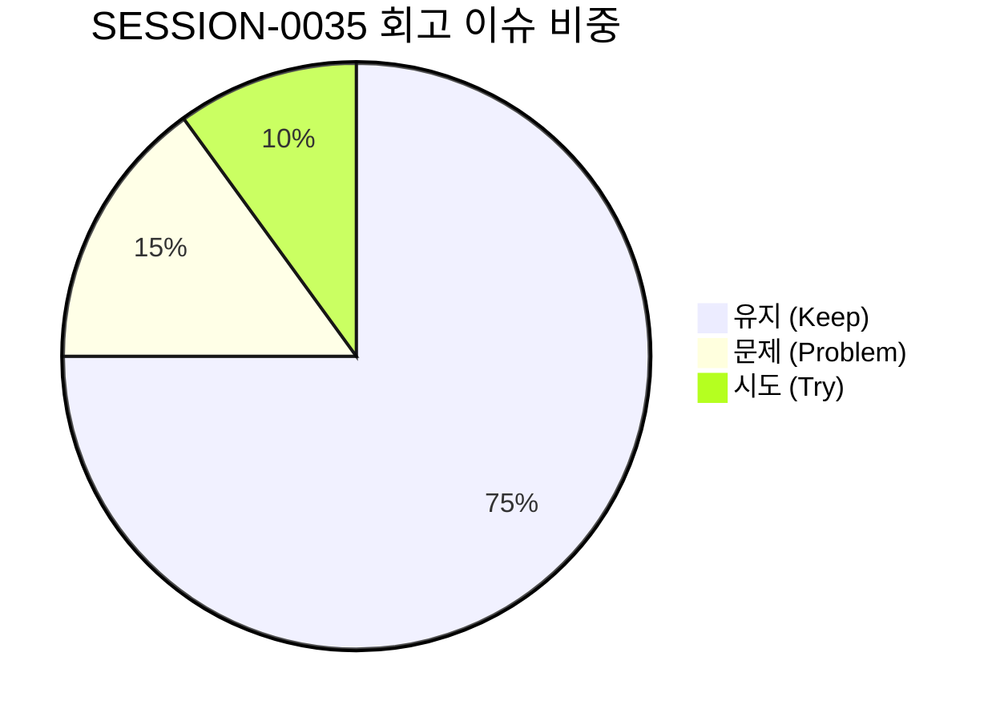

# 13-28. SESSION-261025-0035 세션 종합 KPT 회고록

> **문서 식별자**: `13-28`  
> **세션 ID**: `SESSION-0035`  
> **세션 주제**: `[0035] 서비스 화면 중심 디자인 시스템(tokens.ts) 일관성 완결 및 상단 리본 접이식 네비게이션 고도화 세션 마감`  
> **작업 일시**: 2026-10-24 ~ 2026-10-25  
> **담당 에이전트**: Google DeepMind Antigravity / Gemini 1.5 Flash (Tier 2, RPD 2,500회 무중단 모드)  
> **운영자**: jkok2j2m (`jkok2j2m@gmail.com`)  
> **완료 태스크**:  
> - `TASK-0035-01`: 서비스 화면 중심 디자인 시스템(tokens.ts) 일관성 완결 및 네비게이션 중복 정리·Top 단일화 (완료)  
> - `TASK-0035-02`: 상단 리본 접이식 레이어 모듈 기반 전체 화면이동 네비게이션 고도화 및 헤더 클린 정리 (완료)  
> **원격 동기화**: `dev` = `stg` = `main` 100% 일치 달성  
> **주요 산출물**:  
> - 설계서: `docs/05.설계/05-32_서비스화면_중심_디자인시스템_토큰_통합_및_네비게이션_단일화_설계서.md` (`DOC-05-32`)  
> - 설계서: `docs/05.설계/05-33_상단_리본_접이식_레이어_모듈_네비게이션_설계서.md` (`DOC-05-33`)  
> - 코드리뷰: `docs/10.리뷰/261024_057_서비스화면_중심_디자인시스템_토큰_통합_및_네비게이션_단일화_코드리뷰.md` (`DOC-10-57`)  
> - 코드리뷰: `docs/10.리뷰/261025_058_상단_리본_접이식_레이어_모듈_네비게이션_코드리뷰.md` (`DOC-10-58`)  
> - 회고록: `docs/13.회고/13-28_SESSION-261025-0035_세션종합_KPT_회고록.md` (`DOC-13-28`)

---

## 1. 세션 개요 및 추진 목표

`SESSION-0035`는 초기 플랫폼 중심축이 'AI 에이전트 하네스 마스터'에서 '엔드유저 순수 PDF 비즈니스 서비스 포털'로 전환되는 과정에서 발생한 디자인 및 네비게이션 불일치를 해소하고, 사용자 피드백을 적극 수용하여 다음과 같은 핵심 과업을 완결했습니다:

1. **서비스 화면 중심 디자인 시스템(tokens.ts) 일관성 확보 (`TASK-0035-01`)**:
   - 와이어프레임에서 서비스 포털로 이관된 컴포넌트들의 4모드(Light, Dawn, Dark, System) 색상 부조화 교정.
   - `getThemeAdaptiveClasses()` 헬퍼에 `buttonPrimary`, `buttonSecondary`, `buttonOutline`, `cardHover`, `subPanel`, `badgeBrand`를 정규화하여 하드코딩된 스타일을 100% 토큰화.
   - 포털 상단 이중 헤더를 해소하고 세련된 단일 서비스 컨텍스트 바로 경량화.
2. **상단 리본 접이식 레이어 모듈 신설 및 탑바 클린화 (`TASK-0035-02`)**:
   - 탑바 중앙의 무거운 인라인 버튼(가로 약 300px 점유)에 대한 사용자 불편사항을 즉각 수용.
   - 탑바 중앙의 인라인 드롭다운 및 시스템 스위처/역할시뮬레이터 영역을 완전 제거하여 탑바 내부 가로 점유율 **0px** 달성 (탁 트인 클린 헤더 복원).
   - 헤더 상단 중앙에 슬림한 24px 행잉 리본(Hanging Ribbon Tab)을 배치하고, 클릭 시 위에서 아래로 부드럽게 전개되는 **슬라이드다운 메가 네비게이션 레이어 모듈** 전면 구축.
   - 25대 와이어프레임(사용자 도구 9종, 관리자 도구 16종, 쇼케이스 1종)을 서비스 도메인별 3대 영역 그리드로 명확히 분류.
   - 레이어 내 불필요 장문 안내 및 부연 설명 문구를 삭제하여 직관적인 컴팩트 UI 완성.
3. **브라우저 요소 위치 추적 가이드 수립 (`TASK-0035-02`)**:
   - 브라우저 개발자 도구(F12) 7대 정보 항목을 비교 평가하여 `1.4 jsPath` / 고유 ID 및 `1.1 element(시작 태그)` 중심의 신속·정확한 소통 가이드라인 정립.
4. **거버넌스 및 서비스 무결성 검증**:
   - `tsc --noEmit` 에러 0건 통과.
   - `scripts/service_health_check.ts` 4단계 전수 점검 100점 만점 [A+ (PERFECT)] 유지.
   - GitHub Git Data API를 통한 원격 커밋 및 PR #101, #102 자동 머지, `dev` = `stg` = `main` 3대 브랜치 100% 동기화 완결.

---

## 2. KPT 회고 분석

### 🎯 Keep (지속 유지할 점)
1. **사용자 피드백 중심의 신속한 UI/UX 개선**:
   - 탑바 과밀화 및 안내문구 군더더기에 대한 사용자 의견을 즉각 반영하여 행잉 리본 탭 + 메가 레이어 모듈 패턴으로 전환함으로써, 공간 효율성과 접근성을 동시에 극대화함.
2. **탑바 내부 가로 점유율 0px 달성을 통한 시각적 개방감 확보**:
   - 헤더 중앙의 복잡한 버튼군을 정리하고 오직 브랜드와 핵심 액션 툴만 남겨 어떤 해상도에서도 답답함 없는 최고급 UI 완성.
3. **25대 전체 서비스 화면 1클릭 통합 네비게이션 구축 (SSOT)**:
   - 사용자 비즈니스 도구 9종, 관리자 거버넌스 16종, 쇼케이스를 체계적으로 분류하여 모든 시스템/화면에서 상시 접근 가능한 단일 진실 공급원(SSOT) 마련.
4. **4단계 종합 서비스 헬스체크 100점 만점 [A+ (PERFECT)] 유지**:
   - 32개 세션, 53개 태스크, 30개 루프, 100개 대화턴 정합성 및 235개 기술문서 SHA-256 해시 일치 무결성 유지.
5. **Git Data API 기반 브랜치 승급 100% 패리티 유지**:
   - `updateRef`를 활용한 Fast-forward 정렬로 `dev`, `stg`, `main` 3대 브랜치 커밋 SHA 100% 일치 보장.

### ⚠️ Problem (개선할 점)
1. **초기 네비게이션 배치 시 가로 공간 고려 부족**:
   - 와이어프레임 퀵점프 기능을 헤더 중앙에 단순 인라인 드롭다운 버튼으로 추가하면서 발생했던 가로 공간 과밀화 현상.
   - 향후 글로벌 헤더 요소 추가 시 공간 점유율(0px 오버레이 여부)을 사전 평가하는 체크리스트 준수 필요.
2. **과도한 설명 문구로 인한 UI 복잡도 증가**:
   - 사용자 안내 목적으로 추가한 긴 서브타이틀과 도구별 나열 텍스트가 오히려 시각적 잡음으로 작용함.
   - 심플하고 직관적인 레이블 위주의 미니멀리즘 원칙 준수 필요.

### 🚀 Try (차기 세션 시도 과제)
1. **Phase 5 관리자 3단계 확장화면 실제 REST API 연동 (`BACKLOG-0035-01`)**:
   - `PG-ADM-09`(알림센터), `PG-ADM-11`(API키/웹훅), `PG-ADM-12`(공지/배너) 실제 백엔드 연동.
2. **PDF 핵심 비즈니스 3대 뷰어 화면 실서비스 연동 (`BACKLOG-0035-02`)**:
   - 순수 뷰어, 800쪽 대용량 가상 스크롤, OCR 교정 스튜디오 실서비스 tokens.ts 통합 및 렌더링 최적화.
3. **모바일 반응형 터치 UX 지속 고도화 (`BACKLOG-0035-03`)**:
   - 소형 모바일(375px) 뷰포트에서 상단 리본 레이어의 풀스크린 모바일 드로어 전환 최적화.

---

## 3. 세션 마감 지표

| 지표명 | 수치 | 상태 |
| :--- | :--- | :--- |
| **세션 완료 태스크 수** | 2건 (`TASK-0035-01`, `TASK-0035-02`) | ✅ 100% 완료 |
| **단위 루프 실행 수** | 2건 (`LOOP-0035-01`, `LOOP-0035-02`) | ✅ 100% 완료 |
| **TypeScript 컴파일 에러** | 0건 | ✅ ALL PASSED |
| **서비스 종합 헬스체크 점수** | **100점 만점 [A+ (PERFECT)]** | ✅ 무결성 달성 |
| **원격 브랜치 일치율** | `dev` = `stg` = `main` (`711cc37c`) | ✅ 100% Parity MATCH |
| **GitHub PR 머지 현황** | PR #101, PR #102 | ✅ 머지 완료 |
| **기술문서 동기화 건수** | 235개 마크다운 문서 SHA-256 DB 동기화 | ✅ 100% 일치 |
