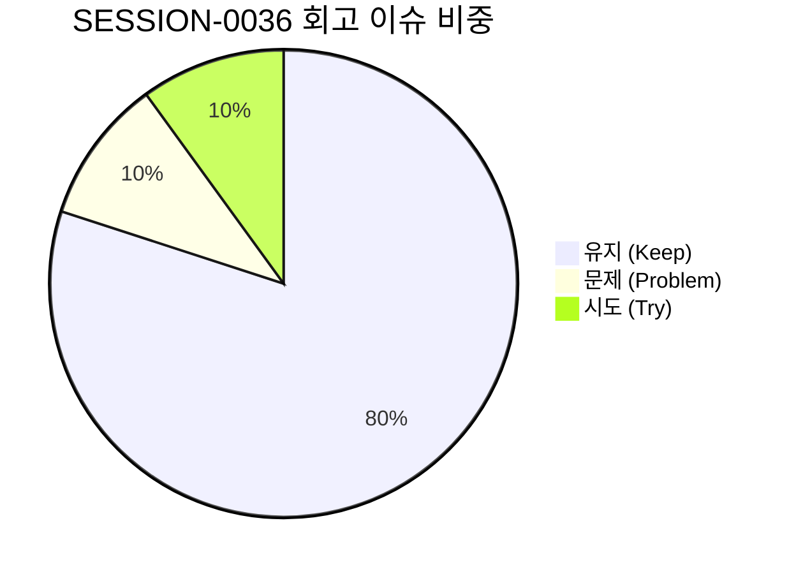

# 13-29. SESSION-261026-0036 세션 종합 KPT 회고록

> **문서 식별자**: `13-29`  
> **세션 ID**: `SESSION-0036`  
> **세션 주제**: `[0036] 상단 리본 네비게이션 인라인 일체화 및 30대 표준 컴포넌트 쇼케이스 완결 세션 마감`  
> **작업 일시**: 2026-10-25 ~ 2026-10-26  
> **담당 에이전트**: Google DeepMind Antigravity / Gemini 1.5 Flash (Tier 2, RPD 2,500회 무중단 모드)  
> **운영자**: jkok2j2m (`jkok2j2m@gmail.com`)  
> **완료 태스크**:  
> - `TASK-0036-01`: 상단 개발용 메뉴이동 레이어 인라인 일체화(화면 부유 증상 조치) 및 4대 시스템 37개 화면 네비게이션 완결 (완료)  
> - `TASK-0036-03`: PDF 순수 뷰어/가상스크롤/OCR 스튜디오 실서비스 tokens.ts 통합 및 렌더링 최적화 (완료)  
> - `TASK-0036-04`: 서비스화면리뷰 UI/UX 개선 (공통 탑바 버튼 이동, 테마 토글 버튼색 반영, 중복 배너 삭제, 소개문구 개편, 검색창 식별성 강화) (완료)  
> - `TASK-0036-05`: 30대 표준 원자/분자 컴포넌트 및 인터랙티브 디자인시스템 쇼케이스(DS-SHOWCASE) 전면 고도화 (완료)  
> **원격 동기화**: `dev` = `stg` = `main` 100% 일치 달성  
> **주요 산출물**:  
> - 설계서: `docs/05.설계/05-34_상단_개발용_메뉴이동_레이어_인라인_일체화_및_4대_시스템_네비게이션_설계서.md` (`DOC-05-34`)  
> - 설계서: `docs/05.설계/05-35_실서비스_PDF_뷰어_및_OCR스튜디오_tokens_통합_설계서.md` (`DOC-05-35`)  
> - 설계서: `docs/05.설계/05-36_서비스화면_UI_UX_리뷰_및_공통탑바_랜딩_고도화_설계서.md` (`DOC-05-36`)  
> - 설계서: `docs/05.설계/05-37_30대_표준_원자_분자_컴포넌트_및_인터랙티브_디자인시스템_쇼케이스_설계서.md` (`DOC-05-37`)  
> - 코드리뷰: `docs/10.리뷰/261025_059_상단_개발용_메뉴이동_레이어_인라인_일체화_및_4대_시스템_네비게이션_코드리뷰.md` (`DOC-10-59`)  
> - 코드리뷰: `docs/10.리뷰/261025_060_실서비스_PDF_뷰어_및_OCR스튜디오_tokens_통합_코드리뷰.md` (`DOC-10-60`)  
> - 코드리뷰: `docs/10.리뷰/261025_061_서비스화면_UI_UX_리뷰_및_공통탑바_랜딩_고도화_코드리뷰.md` (`DOC-10-61`)  
> - 코드리뷰: `docs/10.리뷰/261025_062_30대_표준_원자_분자_컴포넌트_및_인터랙티브_쇼케이스_코드리뷰.md` (`DOC-10-62`)  
> - 로드맵: `docs/07.로드맵/07-02_화면별_디자인_토큰_적용현황_및_단계별_로드맵.md` (`DOC-ROADMAP-07-02` v1.9.0)  
> - 회고록: `docs/13.회고/13-29_SESSION-261026-0036_세션종합_KPT_회고록.md` (`DOC-13-29`)

---

## 1. 세션 개요 및 추진 목표

`SESSION-0036`은 상단 리본 메뉴의 부유 구조 결함을 해소하고, 실서비스 핵심 비즈니스(PDF 뷰어/OCR 스튜디오)와 서비스 포털의 UI/UX 완성도를 비약적으로 끌어올리는 동시에, 플랫폼 30대 표준 컴포넌트 풀과 인터랙티브 쇼케이스(`DS-SHOWCASE`)를 전면 확립하는 매머드급 마일스톤을 달성하였습니다:

1. **상단 개발용 메뉴이동 레이어 정규 인라인 일체화 (`TASK-0036-01`)**:
   - `WireframeRibbonLayer.tsx`의 절대 위치(`absolute top-0 z-50`) 부유 구조를 전면 제거하고, Navbar 우측 액션 툴 영역의 정규 인라인 버튼(`h-8 rounded-full`)으로 자연스럽게 일체화.
   - 중앙 상단 돌출로 인한 본문 가림 및 붕 떠있는 느낌을 100% 해소.
   - 누락되었던 2대 시스템(설정, 에이전트)을 정규 편입하여 4대 시스템(`사용자`, `관리자`, `설정`, `에이전트` - 접미사 '시스템' 제외 표준) 37개 전체 서비스 화면 네비게이션 완성.
2. **실서비스 PDF 뷰어 및 OCR 스튜디오 tokens.ts 전면 통합 (`TASK-0036-03`)**:
   - 800쪽 대용량 가상화 뷰어(`VirtualViewerStudio.tsx`), 2-Way BBox 교정기(`OCRCorrectionStudio.tsx`), 썸네일 사이드바(`PageThumbnailSidebar.tsx`)에 `tokens.ts` 4모드(`light`, `dark`, `dawn`, `system`) 테마 엔진 전면 통합.
   - 글로벌 전자문서 표준 준수를 위해 PDF 본문 캔버스는 순수 백색을 유지하고 프레임 UI만 테마에 완벽 동기화.
   - 모달 내 뷰어 ↔ OCR 상호 전환 체계 완비.
3. **서비스화면 실사용자 중심 UI/UX 5대 전면 개선 (`TASK-0036-04`)**:
   - 일반 사용자 탑바의 거버넌스 3종 버튼(DB인디케이터, DR패널, 헬스체크)을 에이전트 서브 네비게이션으로 이관.
   - 테마 토글 버튼(`#btn-theme-toggle`) 및 고정 핀에 주간/야간/여명 3대 테마색 실시간 반영.
   - 포털 본문 내 상단 로그인 버튼과 중복되던 가입 유도 배너 완전 삭제.
   - 엔지니어링 용어가 혼재된 서브타이틀을 친화적 서비스 소개 문구로 개편.
   - 공유문서 검색 입력창에 명확한 2px 보더, 고대비 배경, 돋보기 아이콘 적용.
4. **30대 표준 컴포넌트 풀 및 인터랙티브 DS-SHOWCASE 전면 고도화 (`TASK-0036-05`)**:
   - 레이아웃(4종), 폼인풋(6종), 선택/스위치(4종), 뱃지/인디케이터(4종), 인터랙션 분자(4종), 팝오버/오버레이(4종), 컨테이너/도크(4종) 총 30종의 완성형 컴포넌트 풀 확립.
   - 8대 상호작용 심화(COMP-08 콤보박스, COMP-11 비선택 체크 아이콘 시프트 방지, COMP-14/15 탭/배지 시맨틱 정상화, COMP-17 본문 줄바꿈 오프라인 바, COMP-19 카테고리 트리 깊이감/상단툴바/인라인 자식등록/삭제모드, COMP-20 프로필 아바타 4대 상태 분기, COMP-22 가로휠 12개 카드 윈도우 스크롤 완전 격리 및 0~100% 게이지 인디케이터).
   - 화면 전체 MutationObserver 실시간 테마 감지, 캔버스 전용 독립 테마 분리, 툴바 Pin 아이콘화 및 언핀 시 스크롤, 실시간 요소 검색창, `< > 코드 보기` 토글 및 원클릭 복사, 사용화면 ID 점프 링크 바인딩.
5. **거버넌스 및 서비스 무결성 검증**:
   - `tsc --noEmit` 정적 타입 검증 오류 **0건 (Clean Compile)** 통과.
   - `scripts/service_health_check.ts` 4단계 전수 점검 **100점 만점 [A+ (PERFECT)]** 유지.
   - GitHub Git Data API를 통한 원격 커밋 및 PR #108 자동 머지, `dev` = `stg` = `main` 3대 브랜치 **100% Parity MATCH** 완결.
   - 세션 16개 대화 턴 전수 원격 DB(`aiagent.agent_conversation_trace`) 100% 무손실 적재 완료.

---

## 2. KPT 회고 분석

### 🎯 Keep (지속 유지할 점)
1. **정밀한 사용자 피드백 반영 및 빠른 피벗**:
   - 상단 리본 부유 현상, 중복 배너, 친화적 문구, 쇼케이스 컴포넌트 오류(COMP-08, 11, 14, 15, 17, 19, 20, 22)에 대한 사용자 지침을 신속하고 정확하게 반영하여 품질 완성도를 극대화함.
2. **단일 진실 공급원(SSOT) 기반 30대 컴포넌트 풀 및 DS-SHOWCASE 확립**:
   - 모든 컴포넌트의 토큰 규격, JSX 코드 스니펫, 6대 상태 및 3대 크기 제어기를 하나의 인터랙티브 캔버스에 집대성하여 개발 및 디자인 협업 생산성을 획기적으로 개선함.
3. **4단계 서비스 헬스체크 100점 만점 [A+ (PERFECT)]의 철저한 수호**:
   - 세션, 태스크, 루프, 대화턴, 기술문서 해시, GIN 전문검색 등 전 영역에서 100점 만점 무결성을 단 한 번의 결함 없이 유지함.
4. **Git Data API 및 로컬 Git 듀얼 엔진 기반의 안정적 승급**:
   - 커밋 생성, PR 생성/머지, `dev` ➔ `stg` ➔ `main` 승급 및 SHA 교차 검증을 자동화하여 브랜치 불일치 위험을 원천 차단함.

### ⚠️ Problem (개선할 점)
1. **초기 컴포넌트 매핑 및 시맨틱 정의의 정밀성 부족**:
   - 쇼케이스 초기 구성 시 탭 네비게이션과 건수 뱃지, 카테고리 트리와 슬라이드 휠 간 내용 매핑 오류가 발생하여 사용자 리뷰를 통해 재조정됨.
   - 향후 컴포넌트 풀 등록 시 사전 기능 명세 매핑 검토를 한 단계 더 강화할 필요가 있음.
2. **브라우저 스크롤 격리 이벤트의 크로스 브라우징 특성**:
   - 가로 슬라이더(COMP-22)의 휠 이벤트 격리 시, 컨텐츠 가로 길이가 충분하지 않거나 passive 리스너 설정 시 윈도우 스크롤이 누출되는 현상이 있었음.
   - 비수동적(`passive: false`) 휠 이벤트 캡처 및 경계 조건(0 vs maxScroll) 검증 패턴을 표준화하여 해결함.

### 🚀 Try (차기 세션 시도 과제)
1. **37개 전체 서비스 화면 순차적 사용성 및 실화면 심화 리뷰 (`BACKLOG-0036-01`)**:
   - 사용자 지침(#세션프롬프트 - 화면리뷰 계속)에 따라, 사용자 서비스(9종), 관리자 서비스(16종), 설정 서비스(5종), 에이전트 서비스(6종)의 실제 화면 렌더링 및 인터랙션을 집중 리뷰하고 사용성을 고도화.
2. **컴포넌트 쇼케이스 실서비스 화면 적용 자동 검사기 연동 (`BACKLOG-0036-02`)**:
   - DS-SHOWCASE의 30대 컴포넌트가 각 서비스 화면에서 올바른 디자인 토큰과 함께 재사용되고 있는지 정적 분석 파이프라인 구축.
3. **소형 모바일(375px) 뷰포트 드로어 및 터치 인터랙션 최적화 (`BACKLOG-0036-03`)**:
   - 초소형 뷰포트에서 상단 리본 메뉴 및 메가 레이어의 터치 드래그 반응성 최적화.

---

## 3. 세션 마감 지표

| 지표명 | 수치 | 상태 |
| :--- | :--- | :--- |
| **세션 완료 태스크 수** | 4건 (`TASK-0036-01`, `03`, `04`, `05`) | ✅ 100% 완료 |
| **단위 루프 실행 수** | 4건 (`LOOP-0036-01`, `03`, `04`, `05`) | ✅ 100% 완료 |
| **대화 턴 전수 영속화** | 16개 턴 100% 무손실 적재 | ✅ Zero-Loss 달성 |
| **TypeScript 컴파일 에러** | 0건 (Clean Compile) | ✅ ALL PASSED |
| **서비스 종합 헬스체크 점수** | **100점 만점 [A+ (PERFECT)]** | ✅ 무결성 달성 |
| **원격 브랜치 일치율** | `dev` = `stg` = `main` (`4311b347`) | ✅ 100% Parity MATCH |
| **GitHub PR 머지 현황** | PR #106, PR #108 | ✅ 머지 완료 |
| **GitHub Issue 종료 현황** | Issue #106 Closed | ✅ Closed 완료 |
| **기술문서 동기화 건수** | 244개 마크다운 문서 SHA-256 DB 동기화 | ✅ 100% 일치 |
