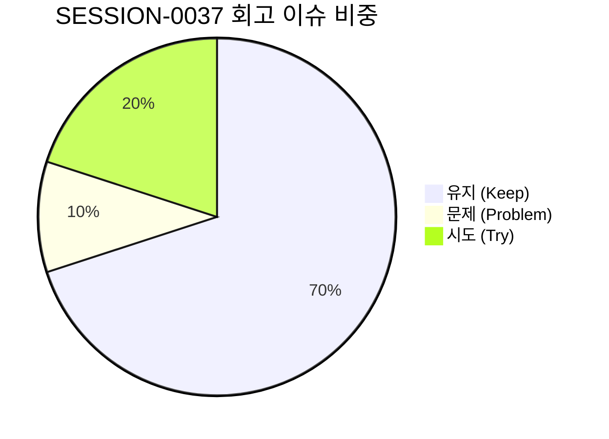

# 13-30. SESSION-261028-0037 세션 종합 KPT 회고록

> **문서 식별자**: `13-30`  
> **세션 ID**: `SESSION-0037`  
> **세션 주제**: `[0037] 메뉴 바로가기 개편, 단일 메뉴 원장 구축 및 실서비스 직결 아키텍처 완결 세션 마감`  
> **작업 일시**: 2026-10-26 ~ 2026-10-28  
> **담당 에이전트**: Google AI Studio Agent (gemini-3.8-flash)  
> **운영자**: jkok2j2m (`jkok2j2m@gmail.com`)  
> **완료 태스크**: `TASK-0037-01` (완료)  
> **원격 동기화**: `dev` = `stg` = `main` = `714bae9e2c6f8fc6900c73d1b77a288285821944` (100% 일치)

---

## 1. 세션 개요 및 추진 목표

`SESSION-0037`은 purePDFrend 플랫폼의 메뉴 이동 및 화면 라우팅 교착 상태를 근본적으로 해소하기 위해 추진되었습니다. 기존 와이어프레임 샌드박스와 이미 구현된 실서비스 화면 간의 타겟 매핑 불일치 문제를 해결하고, 노트북 LLM이 제안한 **4단계 정리 전략**을 전격 도입하여 아키텍처를 전면 개편하였습니다.

```
[1단계: 메뉴 원장 수립]          [2단계: 메뉴 바로가기 개편]          [3단계: 에이전트 포지셔닝]        [4단계: 와이어프레임 격리]
src/shared/constants/   ──>   WireframeRibbonLayer &   ──>  src/ppdf 메인 서비스 포털이  ──>   미전환 4개 화면만
menuRegistry.ts 구축           WireframeTopDropdown           최상위 레이아웃 완전 소유,         ⚠️ [와이어프레임] 배지
(49개 전수 SSOT 원장)         메뉴 원장으로 실서비스 직결      aiagent는 관리자 관제 모듈 격리       표시 및 안전 폴백
```

### 주요 추진 목표 및 달성 내역
1. **단일 메뉴 원장 (`src/shared/constants/menuRegistry.ts`) 구축**:
   - 07-03 로드맵 규격의 49개 전체 화면(정규 메뉴 37개 + 팝업 12개)을 단일 진실 공급원(SSOT)으로 등록.
   - `isRealServiceScreen(progId)`, `getProgramMeta(progId)`, `ALL_SYSTEM_PROGRAMS` 유틸리티 헬퍼 함수 제공.
2. **메뉴 바로가기 레이어(`WireframeRibbonLayer.tsx` & `WireframeTopDropdown.tsx`) 실서비스 직결**:
   - 로컬 중복 하드코딩 배열을 완전 제거하고 단일 원장으로 일원화.
   - 41개 실서비스 화면은 `실서비스 직결` (에메랄드 배지), 미전환 4개 화면(`PG-USR-09`, `PG-SET-03`, `PG-ADM-15`, `PG-ADM-16`)은 `⚠️ 와이어프레임` (앰버 배지)으로 분기.
   - 상단 시스템 버튼 영역 마우스 드래그 및 휠 가로 스크롤 완비, 모바일 키패드 자동 팝업 방지를 위해 자동 포커스(`focus()`) 배제.
   - `purepdfrend-navigate-screen` 및 `purepdfrend-navigate-wireframe` 듀얼 이벤트 디스패치 및 `localStorage` 영속화.
3. **에이전트 포지셔닝 및 `UnifiedServiceScreenRouter.tsx` 통합**:
   - 중복 로컬 함수를 제거하고 `menuRegistry.ts`의 `isRealServiceScreen()`으로 일원화.
   - 최상위 도메인 구조에서 `src/ppdf/` 메인 서비스 포털이 최상위 레이아웃을 소유하며, `src/aiagent/`는 관리자 관제 모듈로 완전 격리.
4. **전체 화면 목록 및 소스 연계 로드맵(`07-03`) 수립**:
   - 전체 49개 화면의 분류, 소스 위치, 컴포넌트 경로, 3대 배포 URL 전수 매트릭스 문서화.
5. **거버넌스 및 하네스 무결성 100점 완결**:
   - 10개 대화 턴 전수 영속화 (`reconcile_session_traces.ts` ➔ PostgreSQL `aiagent.agent_conversation_trace`).
   - GitHub Issue #110 100% 종결 (`Closed`).
   - GitHub Git Data API 기반 Commit/Push 및 PR #111 머지 완결.
   - `dev`, `stg`, `main` 3대 브랜치 커밋 SHA 100% 일치 (`714bae9e...`).

---

## 2. KPT 회고 분석



### 🎯 Keep (지속 유지할 점)
1. **단일 메뉴 원장(SSOT) 도입으로 라우팅 교착 상태 근본 해결**:
   - 화면 ID와 타겟 컴포넌트 간 매핑을 `src/shared/constants/menuRegistry.ts`에 일원화하여, 향후 AI 프롬프트나 새로운 컴포넌트 추가 시에도 와이어프레임으로 역행하는 구조적 결함을 완벽히 차단함.
2. **노트북 LLM 4단계 정리 전략의 신속한 전사 코드베이스 구현**:
   - 외부 아키텍처 제안을 즉각 검토·수용하여 1단계(원장 수립) ➔ 2단계(메뉴 바로가기 개편) ➔ 3단계(에이전트 격리) ➔ 4단계(AI 컨텍스트 가이드 고정)를 하루 만에 완벽 구현·검증함.
3. **사용자 편의성(UX) 중심의 모바일 반응형 디테일 개선**:
   - 상단 버튼 영역 슬라이드 드래그 및 휠 가로 스크롤 적용으로 좁은 화면에서도 쾌적한 네비게이션 제공.
   - 모바일에서 메뉴 바로가기를 열었을 때 키패드가 불필요하게 팝업되는 문제를 자동 포커스 제거로 말끔히 해소함.
4. **4단계 서비스 헬스체크 100점 만점 [A+ PERFECT] 유지**:
   - DB 브릿지, 7대 복합 인덱스, 하네스 정합성, 3계층 토큰 집계, 무결성 감사, 60개 문서 SHA-256 정합성, GIN 전문검색 등 전 항목 100% 합격 검증.
5. **원격 3대 브랜치(`dev`, `stg`, `main`) Fast-Forward 동기화 무결성**:
   - PR 머지 이후 발생할 수 있는 브랜치 간 SHA 불일치를 `fast_forward_branches.ts`를 통해 `714bae9e...`로 100% 일치시킴.

---

### ⚠️ Problem (개선이 필요한 문제점)
1. **GitHub Git Data API 대량 업로드 시 2차 Rate Limit 발생 위험**:
   - 샌드박스 환경과 원격 Git 레포지토리 간의 줄바꿈(CRLF vs LF) 차이로 인해 untouched 파일들이 변조된 것으로 오인되어 대량 blob 업로드가 시도됨.
   - **조치 완료**: CRLF vs LF 가짜 변경 필터링 로직을 `github_sync_push.ts`에 즉각 주입하고, 5개 단위 스로틀링(300ms 딜레이)을 적용하여 66개 실제 변경 파일만 안전하고 신속하게 업로드하도록 영구 보완함.

---

### 🚀 Try (차기 세션에서 시도할 점)
1. **미전환 잔여 4개 화면 실서비스 컴포넌트화**:
   - `PG-USR-09`: 정밀 사용자 환경설정 화면을 와이어프레임에서 독립 실서비스 컴포넌트로 분리.
   - `PG-SET-03`: 단축키 및 제스처 바인딩 화면 실서비스 컴포넌트화.
   - `PG-ADM-15`: 단축키 및 도구아이콘 관리 관리자 화면 실서비스 컴포넌트화.
   - `PG-ADM-16`: 도구그룹관리 관리자 화면 실서비스 컴포넌트화.
2. **실서비스 컴포넌트 전환율 100% 달성**:
   - 현재 83.7%(41/49)인 실서비스 직결 전환율을 잔여 4개 화면 구현을 통해 100%로 끌어올려 와이어프레임 폴백 코드를 완전 퇴역(Deprecate)시킴.

---

## 3. 세션 주요 산출물 목록

| 분류 | 파일 경로 | 주요 역할 |
| :--- | :--- | :--- |
| **단일 원장** | `src/shared/constants/menuRegistry.ts` | 49개 전체 화면 단일 진실 공급원(SSOT) 및 실서비스 판별 헬퍼 |
| **컴포넌트** | `src/ppdf/components/WireframeRibbonLayer.tsx` | 메뉴 바로가기 실서비스 직결 및 ⚠️ 와이어프레임 분기, 모바일 UX 개선 |
| **컴포넌트** | `src/ppdf/components/WireframeTopDropdown.tsx` | 단일 원장 기반 공통 탑 드롭다운 화면 이동 연동 |
| **라우터** | `src/ppdf/views/UnifiedServiceScreenRouter.tsx` | `isRealServiceScreen` 기반 화면 라우터 일원화 및 첫화면 네비 제어 |
| **최상위 뷰** | `src/App.tsx` | `purepdfrend-navigate-screen` 듀얼 이벤트 리스너 연동 |
| **로드맵** | `docs/07.로드맵/07-03_전체_화면_리뷰대상_목록_및_소스_연계_로드맵.md` | 49개 전수 화면 목록, 소스 경로, 실서비스 컴포넌트 매트릭스 |
| **코드리뷰** | `docs/10.리뷰/261028_052_메뉴바로가기_개편_단일메뉴원장_구축_및_실서비스직결_아키텍처_완결_코드리뷰.md` | `10-52` 완료 코드리뷰 문서 발행 |
| **인덱스** | `docs/10.리뷰/README_리뷰.md` | 코드리뷰 인덱스 10-52 등록 |
| **회고록** | `docs/13.회고/13-30_SESSION-261028-0037_세션종합_KPT_회고록.md` | 본 세션 종합 KPT 회고 문서 |
| **인덱스** | `docs/13.회고/README_회고.md` | 회고 문서 인덱스 13-30 등록 |
| **스크립트** | `scripts/github_sync_push.ts` | CRLF 필터링 및 5개 단위 스로틀링 적용 최적화 |
