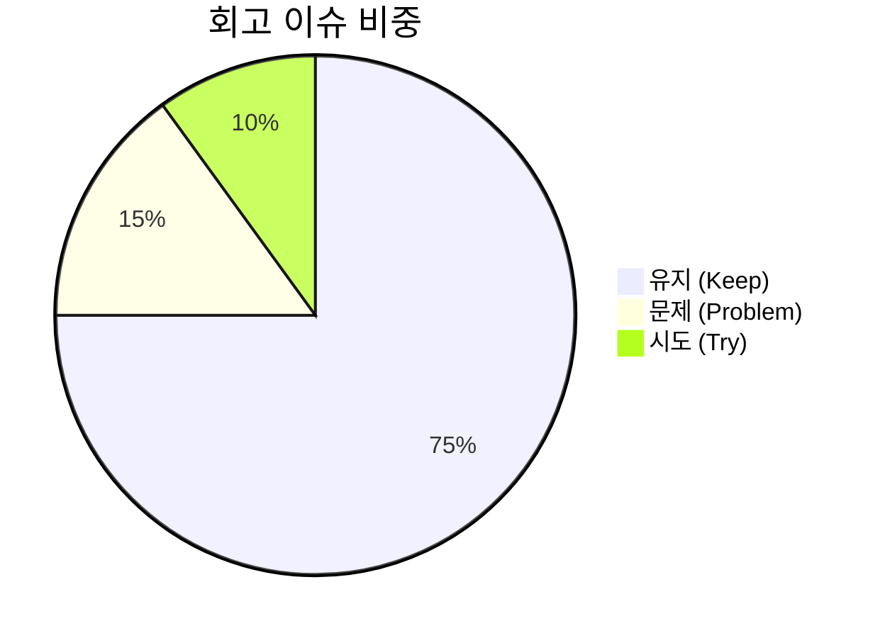

# 13. 회고 (Retrospectives) 요약 가이드

## 📋 폴더 개요
스프린트 및 세션 완료 후 성과를 돌아보고, 유지할 점과 개선할 점(KPT 회고)을 기록합니다.

## 📑 하위 문서 목록
| 문서번호 | 파일명 | 문서 제목 | 주요 내용 요약 |
| :--- | :--- | :--- | :--- |
| `13-01` | `13-01_SESSION-20260917-001_세션종합_KPT_회고록.md` | SESSION-20260917-001 세션 종합 KPT 회고록 | Keep(GitHub REST 제어, 토큰격리, Zero-Hang), Problem(스토어누적, 기본값잔재), Try(세션별 스토어격리, 동적DB검증, 감사API) |
| `13-02` | `13-02_SESSION-20260920-002_세션종합_KPT_회고록.md` | SESSION-20260920-002 세션 종합 KPT 회고록 | Keep(세션격리, 동적DB영속화, P0보안완결, 무결성100점), Problem(모바일넘침, 헤더메뉴과다), Try(IA 3대그룹화, 모바일반응형, 드로어/토글UX) |
| `13-03` | `13-03_SESSION-20260921-003_세션종합_KPT_회고록.md` | SESSION-20260921-003(1차) 세션 종합 KPT 회고록 | Keep(하이브리드 아키텍처 이원화, 5대 디자인패턴, UTF-8 버퍼결함 해결, 15-04 교육자료), Problem(리팩토링+UI과부하), Try(모바일 반응형 UX 단독세션 착수) |
| `13-04` | `13-04_SESSION-20260921-003_2차_세션종합_KPT_회고록.md` | SESSION-20260921-003(2차) 세션 종합 KPT 회고록 | Keep(대화턴 체크포인트 영속화 33건 완결, 복합인덱스 7종, 4단계 서비스전수점검 및 Push 가드레일, 100점 감사), Problem(모바일UX 누적), Try(차기세션 모바일UX 및 3대 IA 그룹화) |
| `13-05` | `13-05_SESSION-20260921-004_세션종합_KPT_회고록.md` | SESSION-20260921-004 세션 종합 KPT 회고록 | Keep(3대 도메인 IA 그룹화, 모바일 반응형 햄버거 드로어, 상단 툴 높이 및 뷰어 버튼 표준화, 전수점검 100점 만점), Problem(스토어 세션 격리 시 혼입), Try(PDF 비즈니스 코어 고도화) |
| `13-12` | `13-12_SESSION-260927-0016_세션종합_KPT_회고록.md` | SESSION-260927-0016 세션 종합 KPT 회고록 | Keep(전수 목록 UI 표준 정책 03-18 일괄 적용, 비-LLM 긴급 Push 및 DR 관제실 상시 복구, Trace ID DESC 기본정렬), Problem(거버넌스 절차 누락 및 백그라운드 태스크 잔류), Try(와이어프레임 기획서 분석 및 프로토타입 구현) |
| `13-13` | `13-13_SESSION-260928-0017_세션종합_KPT_회고록.md` | SESSION-260928-0017 세션 종합 KPT 회고록 | Keep(공통 가로 슬라이더 및 44px 가드레일, Canvas Crop 및 공식 소셜 브랜드 준수, 3대 브랜치 일치), Problem(원격 GitHub 이슈 상태 수동 잔류 현상), Try(800쪽 대용량 가상화 PDF 뷰어 렌더링 최적화) |
| `13-14` | `13-14_SESSION-260930-0018_세션종합_KPT_회고록.md` | SESSION-260930-0018 세션 종합 KPT 회고록 | Keep(GitHub Git Data API Commit/Push 및 PR #42 dev/stg/main 100% 동기화, 대화턴 6개 전수 원문/Markdown 무손실 영속화, KST 16:00 슬라이딩 윈도우 적응형 쿼터 예측 API), Problem(이전 세션 대화턴 누락, 컨텍스트 단절 위험), Try(이전 세션 대화턴 역추적 백필, 800쪽 가상화 뷰어 최적화) |
| `13-15` | `13-15_SESSION-261001-0019_세션종합_KPT_회고록.md` | SESSION-261001-0019 세션 종합 KPT 회고록 | Keep(aiagent 11대 테이블/컬럼 코멘트 등록, 104건 무손실 스키마 스왑, 편집레이어 네비게이션 일체형 내포, 모바일 카테고리 접힘 배너 상시노출, PR #46/#47 머지 및 dev/stg/main 일치), Problem(모달 분리형 레이아웃 시각적 불안정, 조건부 렌더링 누락), Try(PG-USR-06 PDF 전용 가상 뷰어 연동) |
| `13-16` | `13-16_SESSION-261002-0020_세션종합_KPT_회고록.md` | SESSION-261002-0020 세션 종합 KPT 회고록 | Keep(목차 복원·TOC 영문 배제, 툴바 좌우정렬 표준화, 주석 레이어팝업, OCR 위아래 탐색/현행화, 대화턴 10건 무손실 영속화, Git Data API Push 및 PR #52 머지), Problem(자동화 스크립트의 하네스 단계 경계 침범), Try(GitHub Sync Push 스크립트 단계 플래그 분리) |
| `13-17` | `13-17_SESSION-261004-0023_세션종합_KPT_회고록.md` | SESSION-261004-0023 세션 종합 KPT 회고록 | Keep(Zero-Loss 대화턴 영속화 파이프라인 조기 자동화, Full-Text 서식 및 Markdown 시각화 무결성, 슬라이드 화살표 제거/몰입형 독서 UX, dev/stg/main 100% 일치), Problem(토큰 소진 시 컨텍스트 단절 오버헤드, 필드명 파편화 혼선), Try(대화턴 발생 즉시 백그라운드 듀얼 라이트, 실시간 협업 스트리밍 연동) |
| `13-18` | `13-18_SESSION-261005-0024_세션종합_KPT_회고록.md` | SESSION-261005-0024 세션 종합 KPT 회고록 | Keep(화면 본질 집중 2대 시나리오 카드 제거, 모바일 Table-to-Card 0px 가로스크롤 표준화, 시나리오설계 소스 안전 제거, 10개 대화턴 무손실 영속화), Problem(구형 프로토타입 뷰 잔류, 복합 필터 상태 중복 위험), Try(시스템서비스 PG-ADM-01~16 와이어프레임 본격 착수, IndexedDB 큐 실제 엔진 결합) |
| `13-19` | `13-19_SESSION-261006-0025_세션종합_KPT_회고록.md` | SESSION-261006-0025 세션 종합 KPT 회고록 | Keep(사용자 피드백 즉각수용, 복합기능키 Ctrl+Shift, 가로형 카드 플로우, 내부/외부 API연동 단일화 15개 최적화, 13개 대화턴 영속화), Problem(답변완료 시 수정버튼 숨김 혼선, 모바일 줄바꿈 세분화), Try(시스템서비스 실제 백엔드 연동, IndexedDB 큐 엔진 결합) |
| `13-20` | `13-20_SESSION-261008-0026_세션종합_KPT_회고록.md` | SESSION-261008-0026 세션 종합 KPT 회고록 | Keep(8종 기준컴포넌트풀 구축, PG-ADM-01~16 16대 전면대입, 44px 모바일터치, Git Data API Push, 대화턴 화해 완결), Problem(와이어프레임과 실제API 간극, 상단 테마토글 부재), Try(상단 글로벌 테마토글 추가, PG-ADM-01/03 실제 DB 연동) |
| `13-21` | `13-21_SESSION-261011-0027_세션종합_KPT_회고록.md` | SESSION-261011-0027 세션 종합 KPT 회고록 | Keep(SSOT tokens.ts 정의, 디자인시스템 쇼케이스 탭 구축, 글로벌 테마스위처, PG-ADM-01/03 실제 PostgreSQL REST 연동, 3대 브랜치 일치), Problem(23개 와이어프레임 개별 쉘 파편화, PDF 핵심 뷰어 바인딩 대기), Try(3대 통합 쉘 AdminShell/UserShell/StudioShell 구축, PDF MVP 3대 화면 토큰 바인딩) |
| `13-22` | `13-22_SESSION-261011-0028_세션종합_KPT_회고록.md` | SESSION-261011-0028 세션 종합 KPT 회고록 | Keep(서비스명 PDFrend 전역 브랜딩, BrandLogo 4모드 적응형 로고 완결, 대화턴 9건 무손실 영속화, Git Data API Push 및 3대 브랜치 일치), Problem(와이어프레임 서브뷰 로고 파편화 점검 필요, 매뉴얼 문서 동기화 필요), Try(3대 통합 쉘 구축, PDF 핵심 3대 뷰어 화면 실서비스 연동, 매뉴얼 현행화) |
| `13-23` | `13-23_SESSION-261022-0030_세션종합_KPT_회고록.md` | SESSION-261022-0030 세션 종합 KPT 회고록 | Keep(랜딩 시작점 PG-USR-01 전환, WireframeTopDropdown 25개 화면 퀵점프, tokens.ts 07-02 로드맵 수립, Issue #90/#88 종료, dev/stg/main 100% 일치), Problem(샌드박스 초기화 시 로컬 파일트리 불일치 방지), Try(Phase 1 사용자 와이어프레임 tokens.ts 전면 대입) |
| `13-24` | `13-24_SESSION-261023-0031_세션종합_KPT_회고록.md` | SESSION-261023-0031 세션 종합 KPT 회고록 | Keep(tokens.ts 테마 확장, Phase 1 PG-USR-02~04 전면 대입, 4모드 고대비 및 44px 터치 보장, 대화턴 6건 무손실 영속화, 무결성 100점 A+), Problem(GITHUB_TOKEN 로컬 미설정 시 Git Data API 제한), Try(Phase 2 PG-USR-05~07 고도화 및 GITHUB_TOKEN 환경변수 보완) |
| `13-25` | `13-25_SESSION-261024-0032_세션종합_KPT_회고록.md` | SESSION-261024-0032 세션 종합 KPT 회고록 | Keep(Phase 2 PG-USR-05~07 tokens.ts 전면 대입, 4모드 WCAG AA 고대비 가독성, 44px 터치타깃, Zero-Pill 규격, 4단계 서비스 전수점검 100점 만점 A+, 대화턴 5건 무손실 영속화), Problem(DB 스키마 컬럼 불일치 조기 감점 현상), Try(Phase 3 관리자 PG-ADM-01~04 실제 REST API 연동 및 잔여 사용자 PG-USR-08/09 토큰화 완결) |
| `13-26` | `13-26_SESSION-261024-0033_세션종합_KPT_회고록.md` | SESSION-261024-0033 세션 종합 KPT 회고록 | Keep(관리자 PG-ADM-01~04 실제 REST API 연동, 사용자 전 화면 9종 tokens.ts 100% 대입 완결, HarnessRepository 도메인 레포지토리 DDL 정규화 및 Zero-Hang 폴백 완비, 4단계 전수점검 100점 만점 A+), Problem(단위테스트 로컬스토어 오염, 신규문서 해시 불일치), Try(Phase 4 관리자 PG-ADM-05~08 실제 REST 연동 및 모바일 반응형 검증) |
| `13-27` | `13-27_SESSION-261024-0034_세션종합_KPT_회고록.md` | SESSION-261024-0034 세션 종합 KPT 회고록 | Keep(플랫폼 전체 25개 와이어프레임 100% 토큰화 달성, 관리자 8대 핵심화면 실제 REST 연동, checkMenuCycle 순환참조 방지, HarnessRepository 표준 안착, 4단계 전수점검 100점 A+), Problem(CRLF 커밋 해시 일시 불일치, TS noUnusedLocals 엄격성), Try(Phase 5 관리자 3단계 PG-ADM-09~12 실제 REST 연동, PDF 3대 뷰어 tokens 통합) |

