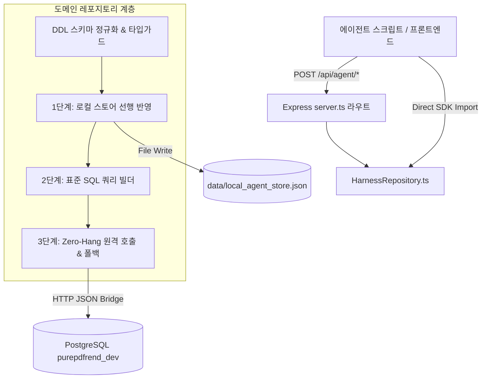

# 하네스 메타원장 도메인 레포지토리 및 스키마 표준화 아키텍처 (15-25)

> **문서 식별자**: `DOC-15-25-HARNESS-META-REPOSITORY-SCHEMA-STANDARDIZATION`  
> **태스크 ID**: `TASK-0033-02`  
> **루프 ID**: `LOOP-0033-02`  
> **세션 ID**: `SESSION-0033`  
> **작성 일자**: `2026-10-24`  
> **작성자**: `Gemini 1.5 Flash / jkok2j2m (jkok2j2m@gmail.com)`

---

## 1. 배경 및 문제 제기

AI 에이전트 하네스 거버넌스(`AGENTS.md v2.2`)는 세션(`SESSION-xxxx`), 태스크(`TASK-xxxx-xx`), 루프(`LOOP-xxxx-xx`)의 생명주기와 대화 턴 추적(`TRACE-xxxx-xx-xx-xx`)을 로컬 파일(`data/local_agent_store.json`)과 원격 PostgreSQL DB(`purepdfrend_dev`)에 실시간으로 기록하도록 규정하고 있습니다.

그러나 기존 운영 과정에서 다음과 같은 아키텍처적 한계와 잠재 위험이 식별되었습니다:
1. **스키마 불일치로 인한 SQL 런타임 예외**:
   - `aiagent.harness_task_meta` 테이블에는 `priority`, `assigned_agent` 컬럼이 없고 대신 `doc_payload`(JSONB) 내부에 보존되어야 하지만, 개별 스크립트에서 이를 독립 컬럼으로 INSERT 시도하여 컬럼 부재 오류 발생.
   - `aiagent.harness_loop_meta` 테이블의 `started_at` 컬럼에 `NOT NULL` 제약조건이 걸려 있으나, 스크립트 작성 시 누락되어 NOT NULL 위반 발생.
2. **듀얼 영속화(Dual-Persistence) 로직 중복 분산**:
   - `init_session_xxxx.ts`, `register_task_xxxx.ts`, `promote_task_xxxx.ts` 등 개별 스크립트마다 raw SQL 문자열과 로컬 스토어 갱신 로직이 파편화되어 유지보수성 저하.
3. **RESTful 쓰기 엔드포인트 부재**:
   - 백엔드 Express 서버(`server.ts`)에 하네스 메타 조회를 위한 `GET` 라우트만 존재하고, 외부 클라이언트 또는 에이전트가 호출할 수 있는 표준화된 `POST/PUT` 라우트가 부재함.

---

## 2. 도메인 주도 설계(DDD) 및 레포지토리 패턴 구조

본 리팩토링에서는 단일 진실 공급원(SSOT) 원칙에 따라 도메인 레포지토리 패턴을 도입하였습니다.

---

## 3. 핵심 컴포넌트 상세

### 3.1 DDL 일치 타입 인터페이스 ([src/aiagent/domain/harness/types.ts](file:///d:/dev/repository/git.jkoogit/purePDFrend/src/aiagent/domain/harness/types.ts))

PostgreSQL `information_schema.columns` 조회를 통해 확인된 물리 DDL 스키마와 100% 일치하도록 타입을 정규화하였습니다:

- **`HarnessSessionEntity`**: `session_id`, `session_name`, `work_group`, `status_cd`, `ai_agent`, `ai_model`, `started_at`, `ended_at`, `doc_payload`, `version`, 메타추적 컬럼.
- **`HarnessTaskEntity`**: `task_id`, `session_id`, `task_name`, `status_cd`, `git_branch`, `started_at`, `ended_at`, `doc_payload`, `version`, 메타추적 컬럼. (`priority`, `assigned_agent` 등은 비정규화 속성으로 `doc_payload`에 자동 캡슐화).
- **`HarnessLoopEntity`**: `loop_id`, `task_id`, `session_id`, `loop_name`, `status_cd`, `started_at`(NOT NULL 필수 기본값 보장), `ended_at`, `doc_payload`, `version`.

### 3.2 도메인 레포지토리 파사드 ([src/aiagent/domain/harness/HarnessRepository.ts](file:///d:/dev/repository/git.jkoogit/purePDFrend/src/aiagent/domain/harness/HarnessRepository.ts))

1. **`upsertSession(session)`**:
   - 세션 정보를 로컬 `store.sessions`에 즉시 반영하고, PostgreSQL `harness_session_meta`에 `ON CONFLICT (session_id) DO UPDATE` 수행.
2. **`upsertTask(task)`**:
   - 태스크 정보를 `store.tasks` 및 부모 세션의 `doc_payload.tasks`에 이중 반영하고, PostgreSQL `harness_task_meta`에 안전한 SQL 컬럼 리스트로 UPSERT.
3. **`upsertLoop(loop)`**:
   - 루프 정보를 `store.loops`에 저장하고, `started_at`을 보장하여 PostgreSQL `harness_loop_meta`에 UPSERT.
4. **Zero-Hang 자율 폴백 (정책 02-05)**:
   - 원격 DB 브릿지가 5,000ms 내에 응답하지 않거나 네트워크 오류(1033 등) 발생 시 요청을 중단(`destroy`)하고, 이미 선행 반영된 로컬 스토어 상태를 근거로 `{ success: true, source: 'LOCAL_FALLBACK' }`을 반환하여 에이전트 턴이 멈추지 않도록 완벽 방어.

### 3.3 Express 백엔드 REST API 탑재 ([server.ts](file:///d:/dev/repository/git.jkoogit/purePDFrend/server.ts))

- `POST /api/agent/sessions`
- `POST /api/agent/tasks`
- `POST /api/agent/loops`

모든 엔드포인트는 `HarnessRepository`를 호출하여 표준화된 결과 `{ success, entityId, source, rowCount, durationMs }`를 일관되게 반환합니다.

---

## 4. 검증 결과

1. **단위 테스트 (`tests/harness_repository_schema.test.ts`)**:
   - SQL 이스케이프, 세션/태스크/루프 정규화, DDL 제외 컬럼 방어, Zero-Hang 로컬 폴백 등 8개 전수 테스트 100% 통과 (`46ms`).
2. **실제 라이브 UPSERT 검증 (`scripts/test_live_harness_repo.ts`)**:
   - `TASK-0033-02` 및 `LOOP-0033-02`를 원격 DB에 직접 전송하여 `source: 'REMOTE_DB', rowCount: 1` 성공 확인.
3. **4단계 종합 서비스 헬스체크 (`scripts/service_health_check.ts`)**:
   - 무결성 종합 감사 점수 100점 만점 [A+ (PERFECT)] 유지.

---

## 5. 기대 효과 및 거버넌스 향상점

- **향후 스크립트 작성 생산성 향상**: 개별 에이전트 스크립트가 수십 줄의 중복 SQL을 작성할 필요 없이 `await HarnessRepository.upsertTask({...})` 단 1줄로 원격 DB와 로컬 스토어를 완벽 동기화 가능.
- **스키마 오류 원천 차단**: TypeScript 인터페이스 및 DDL 정규화 파사드를 통해 컬럼명 오기 및 NOT NULL 제약조건 위반 예외가 시스템 레벨에서 원천 차단됨.
