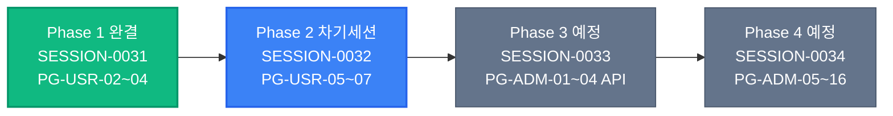

#[0031-09] SESSION-0031 마감 결과 점검 및 디자인 시스템 표준화 차기 세션(0032) 프롬프트 제안

---

### 1. SESSION-0031 세션정리 최종 결과 확인 (AGENTS.md [규칙 3.2-1])

- **세션명**: `[0031] Phase 1 와이어프레임 tokens.ts 대입 및 4모드 고도화` (상태: **`완료`**)
- **원격 레포 이슈 및 PR**: Open Issues **0건**, Open PRs **0건** (100% Closed & Merged)
- **원격 3대 브랜치 일치 상태**: `dev` = `stg` = `main` = `3c26becba60df1aa66f04ad1ce41816405d8a35c` (**100% 일치**)
- **로컬 형상 커밋**: `3656ce02` (15개 파일 +5,832 / -348 라인 형상 무손실 영속화)
- **발행 문서**:
  * 회고록: [13-24_SESSION-261023-0031_세션종합_KPT_회고록.md](file:///d:/dev/repository/git.jkoogit/purePDFrend/docs/13.회고/13-24_SESSION-261023-0031_세션종합_KPT_회고록.md) (`DOC-13-24`)
  * 코드리뷰: [261023_052_Phase1_사용자_와이어프레임_tokens_전면대입_및_4모드_고대비검증_코드리뷰.md](file:///d:/dev/repository/git.jkoogit/purePDFrend/docs/10.리뷰/261023_052_Phase1_사용자_와이어프레임_tokens_전면대입_및_4모드_고대비검증_코드리뷰.md) (`DOC-10-52`)
  * 로드맵: [07-02_화면별_디자인_토큰_적용현황_및_단계별_로드맵.md](file:///d:/dev/repository/git.jkoogit/purePDFrend/docs/07.로드맵/07-02_화면별_디자인_토큰_적용현황_및_단계별_로드맵.md) (v1.1.0 현행화 완결)
- **하네스 무결성**: 4단계 9개 전 항목 합격 (**100점 만점 [A+ (PERFECT)]**)

---

### 2. 디자인 토큰 및 화면 표준화 완료 기준 (Definition of Done)

사용자께서 질의하신 **"디자인 정책 수립과 토큰요소 정립, 화면 표준화 작업"**의 완료 기준은 다음 5대 가드레일로 정의됩니다:

| 가드레일 | 완료 기준 (DoD) | 점검 및 검증 방법 |
| :--- | :--- | :--- |
| **1. 하드코딩 클래스 0건** | Tailwind 임의 다크 클래스(`bg-slate-900`, `border-slate-800` 등) 전면 퇴출 및 `src/styles/tokens.ts`의 `themeClasses` 유틸리티 100% 바인딩 | 소스 코드 정적 검색 및 AST 분석 |
| **2. 4모드 고대비 가독성** | `Light`, `Dark`, `Dawn`, `System` 4개 테마 전환 시 텍스트, 카드 배경, 경계선 명도 대비비 **4.5:1 이상(WCAG AA 준수)** 확보 | 테마 전환 시각 검증 및 쇼케이스 대조 |
| **3. 모바일 터치 타깃** | 버튼, 입력창, 탭 등 모든 주요 대화형 요소에 **`min-h-[44px]`** 최소 터치 영역 필수 적용 | CSS 클래스 및 반응형 검증 |
| **4. Zero-Pill 라운딩 규격** | 아바타/플로팅 칩 외 직사각형 컴포넌트에 알약형(`rounded-full`) 배제, **`rounded-xl`**, **`rounded-2xl`** 사각 라운딩 표준 강제 | 컴포넌트 렌더링 스타일 검증 |
| **5. 빌드 및 거버넌스 100점** | `tsc --noEmit` 0 에러, 단위 테스트 통과, `service_health_check.ts` **100점 만점 [A+ (PERFECT)]** 유지 | 자동화 스크립트 실행 |

---

### 3. 전체 진행 단계 및 현재 작업 방향



1. **Phase 1 (완결, SESSION-0031)**:
   - `PG-USR-02` (로그인/회원가입 Step 1~4), `PG-USR-03` (홈 대시보드 7대 도구 및 7대 인라인 스튜디오), `PG-USR-04` (마이페이지 & 2FA 보안) **tokens.ts 100% 대입 완결**.
2. **Phase 2 (차기 진행 대상, SESSION-0032)**:
   - **`PG-USR-05` (내 문서관리 라이브러리)**: 옵션처리 일체형 팝업, 모바일 카테고리 접힘 배너, 태그 필터 tokens.ts 대입 (현재 90% ➔ 100%).
   - **`PG-USR-06` (대용량 800쪽 가상 뷰어)**: 2단 초슬림 툴바, 좌상단 플로팅 쪽수 칩, 주석 레이어팝업, LRU 캐시 바인딩 tokens.ts 대입 (현재 85% ➔ 100%).
   - **`PG-USR-07` (문서 공유 및 협업)**: 초대 링크 모달, 권한 칩, 실시간 상태표시 tokens.ts 대입 (현재 90% ➔ 100%).
3. **Phase 3 (예정, SESSION-0033)**:
   - 관리자 1단계 핵심 4대 화면(`PG-ADM-01~04`) 통합 디자인 토큰 정합성 검증 및 실제 Express/PostgreSQL 백엔드 REST API 연동.
4. **Phase 4 (예정, SESSION-0034)**:
   - 관리자 2단계 12대 화면(`PG-ADM-05~16`) 컴포넌트 풀 정합성 및 25개 전 화면 크로스 브라우징/E2E 검증.

---

### 4. 차기 세션(`SESSION-0032`) 시작 프롬프트 제안 (AGENTS.md [규칙 3.2-2])

새로운 세션 대화창에서 바로 복사하여 실행할 수 있도록 컨텍스트와 참조 문서가 완비된 최적화 프롬프트를 제시합니다:

```bash
#세션시작 [0032] Phase 2 사용자 와이어프레임(PG-USR-05~07) tokens.ts 전면 대입 및 가상뷰어·문서관리 4모드 고대비 표준화

[작업 세션 컨텍스트]
- 작업자: jkok2j2m (jkok2j2m@gmail.com)
- 추천 모델: Gemini 1.5 Flash (Tier 2, RPD 2,500회 무중단 모드)
- 직전 세션 기준 SHA: 3c26becba60df1aa66f04ad1ce41816405d8a35c (dev/stg/main 100% 일치)
- 핵심 참조 문서:
  * docs/07.로드맵/07-02_화면별_디자인_토큰_적용현황_및_단계별_로드맵.md (v1.1.0)
  * docs/13.회고/13-24_SESSION-261023-0031_세션종합_KPT_회고록.md
  * docs/10.리뷰/261023_052_Phase1_사용자_와이어프레임_tokens_전면대입_및_4모드_고대비검증_코드리뷰.md
  * docs/03.정책/03-23_통합_디자인시스템_및_기준요소_UI_표준가이드.md
  * src/styles/tokens.ts
  * src/ppdf/views/wireframes/UserWireframes.tsx
- 주요 작업 목표:
  1. 원격 dev 최신 커밋 자동 풀(npx tsx scripts/pull_remote_dev.ts) 및 샌드박스 동기화
  2. 로드맵 07-02 기반 Phase 2 대상 화면(PG-USR-05 내 문서관리, PG-USR-06 800쪽 가상뷰어, PG-USR-07 협업/주석)의 하드코딩 인라인 스타일을 tokens.ts 유틸리티로 전면 전환 (대입률 100% 달성)
  3. 4모드(Light, Dark, Dawn, System) 테마 스위칭 시 고대비 가독성 및 44px 모바일 최소 터치 타깃, Zero-Pill 사각 라운딩 표준 준수
  4. 단위 테스트(tests/wireframe_shells_and_tokens.test.ts) 및 4단계 서비스 전수점검 100점 만점 [A+ (PERFECT)] 무결성 검증
```
