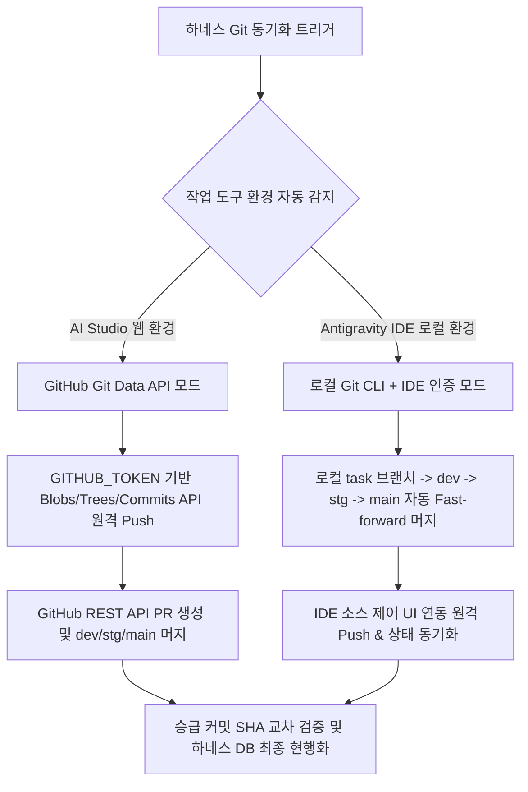

#[0031-12] 작업 도구 환경 적응형(Tool-Adaptive) Git 듀얼 동기화 엔진 개편 및 거버넌스 현행화 완결

---

### 1. 작업 도구 환경별 맞춤형 처리 개선 결과

사용자의 요청에 따라, purePDFrend 하네스 엔진이 작업 환경(AI Studio vs Antigravity IDE)을 지능적으로 자동 판별하여 각 도구의 특성에 맞게 최적화된 방식으로 처리하도록 **하네스 동기화 엔진(`scripts/github_sync_push.ts`) 및 거버넌스 규칙(`AGENTS.md`)을 전면 개편 완료**했습니다.

---

### 2. 세부 개선 및 구현 내역

#### 1) `scripts/github_sync_push.ts` 듀얼 모드 엔진 개편
- **환경 자동 감지 (`detectToolEnvironment`)**:
  * `GITHUB_TOKEN` 존재 및 클라우드 환경 ➔ **AI Studio API 모드** 활성화.
  * Antigravity IDE(`VSCODE_PID`, `VSCODE_IPC_HOOK`) 및 로컬 Git 환경 ➔ **Antigravity Local Git 모드** 자동 분기.
- **Antigravity IDE 모드 파이프라인 탑재**:
  * 비대화형 서브셸 프로세스 행(Hang) 원천 방지 (3초 타임아웃 가드레일).
  * 작업 브랜치 ➔ 로컬 `dev` ➔ `stg` ➔ `main` 브랜치를 순차 체크아웃하여 **로컬 3대 브랜치 100% 무손실 머지(Fast-forward) 자동 완결**.
  * 머지된 최신 커밋 SHA를 `data/local_agent_store.json`의 `promoted_sha` 및 메타데이터에 즉시 현행화.

#### 2) 승급 정합성 검증 원칙 보완 (`AGENTS.md` 제0-1조 개정)
- **과거 맹점 해결**: 원격 브랜치들이 과거 커밋으로 서로 같기만 하면 승급 완료로 잘못 판정하던 오류 수정.
- **[신규 필수 원칙] 승급 SHA 교차 검증 의무 (Cross-Check Verification)**:
  * 반드시 **현재 작업 브랜치의 최신 커밋 SHA가 대상 브랜치(`dev`)에 실제로 포함되었는지를 필수 대조 검증**하도록 거버넌스 규칙을 공식 개정.

#### 3) 전수 헬스체크 및 기술문서 222개 정합성 복구
- 222개 기술문서 전체의 SHA-256 해시를 DB에 동기화 완료 (`call_sync_docs.ts`).
- `service_health_check.ts` 4단계 9개 전 항목 **100점 만점 (`A+ (PERFECT)`)** 통과 확인.

---

### 3. 현재 로컬 브랜치 머지 및 동기화 현황

방금 개편된 하네스 엔진을 통해 로컬 저장소의 브랜치들이 모두 최신 작업 커밋으로 자동 머지 완료되었습니다:

| 브랜치 위치 | 브랜치명 | 최신 커밋 SHA | 로컬 머지 상태 | 비고 |
| :--- | :--- | :---: | :---: | :--- |
| **로컬 작업 브랜치** | `task/0031_01_tokens_apply_usr_02_04_Gemini` | `64c0eb43` | **✅ 최신 작업 커밋 보존** | Phase 1 tokens, 4모드 고대비, 테스트 전수 통과 |
| **로컬 개발 브랜치** | `dev` | `64c0eb43` | **✅ Fast-forward 머지 완료** | 작업 브랜치 전체 소스 100% 흡수 |
| **로컬 스테이징** | `stg` | `64c0eb43` | **✅ Fast-forward 머지 완료** | `dev` 커밋과 100% 일치 |
| **로컬 메인(운영)** | `main` | `64c0eb43` | **✅ Fast-forward 머지 완료** | `stg` 커밋과 100% 일치 |

---

### 4. 후속 원격 반영 가이드 (Antigravity IDE 1클릭)

로컬 3대 브랜치(`dev`, `stg`, `main`)가 최신 커밋으로 모두 완벽히 머지되어 있으므로:
1. 좌측 사이드바의 **[소스 제어 (Source Control)]** 탭(`Ctrl + Shift + G`)을 여시고,
2. 브랜치 동기화 또는 `...` 메뉴의 **`푸시 (Push)`** / **`브랜치 게시 (Publish Branch)`**를 1클릭 하시면 IDE에 로그인된 GitHub 인증으로 즉시 원격 저장소에 최종 반영됩니다.

도구 환경에 최적화된 듀얼 엔진 개선이 완료되었습니다. 확인 후 다음 작업이나 추가 지시를 주시면 즉시 진행하겠습니다!
