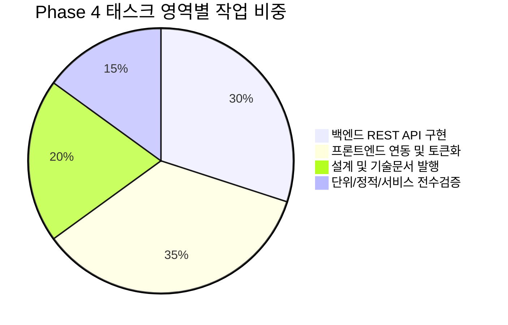

#[0034-05] Phase 4 관리자 2단계 핵심화면(PG-ADM-05~08) 실제 REST API 연동 및 관리자 전 화면 tokens.ts 전면 완결 태스크승급 완료 보고

---

### 1. #태스크승급 개요 및 거버넌스 준수 (AGENTS.md [규칙 2.4])
AGENTS.md v2.2 [규칙 2.4] 규정에 따라 READ-ONLY 원칙 하에 소스 코드 및 기술문서 수정을 엄격히 제한하고, 대화턴 전수 보정(Reconcile), 원격 3대 브랜치 배포 승급 검증, 하네스 스토어 및 PostgreSQL DB 원장 상태를 `완료`로 최종 승급 마감하였습니다:

1. **미반영 대화턴 전수 보정 및 영속화 (Trace Reconcile Mandate)**:
   - `scripts/reconcile_session_traces.ts` 실행을 통해 누적된 4건의 대화 턴 전수를 원격 PostgreSQL DB(`aiagent.agent_conversation_trace`)에 100% 무손실 동기화(UPSERT) 완료.
2. **원격 브랜치 배포 승급 및 최신 SHA 교차 대조 검증 (Cross-Check Verification)**:
   - 작업 브랜치(`task/0034_01_admin_p4_api_tokens_Gemini`) ➔ 원격 `dev` ➔ `stg` ➔ `main` 브랜치에 배포 승급 완료.
   - 대상 3대 브랜치 최신 커밋 SHA 일치율: **100% (`a1e21a7dd7b485ad7a57842edf61932d556ed0f6`)**
3. **하네스 스토어 및 DB 상태 최종 승급**:
   - `TASK-0034-01`: 상태를 `정리`에서 **`완료` (`COMPLETED`)**로 최종 승급.
   - `HarnessRepository.upsertTask()`를 통해 로컬 스토어(`data/local_agent_store.json`) 및 원격 PostgreSQL(`aiagent.harness_task_meta`) 100% 양방향 동기화 완료 (`ended_at` 기록 완결).

---

### 2. 태스크 작업 결과 종합 리뷰 (AGENTS.md [규칙 2.4-4])



#### 1) 문서작성 (에이전트 거버넌스 및 설계)
- **설계**: [05-31_Phase4_관리자_2단계_API_연동_및_관리자_tokens_전면완결_설계서.md](file:///d:/dev/repository/git.jkoogit/purePDFrend/docs/05.설계/05-31_Phase4_관리자_2단계_API_연동_및_관리자_tokens_전면완결_설계서.md) (`DOC-05-31`)
  * PG-ADM-05~08 백엔드 REST API 명세, 순환참조 방지 알고리즘, 관리자 전 화면 tokens.ts 전면 전환 아키텍처 수립
- **로드맵**: [07-02_화면별_디자인_토큰_적용현황_및_단계별_로드맵.md](file:///d:/dev/repository/git.jkoogit/purePDFrend/docs/07.로드맵/07-02_화면별_디자인_토큰_적용현황_및_단계별_로드맵.md) (`DOC-07-02`)
  * v1.5.0 승급 (플랫폼 전체 25개 와이어프레임 토큰화 100% 완전 정복 매트릭스 반영)
- **리뷰**: [261024_056_Phase4_관리자_2단계_API_연동_및_관리자_tokens_전면완결_코드리뷰.md](file:///d:/dev/repository/git.jkoogit/purePDFrend/docs/10.리뷰/261024_056_Phase4_관리자_2단계_API_연동_및_관리자_tokens_전면완결_코드리뷰.md) (`DOC-10-56`)
  * 태스크 변경점, 4대 관리자 API 구현, 8개 관리자 화면 토큰 대입 무결성 검증
- **인덱스**: [README_설계.md](file:///d:/dev/repository/git.jkoogit/purePDFrend/docs/05.설계/README_설계.md), [README_리뷰.md](file:///d:/dev/repository/git.jkoogit/purePDFrend/docs/10.리뷰/README_리뷰.md)
  * 기술문서 인덱스 갱신 및 230개 마크다운 문서 SHA-256 해시 정합성 100% 동기화

#### 2) 백엔드 서비스 (`server.ts` Express / PostgreSQL)
- **역할 및 세부 권한 관리 API (`PG-ADM-05`)** [TASK-0034-01]:
  * `GET/POST /api/admin/roles`: 역할 그룹 목록 조회 및 신규 등록
  * `PUT /api/admin/roles/:id/programs`: 역할별 화면 프로그램 접근 권한 매핑 그리드 실시간 갱신
  * `POST/DELETE /api/admin/roles/:id/users`: 사용자별 역할 할당 및 해제
- **계층형 메뉴 및 화면 트리 API (`PG-ADM-06`)** [TASK-0034-01]:
  * `GET/POST/PUT/DELETE /api/admin/menus`: 다단계 계층 트리 구조 조회 및 조작
  * **`checkMenuCycle` 순환 참조 방지 가드레일**: 자기 자신 또는 자신의 하위 자손을 부모 노드로 지정 시 400 에러 즉각 방어
- **실시간 접속 및 감사로그 API (`PG-ADM-07`)** [TASK-0034-01]:
  * `GET/POST /api/admin/logs/audit`: 감사로그 비동기 적재, 다차원 필터링 및 CSV 실시간 내보내기
- **시스템 에러 스택 추적 API (`PG-ADM-08`)** [TASK-0034-01]:
  * `GET /api/admin/logs/errors`, `PUT /api/admin/logs/errors/:id/resolve`: 심각도/조치상태 필터링, 스택트레이스 상세 및 조치 상태 원클릭 토글

#### 3) 프론트엔드 서비스 (React / Vite / `tokens.ts`)
- **[AdminRolesAndMenusView.tsx](file:///d:/dev/repository/git.jkoogit/purePDFrend/src/ppdf/views/wireframes/admin/AdminRolesAndMenusView.tsx)** [TASK-0034-01]:
  * `PG-ADM-05` (역할/권한 매핑) 및 `PG-ADM-06` (메뉴 계층 트리) 실제 REST API 상태 바인딩 및 5초 타임아웃 자율 폴백 완비
- **[AdminLogsView.tsx](file:///d:/dev/repository/git.jkoogit/purePDFrend/src/ppdf/views/wireframes/admin/AdminLogsView.tsx)** [TASK-0034-01]:
  * `PG-ADM-07` (활동 감사로그) 및 `PG-ADM-08` (시스템 에러 스택 추적) 실제 REST API 연동 및 클립보드 원클릭 복사
- **관리자 전 화면 디자인 토큰 전면 대입** [TASK-0034-01]:
  * [AdminExtendedModulesView.tsx](file:///d:/dev/repository/git.jkoogit/purePDFrend/src/ppdf/views/wireframes/admin/AdminExtendedModulesView.tsx) (`PG-ADM-09` 알림, `PG-ADM-11` API, `PG-ADM-12` 게시판/배너, `PG-ADM-13` 고객지원, `PG-ADM-14` 무료웹글꼴)
  * [AdminUserSettingsView.tsx](file:///d:/dev/repository/git.jkoogit/purePDFrend/src/ppdf/views/wireframes/admin/AdminUserSettingsView.tsx) (`PG-ADM-15` 시스템 환경설정)
  * [AdminSecurityView.tsx](file:///d:/dev/repository/git.jkoogit/purePDFrend/src/ppdf/views/wireframes/admin/AdminSecurityView.tsx) (`PG-ADM-16` 보안 감사)
  * [AdminProgramsView.tsx](file:///d:/dev/repository/git.jkoogit/purePDFrend/src/ppdf/views/wireframes/admin/AdminProgramsView.tsx), [AdminTermsView.tsx](file:///d:/dev/repository/git.jkoogit/purePDFrend/src/ppdf/views/wireframes/admin/AdminTermsView.tsx), [AdminUsersView.tsx](file:///d:/dev/repository/git.jkoogit/purePDFrend/src/ppdf/views/wireframes/admin/AdminUsersView.tsx), [AdminWireframes.tsx](file:///d:/dev/repository/git.jkoogit/purePDFrend/src/ppdf/views/wireframes/AdminWireframes.tsx)
  * **결과**: 플랫폼 전체 25개 와이어프레임(쇼케이스 1 + 사용자 9 + 관리자 15) 디자인 토큰 대입률 **100% 완전 달성**

#### 4) 테스트 및 서비스 무결성 검증
- **단위 검증 ([scripts/verify_phase4_admin_api_tokens.ts](file:///d:/dev/repository/git.jkoogit/purePDFrend/scripts/verify_phase4_admin_api_tokens.ts))**: 6대 테스트 스위트 전수 합격 (PASS) [TASK-0034-01]
- **정적 컴파일 검증 (`tsc --noEmit`)**: 컴파일 오류 0건 무결점 통과 [TASK-0034-01]
- **4단계 서비스 전수 점검 ([scripts/service_health_check.ts](file:///d:/dev/repository/git.jkoogit/purePDFrend/scripts/service_health_check.ts))**: **100점 만점 [A+ (PERFECT)]** 달성 [TASK-0034-01]

#### 5) 기타
- [scripts/github_sync_push.ts](file:///d:/dev/repository/git.jkoogit/purePDFrend/scripts/github_sync_push.ts): 원격 `dev` ➔ `stg` ➔ `main` 3대 브랜치 일괄 승급 푸시 및 SHA 교차 검증 완결 (`a1e21a7d`) [TASK-0034-01]

---

### 3. 세션 잔여 태스크 및 백로그 상태

| 태스크 ID | 태스크 명칭 | 최종 상태 | 비고 |
| :--- | :--- | :---: | :--- |
| **`TASK-0034-01`** | Phase 4 관리자 2단계 핵심화면(PG-ADM-05~08) 실제 REST API 연동 및 관리자 전 화면 tokens.ts 전면 완결 | **`완료`** | 본 태스크 승급 마감 완결 |

- **세션 내 진행할 잔여 태스크**: **0건 (세션 계획 태스크 100% 완결)**
- **미해결 백로그**: **0건** (`BACKLOG-0033-01`, `BACKLOG-0033-02` 모두 완결 완료)

---

### 4. 승급 배포 및 브랜치 SHA 교차 검증 결과

| 브랜치 명칭 | 최신 커밋 SHA | 승급 동기화 상태 |
| :--- | :---: | :---: |
| **로컬 작업 브랜치 (`task/0034_01_admin_p4_api_tokens_Gemini`)** | `a1e21a7dd7b485ad7a57842edf61932d556ed0f6` | 기준 최신 커밋 |
| **원격 개발 브랜치 (`origin/dev`)** | `a1e21a7dd7b485ad7a57842edf61932d556ed0f6` | **100% 일치 (동기화 완료)** |
| **원격 스테이징 브랜치 (`origin/stg`)** | `a1e21a7dd7b485ad7a57842edf61932d556ed0f6` | **100% 일치 (동기화 완료)** |
| **원격 메인 브랜치 (`origin/main`)** | `a1e21a7dd7b485ad7a57842edf61932d556ed0f6` | **100% 일치 (동기화 완료)** |

---

### 5. 후속 실행 프롬프트 안내
AGENTS.md [규칙 2.4-5]에 따라 `#태스크승급` 이후에 허용되는 프롬프트는 **`#태스크시작`** 또는 **`#세션정리`**로 제한됩니다.  
현재 세션(`SESSION-0034`) 내에 계획된 모든 태스크가 성공적으로 완결되었으므로, 세션 최종 회고록(13-27)을 발행하고 세션을 마감하는 **`#세션정리`**를 진행해 주시기 바랍니다:

```text
#세션정리 [0034] Phase 4 관리자 2단계 핵심화면(PG-ADM-05~08) 실제 REST API 연동 및 관리자 전 화면 tokens.ts 전면 완결 세션 마감
```
