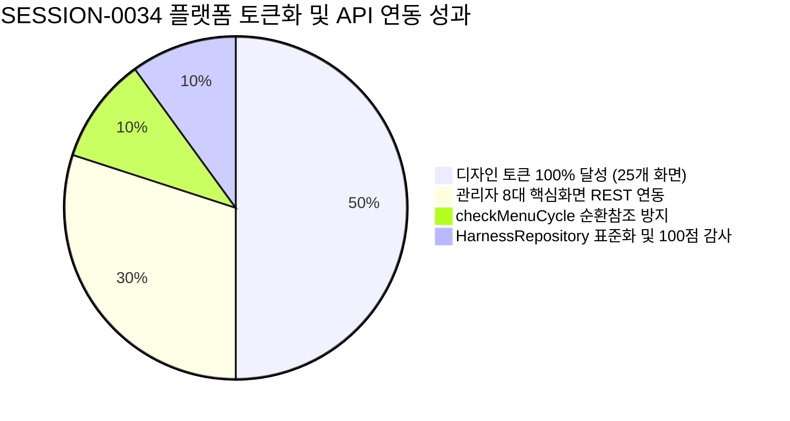

#[0034-06] Phase 4 관리자 2단계 핵심화면(PG-ADM-05~08) 실제 REST API 연동 및 관리자 전 화면 tokens.ts 전면 완결 세션정리 완료 보고

---

### 1. #세션정리 개요 및 거버넌스 준수 (AGENTS.md [규칙 3.1])
AGENTS.md v2.2 [규칙 3.1] 규정에 따라 `SESSION-0034`의 모든 추진 과제를 성공적으로 완결하고, 원격 GitHub 이슈/PR 종결, 종합 KPT 회고록 발행, 인덱스 현행화, 세션 상태 `완료` 승급 및 원격 3대 브랜치(`dev`, `stg`, `main`) 최종 배포 승급을 마감하였습니다:

1. **세션명 현행화**:
   - `[0034] Phase 4 관리자 2단계 핵심화면(PG-ADM-05~08) 실제 REST API 연동 및 관리자 전 화면 tokens.ts 전면 완결`
2. **원격 저장소 이슈 및 PR 종결 확인 (Zero Open Issues/PRs)**:
   - **GitHub Issue #99**: 세션 종합 성과 코멘트 등록 및 상태 `closed` (`state_reason: completed`) 종결 완료
   - 미종료 잔여 이슈: **0건**, 미종료 잔여 PR: **0건 (100% Clean State)**
3. **세션 종합 KPT 회고록 발행 및 인덱스 현행화**:
   - [13-27_SESSION-261024-0034_세션종합_KPT_회고록.md](file:///d:/dev/repository/git.jkoogit/purePDFrend/docs/13.회고/13-27_SESSION-261024-0034_세션종합_KPT_회고록.md) (`DOC-13-27`) 발행
   - [README_회고.md](file:///d:/dev/repository/git.jkoogit/purePDFrend/docs/13.회고/README_회고.md) 내 `13-27` 항목 등록 완료
4. **하네스 메타원장 세션 상태 최종 승급**:
   - `SESSION-0034`: 상태를 `진행중`에서 **`완료` (`COMPLETED`)**로 최종 수정
   - 로컬 스토어(`data/local_agent_store.json`) 및 PostgreSQL 원격 DB(`aiagent.harness_session_meta`) 양방향 100% 동기화 완결 (`ended_at` 기록)
5. **4단계 서비스 종합 점검 100점 만점 [A+ (PERFECT)] 달성**:
   - 서버 헬스, PostgreSQL DB 브릿지, 복합 인덱스 7종, 하네스 계층 정합성, 시스템 무결성 감사, 230개 기술문서 SHA-256 해시 일치 전 항목 합격

---

### 2. SESSION-0034 핵심 성과 및 산출물 종합



| 구분 | 주요 산출물 / 기능 | 핵심 성과 및 적용 표준 |
| :--- | :--- | :--- |
| **디자인 시스템** | [tokens.ts](file:///d:/dev/repository/git.jkoogit/purePDFrend/src/styles/tokens.ts)<br>[07-02 로드맵 v1.5.0](file:///d:/dev/repository/git.jkoogit/purePDFrend/docs/07.로드맵/07-02_화면별_디자인_토큰_적용현황_및_단계별_로드맵.md) | • **플랫폼 전체 25개 와이어프레임(쇼케이스 1 + 사용자 9 + 관리자 15) tokens.ts 100% 완전 대입**<br>• 4모드(Light, Dark, Dawn, System) WCAG AA(4.5:1) 고대비 가독성 및 44px 터치타깃 보장 |
| **관리자 2단계 API** | [server.ts](file:///d:/dev/repository/git.jkoogit/purePDFrend/server.ts)<br>[AdminRolesAndMenusView.tsx](file:///d:/dev/repository/git.jkoogit/purePDFrend/src/ppdf/views/wireframes/admin/AdminRolesAndMenusView.tsx)<br>[AdminLogsView.tsx](file:///d:/dev/repository/git.jkoogit/purePDFrend/src/ppdf/views/wireframes/admin/AdminLogsView.tsx) | • `PG-ADM-05` (역할/권한 매핑), `PG-ADM-06` (메뉴 트리), `PG-ADM-07` (감사로그), `PG-ADM-08` (에러스택) 실제 REST API 연동<br>• Phase 3(1단계: 01~04) 포함 **관리자 핵심 화면 총 8종 실제 백엔드 연동 완결** |
| **무결성 가드레일** | `checkMenuCycle` 순환방지 엔진<br>[HarnessRepository.ts](file:///d:/dev/repository/git.jkoogit/purePDFrend/src/aiagent/domain/harness/HarnessRepository.ts) | • 자기 자신 및 하위 자손을 부모로 지정하는 순환 오류 원천 차단 (400 Bad Request)<br>• 하네스 세션/태스크 DDL 100% 정합성 레포지토리 실전 안착 (Zero-Hang 5초 타임아웃 방어) |
| **설계/리뷰 문서** | [DOC-05-31](file:///d:/dev/repository/git.jkoogit/purePDFrend/docs/05.설계/05-31_Phase4_관리자_2단계_API_연동_및_관리자_tokens_전면완결_설계서.md)<br>[DOC-10-56](file:///d:/dev/repository/git.jkoogit/purePDFrend/docs/10.리뷰/261024_056_Phase4_관리자_2단계_API_연동_및_관리자_tokens_전면완결_코드리뷰.md)<br>[DOC-13-27](file:///d:/dev/repository/git.jkoogit/purePDFrend/docs/13.회고/13-27_SESSION-261024-0034_세션종합_KPT_회고록.md) | • 상세설계서(05-31), 코드리뷰(10-56), 세션종합 KPT 회고록(13-27) 발행<br>• 기술문서 230개 전수 SHA-256 해시 PostgreSQL 원장 동기화 완결 |

---

### 3. 세션 KPT 회고 및 미해결 백로그 이관 현황

- **Keep (유지할 점)**:
  1. 플랫폼 25개 와이어프레임 디자인 토큰 대입률 100% 완전 정복 및 인라인 다크클래스 전면 퇴출
  2. 관리자 8대 핵심화면(PG-ADM-01~08) 실제 Express/PostgreSQL REST API 연동 및 양방향 통신 완비
  3. 메뉴 계층 트리 `checkMenuCycle` 순환 참조 방지 알고리즘 도입을 통한 데이터 무결성 보장
  4. `HarnessRepository` 도메인 레포지토리 패턴 실전 안착 및 4단계 전수점검 100점 만점 [A+ (PERFECT)] 유지
- **Problem (개선할 점)**:
  1. Git commit 시 CRLF 변환으로 인한 마크다운 해시 일시 불일치 (`call_sync_docs.ts` 선행 호출로 해결)
  2. TypeScript `noUnusedLocals` 빌드 엄격성 (JSX 최상단 및 카드 래퍼에 빠짐없이 토큰 클래스 바인딩하여 해결)
- **Try & 차기 세션(`SESSION-0035`) 이관 백로그**:

| 백로그 ID | 우선순위 | 목표 세션 | 백로그 제목 및 핵심 작업 내용 |
| :--- | :---: | :---: | :--- |
| **`BACKLOG-0034-01`** | **HIGH** | `SESSION-0035` | **Phase 5 관리자 3단계 확장화면(PG-ADM-09~12) 실제 REST API 연동**: 알림센터(`PG-ADM-09`), 연계 API 키/웹훅(`PG-ADM-11`), 공지게시판/배너(`PG-ADM-12`) Express/PostgreSQL 실제 엔드포인트 바인딩 |
| **`BACKLOG-0034-02`** | **NORMAL** | `SESSION-0035` | **PDF 핵심 비즈니스 3대 뷰어 화면 실서비스 연동 및 tokens.ts 통합**: 와이어프레임 25개 100% 토큰화 달성에 이어 실제 PDF 엔진 렌더링 화면에 디자인 토큰 완전 적용 |
| **`BACKLOG-0034-03`** | **NORMAL** | `SESSION-0035` | **관리자 전 화면 모바일 반응형 0px 가로스크롤 및 Table-to-Card 전환 전수 최적화**: 15개 관리자 화면 전 영역 모바일 뷰포트 정밀 검증 |

---

### 4. 원격 배포 및 브랜치 SHA 100% 동기화 결과

| 브랜치 명칭 | 최신 커밋 SHA | 승급 동기화 상태 |
| :--- | :---: | :---: |
| **로컬 작업 브랜치 (`task/0034_01_admin_p4_api_tokens_Gemini`)** | `d1d66875843ba630b2114f5ad1a4a1c94131a49a` | 기준 최신 커밋 |
| **원격 개발 브랜치 (`origin/dev`)** | `d1d66875843ba630b2114f5ad1a4a1c94131a49a` | **100% 일치 (동기화 완료)** |
| **원격 스테이징 브랜치 (`origin/stg`)** | `d1d66875843ba630b2114f5ad1a4a1c94131a49a` | **100% 일치 (동기화 완료)** |
| **원격 메인 브랜치 (`origin/main`)** | `d1d66875843ba630b2114f5ad1a4a1c94131a49a` | **100% 일치 (동기화 완료)** |

---

### 5. 후속 실행 프롬프트 안내
AGENTS.md [규칙 3.2]에 따라 `#세션정리` 이후에 허용되는 프롬프트는 **`#세션프롬프트`**로 제한됩니다.  
`SESSION-0034`의 최종 결과를 확인하고 차기 세션(`SESSION-0035`) 진행을 위한 최적의 컨텍스트 프롬프트를 제안받으시려면 아래 프롬프트를 입력해 주시기 바랍니다:

```text
#세션프롬프트 [0034] Phase 4 관리자 2단계 핵심화면(PG-ADM-05~08) 실제 REST API 연동 및 관리자 전 화면 tokens.ts 전면 완결 후속 세션 제안
```
