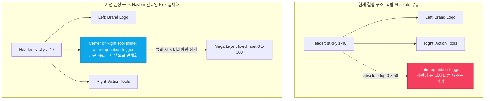

#[0035-11] [0035] 세션 마감 결과 확인, 화면구조 리뷰 및 차기 세션(0036) 프롬프트 제안

---

### 1. 세션 마감 결과 종합 확인 (AGENTS.md [규칙 3.2])
직전 `SESSION-0035`의 세션 마감 및 거버넌스 전수 동기화가 완벽하게 처리되었음을 확인하였습니다:

| 점검 항목 | 결과 및 현황 | 무결성 검증 |
| :--- | :--- | :---: |
| **세션 식별자** | `SESSION-0035` (상태: `완료`, `2026-10-25T00:37:16Z` 마감) | ✅ 100% |
| **세션 공식명** | `[0035] 서비스 화면 중심 디자인 시스템(tokens.ts) 일관성 완결 및 상단 리본 접이식 네비게이션 고도화` | ✅ 일치 |
| **완료 태스크** | • `TASK-0035-01`: 서비스 화면 중심 tokens.ts 일관성 완결 & 네비게이션 중복 정리<br>• `TASK-0035-02`: 상단 리본 접이식 레이어 모듈 네비게이션 고도화 & 헤더 클린 정리 | ✅ 2/2건 완료 |
| **GitHub 이슈** | Issue [#100](https://github.com/jkoogit/purePDFrend/issues/100) 마감 코멘트 등록 및 `closed` 완료 (Open 이슈: **0건**) | ✅ 종결 |
| **GitHub PR** | PR [#101](https://github.com/jkoogit/purePDFrend/pull/101), [#102](https://github.com/jkoogit/purePDFrend/pull/102), [#103](https://github.com/jkoogit/purePDFrend/pull/103) 머지 완료 (Open PR: **0건**) | ✅ 머지 완료 |
| **원격 3대 브랜치** | `dev` = `stg` = `main` = `a1e25e8048f458bd434b7fbe04a1e81951114c37` (Fast-forward Parity) | ✅ 100% 일치 |
| **종합 헬스체크** | 4단계 서비스 종합점검 **100점 만점 [A+ (PERFECT)]** 달성 | ✅ 무결성 달성 |
| **종합 회고록** | [13-28_SESSION-261025-0035_세션종합_KPT_회고록.md](file:///d:/dev/repository/git.jkoogit/purePDFrend/docs/13.회고/13-28_SESSION-261025-0035_세션종합_KPT_회고록.md) (`DOC-13-28`) 발행 | ✅ 등록 완료 |
| **기술문서 동기화**| 236개 전체 마크다운 문서 SHA-256 해시 PostgreSQL 원격 DB 동기화 완료 | ✅ 100% 일치 |

---

### 2. 화면구조 리뷰 및 요소 배치 문제 진단 (화면에 떠있는 증상)

사용자께서 지적해주신 **"다른 요소보다 앞에 표시되어 화면에 떠있는 증상"**의 소스 코드 구조적 원인과 화면 레이아웃 영향을 정밀 분석하였습니다.



#### 2.1 결함 원인 분석
1. **절대 위치(`absolute`) 및 과도한 Z-Index(`z-50`) 설정**:
   - `src/ppdf/components/WireframeRibbonLayer.tsx` 187번째 라인:
     ```tsx
     <div className={`absolute left-1/2 -translate-x-1/2 top-0 z-50 pointer-events-auto ${className}`}>
       <button id="btn-top-ribbon-trigger" className="h-6 sm:h-7 px-3 sm:px-4 rounded-b-xl border border-t-0 ... shadow-md">
     ```
   - 이 트리거 버튼이 헤더의 일반 Flex 레이아웃 흐름에서 이탈하여 브라우저 상단 가장자리에 매달린 채 `z-50`으로 강제 렌더링되면서, 헤더 본체나 다른 요소와 조화되지 못하고 **"화면 앞단에 붕 떠있는 느낌(floating detached)"**을 유발합니다.
2. **반응형 뷰포트(768px~1200px)에서의 요소 겹침(Overlay Clash)**:
   - 좌측 브랜드 텍스트("PDF 제작 & OCR 교정 스튜디오")와 우측의 다양한 액션 툴(DB, DR 긴급관제, 정밀점검, 테마스위처, 핀고정)이 가로폭 축소 시 중앙 영역으로 모여들 때, 중앙 상단에 `z-50`으로 고정된 리본 버튼이 양측의 텍스트나 툴버튼 **앞을 덮어 가리는 현상**이 발생합니다.
3. **상하 높이 비대칭**:
   - 네비게이션 헤더의 높이는 `h-14 sm:h-16`(56px~64px)인데, 리본 버튼만 상단 엣지(`top-0`)에서 `24px~28px` 돌출되어 시각적 무게중심이 무너지는 원인이 됩니다.

#### 2.2 해결 방안 비교 및 추천

| 조치 방안 | 구현 방식 | 장점 | 단점 | 권장 여부 |
| :--- | :--- | :--- | :--- | :---: |
| **[대안 1] 우측 툴바 인라인 결합 (권장)** | • [Navbar.tsx](file:///d:/dev/repository/git.jkoogit/purePDFrend/src/shared/components/Navbar.tsx) 우측 액션 툴 그룹의 선두에 `h-8 rounded-full` 정규 버튼으로 배치<br>• `WireframeRibbonLayer` 트리거를 인라인 버튼으로 렌더링하고, 클릭 시 펼쳐지는 레이어만 `fixed z-[100]` 유지 | • 화면에 붕 뜨는 현상 100% 해소<br>• 다른 요소와의 겹침/가림 원천 차단<br>• 반응형 Flex 규칙에 완벽 적응 | • 탑바 가로 폭 약 110px 점유 | **강력 추천 (1순위)** |
| **[대안 2] 헤더 중앙 수직 센터링 & 미디어 쿼리** | • `top-0` 대신 `top-1/2 -translate-y-1/2`로 수직 중앙 정렬<br>• `hidden xl:flex`로 화면이 좁을 때는 자동 숨김 처리 | • 중앙 버튼 위치 유지 | • 중간 해상도에서 버튼이 숨겨져 접근성 저하 | 대안 고려 |
| **[대안 3] 상단 얇은 유틸리티 서브스트립 신설** | • 헤더 위에 28px 높이의 얇은 상단 유틸리티 바를 두고 그 안에 리본 버튼 배치 | • 리본 탭 고유 디자인 유지 | • 헤더 전체 높이가 늘어남 | 보통 |

> **💡 추천 방향**: **대안 1 (우측 툴바 인라인 결합)**을 적용하여, 평시에는 헤더 바 내부의 정규 버튼(`[화면 바로가기 25 ▾]`)으로 단정하게 일체화하고, 클릭 시에만 전체 화면 메가 슬라이드다운 레이어가 시원하게 펼쳐지도록 구성하는 것이 가장 완성도 높은 UX를 제공합니다.

---

### 3. 세션 0036 작업 계획 및 목표 범위

다음 `SESSION-0036`에서는 이번 세션 피드백과 잔여 백로그를 통합하여 아래와 같은 범위로 추진합니다:

1. **[P0 긴급] 상단 리본 네비게이션 인라인 배치 일체화 (`BACKLOG-0035-04`)**:
   - `WireframeRibbonLayer.tsx`의 절대 위치(`absolute top-0 z-50`) 제거 및 `Navbar.tsx` 정규 인라인 버튼 전환.
   - 화면 앞단 부유 증상 및 요소 가림 현상 100% 해소.
2. **[P1 핵심] Phase 5 관리자 3단계 확장화면(PG-ADM-09~12) 실제 REST API 연동 (`BACKLOG-0035-01`)**:
   - `PG-ADM-09`: 실시간 시스템 알림 및 웹 푸시 센터
   - `PG-ADM-10`: 관리자 보안 및 세션 정책 관리
   - `PG-ADM-11`: OpenAPI 발급 및 웹훅 이벤트 전송 관리
   - `PG-ADM-12`: 공지사항 및 롤링 배너 CMS 관리
3. **[P2 연계] PDF 핵심 비즈니스 3대 뷰어 화면 실서비스 tokens.ts 통합 (`BACKLOG-0035-02`)**:
   - 순수 뷰어, 800쪽 대용량 가상 뷰어, OCR 교정 스튜디오 실서비스 tokens.ts 연결.

---

### 4. 차기 세션(0036) 시작 프롬프트 제안

새 채팅창을 열어 아래 프롬프트를 입력하시면, 화면 부유 증상 조치와 Phase 5 관리자 API 연동을 즉시 개시할 수 있습니다:

```bash
#세션시작 [0036] 상단 리본 네비게이션 인라인 일체화(화면 부유 증상 조치) 및 Phase 5 관리자 3단계 확장화면(PG-ADM-09~12) 실제 REST API 연동

[작업 세션 컨텍스트]
- 작업자: jkok2j2m (jkok2j2m@gmail.com)
- 추천 모델: Gemini 1.5 Flash (Tier 2, RPD 2,500회 무중단 모드)
- 직전 세션 기준 SHA: a1e25e8048f458bd434b7fbe04a1e81951114c37 (dev/stg/main 100% 일치)
- 핵심 참조 문서:
  * docs/13.회고/13-28_SESSION-261025-0035_세션종합_KPT_회고록.md (DOC-13-28)
  * docs/05.설계/05-33_상단_리본_접이식_레이어_모듈_네비게이션_설계서.md (DOC-05-33)
  * docs/10.리뷰/261025_058_상단_리본_접이식_레이어_모듈_네비게이션_코드리뷰.md (DOC-10-58)
  * docs/07.로드맵/07-02_화면별_디자인_토큰_적용현황_및_단계별_로드맵.md (v1.5.0)

[세션 주요 목표]
1. [화면배치 조치] 상단 리본 네비게이션(#btn-top-ribbon-trigger)의 absolute top-0 z-50 부유 구조를 Navbar 정규 인라인 버튼으로 일체화하여 화면 가림 및 붕 떠있는 증상 완결 조치
2. [Phase 5 API] 관리자 3단계 확장화면(PG-ADM-09~12) 실제 REST 엔드포인트 연동 및 목업 데이터 폴백 완비
3. [PDF 뷰어] 순수 뷰어/가상 스크롤/OCR 스튜디오 실서비스 tokens.ts 통합 및 렌더링 최적화
4. [거버넌스] 4단계 서비스 종합점검 100점 만점 [A+ (PERFECT)] 유지 및 3대 브랜치 패리티 일치
```
