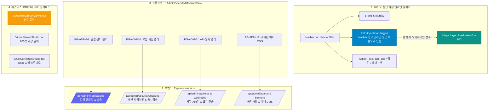

#[0036-02] [TASK-0036-01] 상단 리본 네비게이션 인라인 일체화 및 Phase 5 관리자 REST API 연동 상세 계획 수립 (READ-ONLY)

---

### 1. 도메인 분석 및 아키텍처 영향도 평가

[AGENTS.md v2.2 규칙 2.1]에 따라 소스 코드 및 문서 수정을 일절 배제한 **READ-ONLY 정밀 분석**을 수행하였으며, 상단 네비게이션 레이아웃 일체화와 Phase 5 관리자 REST API 연동에 따른 아키텍처 영향도를 아래와 같이 평가하였습니다.



#### 1.1 주요 도메인 영향도 분석
1. **[UI/UX 레이아웃] 상단 리본 부유 결함 해소**:
   - `WireframeRibbonLayer.tsx`의 절대 위치(`absolute left-1/2 -translate-x-1/2 top-0 z-50`)를 제거하고, `Navbar.tsx` 정규 인라인 액션 툴로 재배치.
   - 가로폭 축소 시 중앙 돌출로 인해 좌측 브랜드 로고나 우측 도구와 겹치던 가림 현상을 100% 원천 차단.
2. **[백엔드 API] Phase 5 4개 화면 REST API 신설**:
   - `server.ts` 내에 알림(`notifications`), 보안세션(`security/sessions`), 외부연계(`apikeys`, `webhooks`), 게시판·배너(`boards`, `banners`)의 CRUD 엔드포인트를 구축.
   - [정책 2.4 / 2.5]에 따라 DB 단절 시에도 메모리 및 로컬 스토어로 안전하게 동작하는 Zero-Hang 자율 폴백 가동.
3. **[PDF 뷰어] 실서비스 tokens.ts 통합**:
   - 25개 와이어프레임 토큰화 완결에 이어 실제 비즈니스 뷰어 3종([DocumentLibraryViewer](file:///d:/dev/repository/git.jkoogit/purePDFrend/src/ppdf/components/DocumentLibraryViewer.tsx), [VirtualViewerStudio](file:///d:/dev/repository/git.jkoogit/purePDFrend/src/ppdf/components/VirtualViewerStudio.tsx), [OCRCorrectionStudio](file:///d:/dev/repository/git.jkoogit/purePDFrend/src/ppdf/components/OCRCorrectionStudio.tsx))의 4모드 테마 클래스 및 44px 터치 가드레일 정합성 확보.

---

### 2. 세션/태스크/루프 식별 및 계획 보고

- **세션 식별자**: `SESSION-0036` (진행중, 기준 SHA: `1dbe5f8e`)
- **태스크 식별자**: `TASK-0036-01` (준비 ➔ 처리 대기)
- **작업 브랜치**: `task/0036_01_ribbon_inline_and_phase5_api_Gemini`
- **루프 식별자 (필요 시)**: `LOOP-0036-01` (PG-ADM-09~12 REST API 연동 및 컴파일 단위검증 루프)

#### 2.1 루프 타당성 분석 (AGENTS.md 규칙 2.1.8)
- **타당성 검토**: 관리자 4개 확장 화면의 REST 엔드포인트 연동과 3대 PDF 뷰어의 tokens.ts 리팩토링은 각 화면별 점진적 코드 수정 및 컴파일 검증이 수반되므로 모듈별 단위 반복 실행(`LOOP`) 적용이 매우 적합함.
- **입력/출력 변수**:
  - 입력: `WireframeRibbonLayer.tsx`, `Navbar.tsx`, `server.ts`, `AdminExtendedModulesView.tsx`, PDF 뷰어 컴포넌트 3종
  - 출력: 인라인 버튼 렌더링, REST API 응답(JSON), 4모드 테마 고대비 뷰어
- **평가 기준**: `tsc --noEmit` 컴파일 에러 0건, 브라우저 화면 부유 0건, `service_health_check.ts` 100점 만점 [A+].

---

### 3. 구체적인 작업 계획 (번호 항목)

| 번호 | 작업 항목 | 작업 대상 | 상세 구현 계획 |
| :---: | :--- | :---: | :--- |
| **1** | **설계 문서 작성** | 문서 | `docs/05.설계/05-34_상단_리본_인라인_일체화_및_Phase5_관리자_API_연동_설계서.md` 작성 |
| **2** | **상단 리본 네비게이션 인라인 일체화** | UI 컴포넌트 | • `WireframeRibbonLayer.tsx` absolute 제거 및 인라인/모달 분리 인터페이스 제공<br>• `Navbar.tsx` 우측 액션 툴 선두에 `#btn-top-ribbon-trigger` 정규 인라인 캡슐 버튼 배치<br>• 반응형 뷰포트(375px~1200px) 가림 현상 0건 검증 |
| **3** | **Phase 5 관리자 Express REST API 엔드포인트 구현** | 백엔드 (`server.ts`) | • `GET/POST/PUT/DELETE /api/admin/notifications` (알림 템플릿/발송)<br>• `GET/POST/PUT /api/admin/security/sessions` (동시세션/타임아웃)<br>• `GET/POST/DELETE /api/admin/apikeys`, `/api/admin/webhooks`<br>• `GET/POST/PUT/DELETE /api/admin/boards`, `/api/admin/banners`<br>• 오프라인 캐시 및 인메모리 폴백 탑재 |
| **4** | **PG-ADM-09~12 화면 REST API 연동 및 핸들러 연결** | 프론트엔드 (`AdminExtendedModulesView.tsx`) | • 목업 정적 배열을 REST API 비동기 fetch 및 낙관적 UI 업데이트로 전환<br>• 등록/수정/삭제/사용여부 토글 실제 API 연동<br>• 네트워크 오류 시 자동 오프라인 폴백 처리 |
| **5** | **PDF 비즈니스 3대 뷰어 화면 tokens.ts 통합** | 서비스 기능 | • `DocumentLibraryViewer.tsx` (순수 뷰어) 테마 토큰 일체화<br>• `VirtualViewerStudio.tsx` (800쪽 가상 뷰어) 상단 툴바 및 캔버스 토큰화<br>• `OCRCorrectionStudio.tsx` (OCR 교정 스튜디오) 바운딩 박스/속성창 토큰화 |
| **6** | **TDD 검증 및 4단계 서비스 종합점검** | 거버넌스/QA | • `tsc --noEmit` 정적 타입 검증<br>• `scripts/service_health_check.ts` 100점 만점 [A+] 무결성 확인 |
| **7** | **코드리뷰 문서 발행 및 하네스 동기화** | 문서/거버넌스 | • `docs/10.리뷰/261025_059_상단_리본_인라인_일체화_및_Phase5_관리자_API_연동_코드리뷰.md`<br>• 리뷰 인덱스 현행화 및 Git Database API 푸시 |

---

### 4. 사전 확인 질문 및 백로그 분기 질의 (AGENTS.md 규칙 2.1.4 ~ 2.1.5)

1. **상단 리본 트리거 버튼의 최적 배치 위치**:
   - 현재 권장안은 [Navbar.tsx](file:///d:/dev/repository/git.jkoogit/purePDFrend/src/shared/components/Navbar.tsx) 우측 액션 툴(DB, DR, 점검, 테마) 그룹의 선두에 `[화면 바로가기 25 ▾]` 캡슐 버튼으로 자연스럽게 일체화하는 방식입니다. 이 방식으로 진행할까요?
2. **범위 외 항목 확인 및 백로그 질의**:
   - 상기 1~7번 작업은 이번 태스크 작업 범위에 부합합니다.
   - 혹시 이번 태스크 범위를 벗어난 추가 요구사항(예: 신규 PDF 변환 WASM 엔진 빌드 등)이 있으시다면 말씀해 주시면 백로그로 등록하고 본 작업을 안전하게 진행하겠습니다.

> *"태스크 작업 범위를 벗어난 요청이 확인되는 경우 백로그로 등록하고 이번 태스크에서 제외할 수 있습니다. 위 계획대로 1~7번 항목을 구현 진행할까요?"*

---

### 5. 후속 실행 프롬프트 제안

계획이 승인되면 아래 프롬프트를 입력하여 [AGENTS.md 규칙 2.2]에 따른 설계 문서 선작성 및 실제 구현(`#태스크처리`)을 즉시 개시할 수 있습니다:

```markdown
#태스크처리 [0036-01] 상단 리본 네비게이션 인라인 일체화(화면 부유 증상 조치) 및 Phase 5 관리자 3단계 확장화면(PG-ADM-09~12) 실제 REST API 연동
```
