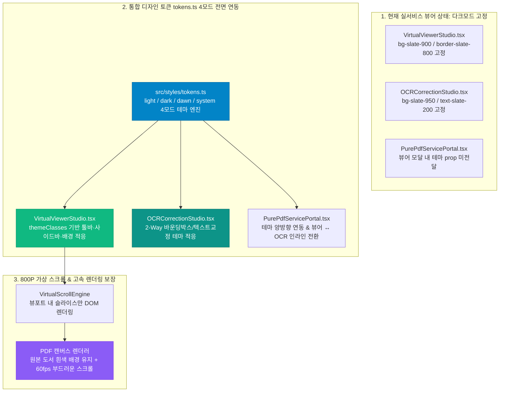

#[0036-05] [TASK-0036-03] PDF 순수 뷰어/가상스크롤/OCR 스튜디오 실서비스 tokens.ts 통합 및 렌더링 최적화 계획 수립 보고

---

### 1. 도메인 분석 및 아키텍처 영향도 평가

AGENTS.md [규칙 2.1] READ-ONLY 분석 정책에 따라 소스 코드 및 문서 수정을 일체 보류하고 요구사항을 심층 분석하였습니다.



#### 1.1 핵심 현황 및 문제점 분석
1. **와이어프레임(25개 완료) 대비 실서비스 비즈니스 뷰어의 토큰 누락**:
   - `PG-USR-06` 와이어프레임 뷰어는 디자인 토큰이 적용되었으나, 실제 대용량 800쪽 PDF를 처리하는 비즈니스 컴포넌트인 [VirtualViewerStudio.tsx](file:///d:/dev/repository/git.jkoogit/purePDFrend/src/ppdf/components/VirtualViewerStudio.tsx) 및 [OCRCorrectionStudio.tsx](file:///d:/dev/repository/git.jkoogit/purePDFrend/src/ppdf/components/OCRCorrectionStudio.tsx)는 고정된 다크 색상(`bg-slate-900`, `text-slate-200`, `border-slate-800` 등)으로 하드코딩되어 있습니다.
   - 사용자가 상단 헤더에서 `라이트(Light)` 또는 `새벽(Dawn)` 모드로 전환하더라도 실서비스 뷰어 내부 UI(상단 툴바, 좌측 썸네일 사이드바, 설정 팝업 등)는 여전히 어두운 다크 색상을 유지하여 시각적 이질감이 발생합니다.
2. **뷰어와 OCR 교정 스튜디오 간 양방향 라우팅 부재**:
   - `VirtualViewerStudio.tsx`에 `onNavigateToCorrection` 프로퍼티는 정의되어 있으나, 이를 감싸는 [PurePdfServicePortal.tsx](file:///d:/dev/repository/git.jkoogit/purePDFrend/src/ppdf/components/PurePdfServicePortal.tsx) 뷰어 모달에서 `OCRCorrectionStudio`로의 인라인 전환 상태가 연결되어 있지 않아 단절되어 있습니다.
3. **가상 스크롤 렌더링 성능 보장**:
   - 테마 토큰 동적 클래스가 800쪽 가상 스크롤 렌더링 루프에 불필요한 리렌더링을 유발하지 않도록 `useMemo` 및 스타일 캐싱 최적화가 필수적입니다.

---

### 2. 세부 작업 계획 (Task Breakdown)

| 번호 | 작업 대상 | 구분 | 작업 내용 및 산출물 |
| :---: | :--- | :---: | :--- |
| **1** | [VirtualViewerStudio.tsx](file:///d:/dev/repository/git.jkoogit/purePDFrend/src/ppdf/components/VirtualViewerStudio.tsx) | 서비스 | `ThemeMode`, `resolveThemeMode`, `getThemeAdaptiveClasses` 전면 연동, 상단 조작 툴바, 썸네일 사이드바, 가상 스크롤 컨테이너 4모드 테마 적응 |
| **2** | [OCRCorrectionStudio.tsx](file:///d:/dev/repository/git.jkoogit/purePDFrend/src/ppdf/components/OCRCorrectionStudio.tsx) | 서비스 | `tokens.ts` 테마 클래스 대입, 2-Way 분할 패널(캔버스 바운딩박스/우측 인라인 텍스트 교정기), 히스토리(Undo/Redo) 툴바 테마 표준화 |
| **3** | [PurePdfServicePortal.tsx](file:///d:/dev/repository/git.jkoogit/purePDFrend/src/ppdf/components/PurePdfServicePortal.tsx) | 서비스 | 포털 모달 내 `themeMode` 주입 및 `VirtualViewerStudio` ↔ `OCRCorrectionStudio` 간 원클릭 양방향 인라인 전환 핸들러 연동 |
| **4** | [로드맵](file:///d:/dev/repository/git.jkoogit/purePDFrend/docs/07.로드맵/07-02_화면별_디자인_토큰_적용현황_및_단계별_로드맵.md) & [설계서] | 문서 | 신규 설계서 `docs/05.설계/05-35_실서비스_PDF_뷰어_및_OCR스튜디오_tokens_통합_설계서.md` 발행 및 `07-02` 로드맵 현행화 |
| **5** | 서비스 헬스체크 및 품질 검증 | 에이전트 | `tsc --noEmit` 타입 검증(0 errors), `service_health_check.ts` **100점 만점 [A+ (PERFECT)]** 유지 |

---

### 3. 사전 확인 질문 및 피드백 요청

작업 착수 전 설계 방향을 명확히 하고자 두 가지 사항에 대해 사용자 피드백을 요청드립니다:

1. **[질문 1 - PDF 페이지 본문 캔버스 배경 처리]**:
   - 뷰어 외곽 프레임, 툴바, 사이드바는 시스템 테마(`light`, `dark`, `dawn`)에 100% 연동되지만, **실제 PDF 페이지 캔버스 자체**는 원본 도서 시인성을 위해 기본 흰색(White) 종이 질감을 유지하는 것이 업계 표준(Adobe Acrobat, Xodo 등)입니다.  
   - 본 작업에서도 페이지 캔버스는 순수 도서 원형을 유지하고 툴바/사이드바/컨테이너 배경만 4모드 테마를 완벽 적응하도록 구성할까요? 아니면 페이지 자체에도 야간모드(다크 반전 필터) 토글 옵션을 추가할까요?
2. **[질문 2 - 뷰어 ↔ OCR 스튜디오 양방향 점프]**:
   - 포털 뷰어 모달에서 뷰어 툴바의 'OCR 검수/교정' 클릭 시 모달 내부에서 `OCRCorrectionStudio`로 부드럽게 화면을 전환하고, 교정 저장 시 다시 가상 뷰어로 복귀하도록 일체화된 워크플로우를 구성할까요?
3. **[범위 외 요청 확인]**:
   - 상기 5개 항목 이외에 추가로 희망하시는 항목이 있다면 말씀해 주십시오. 태스크 범위를 벗어난 요청이 확인될 경우 백로그(`BACKLOG`)로 등록하여 관리하거나 본 태스크에 편입할 수 있습니다.

---

### 4. 루프 분석 (Loop Analysis)

- **루프 ID**: `LOOP-0036-03`
- **루프 처리 타당성**: 실서비스 2대 뷰어 컴포넌트(`VirtualViewerStudio`, `OCRCorrectionStudio`)에 대한 테마 클래스 치환 및 렌더링 성능 검증은 명확한 입력/출력과 정량적 평가 기준을 가진 단위 루프로 반복 수행하기에 최적입니다.
- **문제의 목표 및 데이터 분석**:
  - 하드코딩된 Tailwind 다크 클래스 전수 추출
  - `ThemeMode` prop 및 `resolveThemeMode` 계산 값에 따른 동적 클래스(`themeClasses`) 주입
- **조건 및 범위**:
  - 800쪽 가상 스크롤 시 프레임 드랍 없는 60fps 유지
  - 4모드(`light`, `dark`, `dawn`, `system`) 전환 시 렌더링 깨짐 및 미적용 컴포넌트 0건
- **평가 기준**:
  - `tsc --noEmit` 클린 패스 (오류 0건)
  - `scripts/service_health_check.ts` 4단계 전 항목 합격 및 100점 만점 [A+ (PERFECT)]

---

### 5. 승인 후 즉시 실행 프롬프트

위 계획과 질문 사항을 검토하신 후, 승인하시거나 추가 의견을 포함하여 아래 프롬프트로 회신해 주시면 즉시 구현 및 검증에 착수하겠습니다.

```bash
#태스크처리 [0036-03] PDF 순수 뷰어/가상스크롤/OCR 스튜디오 실서비스 tokens.ts 통합 및 렌더링 최적화
```
