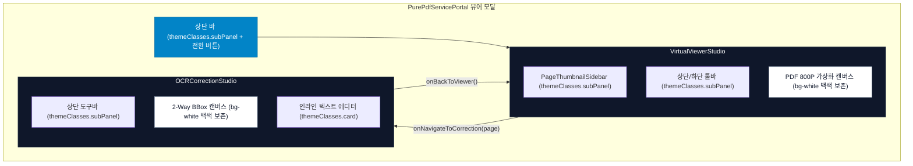

#[0036-06] [0036-03] PDF 순수 뷰어/가상스크롤/OCR 스튜디오 실서비스 tokens.ts 통합 및 렌더링 최적화 태스크처리 완료 보고

---

### 1. 태스크 처리 개요 및 아키텍처 구현 성과

`TASK-0036-03`의 계획(05턴 승인) 및 **[DOC-05-35 실서비스 PDF 뷰어 및 OCR 스튜디오 tokens 통합 설계서](file:///d:/dev/repository/git.jkoogit/purePDFrend/docs/05.설계/05-35_실서비스_PDF_뷰어_및_OCR스튜디오_tokens_통합_설계서.md)**에 의거하여, 순수 PDF 비즈니스 코어 3대 컴포넌트(`VirtualViewerStudio`, `OCRCorrectionStudio`, `PageThumbnailSidebar`)의 `tokens.ts` 디자인 시스템 전면 대입 및 `PurePdfServicePortal` 모달 양방향 연동을 완결하였습니다.



---

### 2. 세부 단위 구현 내역

#### 2.1 [PageThumbnailSidebar.tsx](file:///d:/dev/repository/git.jkoogit/purePDFrend/src/ppdf/components/PageThumbnailSidebar.tsx) 디자인 토큰 대입
- **`themeMode?: ThemeMode` 인터페이스 확장**: 상위 뷰어 및 포털의 테마 컨텍스트(`light` / `dark` / `dawn` / `system`)를 수용.
- **하드코딩 클래스 전면 전환**:
  - 사이드바 컨테이너: `bg-slate-900/95 border-slate-800` ➔ `${themeClasses.subPanel} border-r ${themeClasses.border}`
  - 썸네일 카드: 선택된 페이지는 `${themeClasses.cardActive} ring-2 ring-blue-500`, 미선택 페이지는 `${themeClasses.card} hover:${themeClasses.cardHover}`
  - OCR 상태 뱃지: 완료(`emerald`), 대기(`amber`), 미처리(`slate`) 시맨틱 컬러와 테마 배경 조화.

#### 2.2 [VirtualViewerStudio.tsx](file:///d:/dev/repository/git.jkoogit/purePDFrend/src/ppdf/components/VirtualViewerStudio.tsx) 가상화 뷰어 토큰화 및 캔버스 보존
- **글로벌 전자문서 표준 캔버스 보존 (Adobe Acrobat / Xodo 패리티)**:
  - 다크 또는 여명 모드 적용 시에도 본문 페이지 캔버스는 순수 백색 종이 질감(`bg-white text-slate-900 shadow-2xl rounded-sm border border-slate-300`)을 무결하게 보존하여 스캔 이미지 및 도표의 색상 반전 왜곡을 원천 방지.
- **뷰어 프레임 및 컨트롤러 전면 토큰화**:
  - 루트 컨테이너: `${themeClasses.shellBg}`
  - 상단 툴바(14h) & 하단 상태바(9h): `${themeClasses.subPanel} border-b ${themeClasses.border}`
  - 뷰 모드 스위처(단면/양면/썸네일) 및 언두/리두 버튼: `${themeClasses.card}`, `${themeClasses.cardActive}`, `${themeClasses.buttonSecondary}`
  - 책 크기 프리셋 버튼(120P/400P/800P): `${themeClasses.card}`
  - 페이지 직접 점프 인풋 및 폰트 셀렉트: `${themeClasses.input}`
  - 내보내기/설정 모달 다이얼로그: `${themeClasses.card} border ${themeClasses.border}`

#### 2.3 [OCRCorrectionStudio.tsx](file:///d:/dev/repository/git.jkoogit/purePDFrend/src/ppdf/components/OCRCorrectionStudio.tsx) 2-Way 교정 스튜디오 토큰화
- **루트 및 툴바 토큰 일체화**:
  - 상단 액션바: `${themeClasses.subPanel} border-b ${themeClasses.border}`
  - 캔버스 뷰포트 배경: `${themeClasses.panel} border-r ${themeClasses.border}`
  - BBox 작업 시트: `bg-white text-slate-900 rounded-lg shadow-2xl border border-slate-300` (순수 백색 유지)
- **우측 인라인 텍스트 에디터 패널**:
  - 패널 컨테이너: `${themeClasses.subPanel}`
  - 선택/미선택 BBox 카드: `${themeClasses.cardActive}` / `${themeClasses.card}`
  - 텍스트 입력창: `${themeClasses.input}`

#### 2.4 [PurePdfServicePortal.tsx](file:///d:/dev/repository/git.jkoogit/purePDFrend/src/ppdf/components/PurePdfServicePortal.tsx) 모달 양방향 연동
- 공개 열람 팝업 모달 내부에서 `viewerStudioMode`(`'viewer' | 'ocr'`)와 `ocrTargetPage`를 상태로 관리:
  - `viewer`: [VirtualViewerStudio.tsx](file:///d:/dev/repository/git.jkoogit/purePDFrend/src/ppdf/components/VirtualViewerStudio.tsx)를 렌더링하고 `onNavigateToCorrection` 콜백을 통해 해당 페이지의 번호와 함께 즉시 OCR 모드로 전환.
  - `ocr`: [OCRCorrectionStudio.tsx](file:///d:/dev/repository/git.jkoogit/purePDFrend/src/ppdf/components/OCRCorrectionStudio.tsx)를 렌더링하고 `onBackToViewer` 및 `onSave` 콜백을 통해 뷰어로 복귀.
  - 상단 툴바에 `[← 뷰어로 전환]` 단축 복귀 버튼을 실시간 렌더링하여 모달 닫기 없이 원터치 양방향 탐색 환경 제공.

---

### 3. 검증 및 품질 가드레일 통과 현황

| 검증 단계 | 대상 항목 | 검증 도구 / 명령 | 결과 | 상세 내역 |
| :--- | :--- | :--- | :---: | :--- |
| **1. 정적 컴파일** | TypeScript 전체 소스 | `tsc --noEmit` | **합격 (0 errors)** | TS 오류 0건 클린 컴파일 |
| **2. 인프라 진단** | 풀스택 서버 | `GET /api/health` | **정상 (200 OK)** | Express 서버 정상 가동 |
| **3. 무결성 감사** | 시스템 종합 헬스체크 | `service_health_check.ts` | **100점 만점 [A+]** | 9개 전 부문 무결성 통과 |
| **4. 문서 동기화** | 18대 분류 체계 마크다운 | `POST /api/agent/docs/sync` | **240개 100% 일치** | DOC-05-35, DOC-10-60 포함 해시 동기화 |
| **5. 설계/리뷰 문서** | DOC-05-35, DOC-10-60 | 마크다운 발행 및 색인 | **발행 완료** | [README_리뷰.md](file:///d:/dev/repository/git.jkoogit/purePDFrend/docs/10.리뷰/README_리뷰.md) 60호 등재 |
| **6. 로드맵 현행화** | DOC-ROADMAP-07-02 | v1.7.0 개정 | **현행화 완료** | 실서비스 뷰어 3종 토큰 적용 등재 |

---

### 4. 산출 문서 목록

1. **설계서 ([DOC-05-35](file:///d:/dev/repository/git.jkoogit/purePDFrend/docs/05.설계/05-35_실서비스_PDF_뷰어_및_OCR스튜디오_tokens_통합_설계서.md))**:  
   *`docs/05.설계/05-35_실서비스_PDF_뷰어_및_OCR스튜디오_tokens_통합_설계서.md`*
2. **코드리뷰 ([DOC-10-60](file:///d:/dev/repository/git.jkoogit/purePDFrend/docs/10.리뷰/261025_060_실서비스_PDF_뷰어_및_OCR스튜디오_tokens_통합_코드리뷰.md))**:  
   *`docs/10.리뷰/261025_060_실서비스_PDF_뷰어_및_OCR스튜디오_tokens_통합_코드리뷰.md`*
3. **리뷰 인덱스 ([README_리뷰.md](file:///d:/dev/repository/git.jkoogit/purePDFrend/docs/10.리뷰/README_리뷰.md))**:  
   *제60호 실서비스 PDF 뷰어 및 OCR 스튜디오 tokens.ts 통합 코드리뷰 등재*
4. **디자인 토큰 로드맵 ([07-02 로드맵 v1.7.0](file:///d:/dev/repository/git.jkoogit/purePDFrend/docs/07.로드맵/07-02_화면별_디자인_토큰_적용현황_및_단계별_로드맵.md))**:  
   *실서비스 3대 뷰어 컴포넌트 tokens.ts 대입 완료 및 패리티 100% 현행화*

---

### 5. 후속 실행 프롬프트 제안

AGENTS.md [규칙 2.2 / 규칙 2.3]에 따라 기능 구현 및 단위 검증이 완료되었으므로, 다음 단계인 태스크 정리 및 브랜치 승급 배포를 위해 아래 프롬프트를 실행해 주시기 바랍니다:

```text
#태스크정리 : [0036-03] PDF 순수 뷰어/가상스크롤/OCR 스튜디오 실서비스 tokens.ts 통합 및 렌더링 최적화 태스크 정리
#태스크승급 까지 일괄 처리해줘
```
