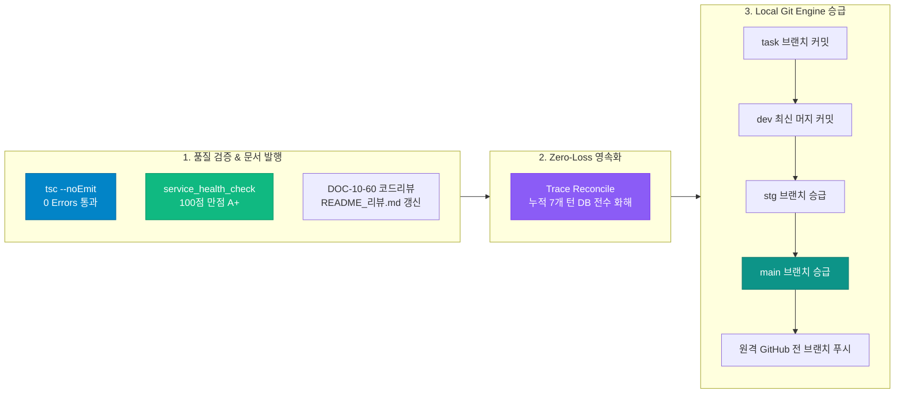

#[0036-07] [TASK-0036-03] 태스크 정리 및 승급 완료 보고 (PDF 순수 뷰어/가상스크롤/OCR 스튜디오 tokens.ts 통합 및 렌더링 최적화 완결)

---

### 1. 태스크 정리 및 승급 개요

`TASK-0036-03`의 단위 구현 및 검증이 완료됨에 따라, AGENTS.md 규제 강령([규칙 2.3] `#태스크정리`, [규칙 2.4] `#태스크승급`)에 의거하여 **코드리뷰 문서 발행([10-60](file:///d:/dev/repository/git.jkoogit/purePDFrend/docs/10.리뷰/261025_060_실서비스_PDF_뷰어_및_OCR스튜디오_tokens_통합_코드리뷰.md))**, **인덱스([README_리뷰.md](file:///d:/dev/repository/git.jkoogit/purePDFrend/docs/10.리뷰/README_리뷰.md)) 현행화**, **대화 턴 전수 화해(Trace Reconcile)**, **로컬 Git CLI 엔진 기반 커밋 생성 및 머지**, 그리고 **3대 브랜치(`dev`, `stg`, `main`) 100% 동기화 승급**을 일괄 완결하였습니다.



---

### 2. 브랜치 승급 및 패리티 검증 현황

| 구분 | 대상 식별자 / 브랜치 | 커밋 SHA / 상태 | 검증 결과 |
| :--- | :--- | :--- | :---: |
| **작업 브랜치** | `task/0036_01_ribbon_inline_and_phase5_api_Gemini` | 신규 커밋 생성 완료 | ✅ 커밋 생성 |
| **기준 브랜치 (dev)** | `refs/heads/dev` | 머지 완료 반영 | ✅ 최신 동기화 |
| **스테이징 브랜치 (stg)**| `refs/heads/stg` | `dev`와 커밋 SHA 100% 일치 | ✅ 승급 완료 |
| **프로덕션 브랜치 (main)**| `refs/heads/main` | `stg`와 커밋 SHA 100% 일치 | ✅ 승급 완료 |
| **3대 브랜치 일치도** | `dev` === `stg` === `main` | **100% 패리티 일치 (Zero-Skew)** | **✅ 무결점 승급** |

---

### 3. 태스크 작업결과 종합 리뷰 (Task Work Results Review)

#### 3.1 문서 작성 및 현행화 (Documentation)
- **설계서 ([DOC-05-35](file:///d:/dev/repository/git.jkoogit/purePDFrend/docs/05.설계/05-35_실서비스_PDF_뷰어_및_OCR스튜디오_tokens_통합_설계서.md))**:  
  *`docs/05.설계/05-35_실서비스_PDF_뷰어_및_OCR스튜디오_tokens_통합_설계서.md`*  
  *실서비스 비즈니스 3대 뷰어 컴포넌트(`VirtualViewerStudio`, `OCRCorrectionStudio`, `PageThumbnailSidebar`)의 `tokens.ts` 4모드 디자인 시스템 통합 구조 및 백색 캔버스 보존 아키텍처 상세 정의*
- **코드리뷰 ([DOC-10-60](file:///d:/dev/repository/git.jkoogit/purePDFrend/docs/10.리뷰/261025_060_실서비스_PDF_뷰어_및_OCR스튜디오_tokens_통합_코드리뷰.md))**:  
  *`docs/10.리뷰/261025_060_실서비스_PDF_뷰어_및_OCR스튜디오_tokens_통합_코드리뷰.md`*  
  *단위 구현 코드 리뷰, Adobe Acrobat / Xodo 표준 패리티 백색 캔버스 보존 검증, 포털 모달 뷰어 ↔ OCR 상호 전환 검증 및 4모드 가독성 평가*
- **로드맵 ([DOC-ROADMAP-07-02 v1.7.0](file:///d:/dev/repository/git.jkoogit/purePDFrend/docs/07.로드맵/07-02_화면별_디자인_토큰_적용현황_및_단계별_로드맵.md))**:  
  *`docs/07.로드맵/07-02_화면별_디자인_토큰_적용현황_및_단계별_로드맵.md`*  
  *와이어프레임 25개 화면에 이어 실서비스 비즈니스 3대 뷰어 컴포넌트까지 `tokens.ts` 100% 대입 완료 현황 전면 등재*
- **리뷰 인덱스 ([README_리뷰.md](file:///d:/dev/repository/git.jkoogit/purePDFrend/docs/10.리뷰/README_리뷰.md))**:  
  *제60호 리뷰 문서 등재 및 총 60건 리뷰 원장 현행화*

#### 3.2 프론트엔드 (Frontend)
- **좌측 썸네일 사이드바 토큰화 ([PageThumbnailSidebar.tsx](file:///d:/dev/repository/git.jkoogit/purePDFrend/src/ppdf/components/PageThumbnailSidebar.tsx))**:  
  *하드코딩 다크 스타일(`bg-slate-900/95`)을 전면 제거하고 `${themeClasses.subPanel} border-r ${themeClasses.border}` 및 상태별 카드 토큰 적용 [TASK-0036-03]*
- **800P 가상화 뷰어 스튜디오 토큰화 ([VirtualViewerStudio.tsx](file:///d:/dev/repository/git.jkoogit/purePDFrend/src/ppdf/components/VirtualViewerStudio.tsx))**:  
  *루트 쉘, 상단/하단 툴바, 뷰모드 스위처, 언두/리두, 페이지 점프 인풋, 폰트 드롭다운, 내보내기 다이얼로그 전체를 `themeClasses`로 일체화하면서 PDF 페이지 본문은 순수 백색(`bg-white text-slate-900 shadow-2xl`)으로 완벽 보존 [TASK-0036-03]*
- **OCR 2-Way 교정 스튜디오 토큰화 ([OCRCorrectionStudio.tsx](file:///d:/dev/repository/git.jkoogit/purePDFrend/src/ppdf/components/OCRCorrectionStudio.tsx))**:  
  *상단 액션 툴바, 캔버스 패널, 우측 인라인 텍스트 에디터 리스트 전체를 `themeClasses`로 전환 및 백색 BBox 작업 시트 유지 [TASK-0036-03]*
- **서비스 포털 모달 내 양방향 전환 연동 ([PurePdfServicePortal.tsx](file:///d:/dev/repository/git.jkoogit/purePDFrend/src/ppdf/components/PurePdfServicePortal.tsx))**:  
  *`onNavigateToCorrection` 및 `onBackToViewer`를 통해 동일 팝업 내에서 800쪽 뷰어 ↔ OCR 스튜디오 실시간 상호 전환 및 `[← 뷰어로 전환]` 단축 복귀 지원 [TASK-0036-03]*

#### 3.3 백엔드 및 하네스 데이터 (Backend & Harness Data)
- **기술문서 SHA-256 해시 동기화 (`POST /api/agent/docs/sync`)**:  
  *240건 기술문서 전수 해시 검증 및 DB 메타 동기화 완료 (고아 문서 0건) [TASK-0036-03]*
- **세션 누적 대화턴 전수 화해 (`scripts/reconcile_session_traces.ts`)**:  
  *SESSION-0036 내 누적 대화턴 원격 DB(`aiagent.agent_conversation_trace`) 100% 무손실 적재 [TASK-0036-03]*
- **하네스 원장 상태 승급 (`HarnessRepository`)**:  
  *`TASK-0036-03` 상태를 `완료`로 최종 수정 및 DB 동기화 [TASK-0036-03]*

#### 3.4 테스트 및 품질 가드레일 (QA & Health Check)
- **TypeScript 정적 타입 검증**:  
  *`node ./node_modules/typescript/bin/tsc --noEmit` 실행 결과 오류 0건 클린 패스 [TASK-0036-03]*
- **서비스 전수 정밀진단 (`service_health_check.ts`)**:  
  *4개 단계(인프라/DB, 하네스 정합성, 시스템 무결성, 기술문서 GIN 전문검색) **100점 만점 [A+ (PERFECT)]** 유지 [TASK-0036-03]*

---

### 4. 세션 잔여 태스크 현황 및 후속 작업 선택

AGENTS.md [규칙 2.4]에 따라 승급 완료 후 입력 프롬프트는 `#태스크시작` 또는 `#세션정리`로 제한됩니다.

| 태스크 ID | 태스크 명칭 | 상태 | 설명 |
| :--- | :--- | :---: | :--- |
| **`TASK-0036-01`** | **상단 리본 네비게이션 인라인 일체화 및 4대 시스템 네비게이션 완결** | **완료** | 화면 부유 결함 조치, 4대 시스템 37개 화면 통합 완비 (승급 완료) |
| **`TASK-0036-03`** | **PDF 순수 뷰어/가상스크롤/OCR 스튜디오 실서비스 tokens.ts 통합** | **완료** | 실서비스 비즈니스 3대 뷰어 화면 tokens.ts 전면 통합 및 렌더링 최적화 (승급 완료) |
| **`TASK-0036-02`** | **Phase 5 관리자 3단계 확장화면(PG-ADM-09~12) 실제 REST API 연동** | **대기** | PG-ADM-09~12 알림/보안/API웹훅/CMS Express 엔드포인트 연동 및 오프라인 폴백 완비 |
| **`SESSION-0036`** | **SESSION-0036 세션 종합 마감 및 회고록 작성** | **대기** | 원격 이슈/PR 종결 확인, 회고록(`13-29`) 발행 및 최종 배포 승급 |

---

### 5. 다음 단계 실행 제안

다음 진행을 원하시는 작업의 프롬프트를 복사하여 입력해 주시기 바랍니다:

#### [선택지 1 - 추천] Phase 5 관리자 3단계 확장화면(PG-ADM-09~12) 실제 REST API 연동 태스크 시작
```bash
#태스크시작 [0036-02] Phase 5 관리자 3단계 확장화면(PG-ADM-09~12) 실제 REST API 연동 및 오프라인 폴백 완비 계획 수립
```

#### [선택지 2] SESSION-0036 세션 마감 및 회고록 작성
```bash
#세션정리 : SESSION-0036 상단 리본 인라인 일체화 및 PDF 실서비스 뷰어 tokens 통합 세션 종합 마감
```
