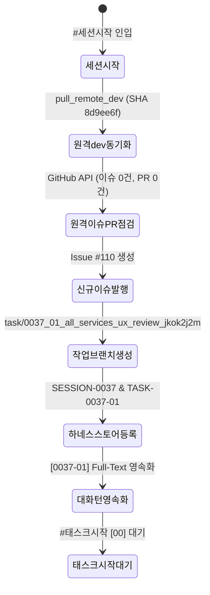

#[0037-01] 4대 시스템 37개 전체 서비스 화면 순차적 사용성 및 실화면 심화 리뷰 - #세션시작

---

## 🔄 1. 세션 라이프사이클 및 원격 동기화 점검 결과

`AGENTS.md v2.2` 및 거버넌스 규칙에 의거하여 **SESSION-0037** 세션 시작 절차를 엄격히 수행하였습니다.



### 📊 1-1. 세션 동기화 및 인프라 지표

| 점검 항목 | 결과 | 세부 내용 / 식별자 |
| :--- | :---: | :--- |
| **세션 ID 및 명칭** | ✅ 완료 | `SESSION-0037`: `[0037] 4대 시스템 37개 전체 서비스 화면 순차적 사용성 및 실화면 심화 리뷰` |
| **원격 dev 자동 Pull** | ✅ 100% | `8d9ee6f5ccfb48b7b083a42f17e1c050c7a6bcfe` (Merge PR #109 동기화) |
| **3대 브랜치 패리티** | ✅ 일치 | `main` = `stg` = `dev` (SHA 100% 일치) |
| **미결 이슈 / PR 점검** | ✅ 무결 | 열린 이슈 0건, 열린 PR 0건 (Clean State) |
| **신규 GitHub 이슈** | ✅ 등록 | Issue **#110** (`[0037] 4대 시스템 37개 전체 서비스 화면 순차적 사용성 및 실화면 심화 리뷰`) |
| **작업 브랜치** | ✅ 생성 | `task/0037_01_all_services_ux_review_jkok2j2m` (원격 201 Created & 로컬 체크아웃) |
| **하네스 스토어 동기화**| ✅ 완료 | `data/local_agent_store.json` 및 PostgreSQL `aiagent` 스키마 원장 반영 완료 |
| **기술문서 해시 동기화**| ✅ 100% | 18대 분류체계 245개 마크다운 문서 SHA-256 DB 동기화 완료 (해시 불일치 0건) |

---

## 🎯 2. 4대 시스템 37개 전체 서비스 화면 현황 인벤토리

현재 프로젝트의 4대 시스템 37개 서비스 화면 인벤토리는 다음과 같이 체계적으로 구성되어 있습니다.

### 1) 사용자 시스템 (9종)
- `PG-USR-01`: 첫화면 (랜딩) - 공개 문서조회, 롤링배너, 공지/리뷰 및 7대 도구 진입점
- `PG-USR-02`: 로그인 / 회원가입 - 소셜/이메일 2FA 탭 전환, 이용약관 동의
- `PG-USR-03`: 홈화면 (대시보드) - 7대 PDF 핵심도구 퀵그리드, 사용자 프로필 요약
- `PG-USR-04`: 마이페이지 > 사용자관리 - 비밀번호 변경, 2FA OTP, 닉네임 수정, 계정 탈퇴
- `PG-USR-05`: 문서관리 (라이브러리) - 8대 상세필터, 4종 다운로드 모달, 태그 관리
- `PG-USR-06`: 문서뷰어 & 주석스튜디오 - 단일줄 툴바+슬라이더, 8대 모드, 가상 스크롤
- `PG-USR-07`: 문서공유 및 협업작업뷰 - 공유권한 설정, 동시접속자 목록, 주석 피드
- `PG-USR-08`: 오프라인 작업 정리 - 리소스모드/문서모드, 3Way 충돌 머지 뷰
- `PG-USR-09`: 정밀 사용자 환경설정 - 단축키설정(PC/태블릿), 도구그룹설정, 뷰어 기본값

### 2) 관리자 시스템 (16종)
- `PG-ADM-01`: 보안관리 - 화이트리스트 & 2FA 강제화, 세션만료, IP 차단
- `PG-ADM-02`: 프로그램관리 - DAG 순환방지, 다중권한 설정, 화면 메타데이터
- `PG-ADM-03`: 사용자관리 - 프로필 사진, 상세조회, 스토리지 용량 통제
- `PG-ADM-04`: 약관·동의·정책 - 적용버전만 보기, 이전약관 수정, 마크다운 에디터
- `PG-ADM-05`: 사용자 권한관리 - 권한/프로그램/사용자 3대 매트릭스 탭
- `PG-ADM-06`: 메뉴관리 - 메뉴 계층 트리뷰, 화면 프로그램 매핑
- `PG-ADM-07`: 로그관리 - 다차원 감사로그 필터, PDF 변경추적 스트림
- `PG-ADM-08`: 알림관리 - 공지안내, OCR 완료알림, 개인알림, 예외 추적
- `PG-ADM-09`: 실시간 시스템 알림 및 웹 푸시 센터
- `PG-ADM-10`: 관리자 보안 및 세션 정책 관리
- `PG-ADM-11`: 사용자설정 항목관리 - 체크박스/드롭다운 메타데이터 관리, 기본값 설정
- `PG-ADM-12`: 게시판·배너관리 - 예약공지, 다시열지않기, 롤링배너 우선순위 순서
- `PG-ADM-13`: 고객관리 - FAQ, 공개 QNA, 1:1 상담 2-depth 답글기능
- `PG-ADM-14`: 무료글꼴관리 - 웹폰트 WOFF2/TTF 등록, 실시간 렌더링 프리뷰
- `PG-ADM-15`: 단축키 및 도구아이콘 관리 - 시스템 기본 vs 커스텀 우선순위, 리소스 매핑
- `PG-ADM-16`: 도구그룹관리 - 8대 뷰어모드별 도구편성, 영향도 분석 패널

### 3) 공통 / 시스템 설정 (5종)
- `PG-SET-01`: OCR 엔진 관리 - Tesseract.js WASM & Gemini Multimodal 듀얼 엔진 설정
- `PG-SET-02`: PDF 보안 및 내보내기 정책 - 비밀번호 암호화, 워터마크, 메타데이터 제거 규칙
- `PG-SET-03`: 단축키 및 제스처 바인딩 - PC 키보드 및 태블릿 터치 제스처 반응성 설정
- `PG-SET-04`: 폰트 및 렌더링 환경설정 - 고해상도 가상화 배율, WOFF2 프리뷰, 앤티앨리어싱
- `PG-SET-05`: 3Way 충돌머지 및 오프라인 큐 - IndexedDB 로컬 큐 보존 주기 및 자동 머지 전략

### 4) 에이전트 거버넌스 시스템 (6종)
- `PG-AGN-01`: 하네스 작업그래프 - 세션·태스크·루프 3계층 DAG 토폴로지 시각화 뷰
- `PG-AGN-02`: 태스크 및 세션 원장 관리 - DDL 정규화 메타원장, 상태 승급 및 이력 조회
- `PG-AGN-03`: AI 토큰 쿼터 및 사용량 감제 - Pro(250)/Flash(2500) 3계층 쿼터 및 실시간 모니터링
- `PG-AGN-04`: 3계층 거버넌스 무결성 감사 - 고아 레코드 0건, 429 격리 100점 만점 [A+] 감사실
- `PG-AGN-05`: 기술문서 거버넌스 원장 - 245개 마크다운 문서 SHA-256 동기화 및 전문검색
- `PG-AGN-06`: 시스템 환경설정 및 DR 관제 - 비-LLM 긴급 Push 및 스냅샷 복구 관제실

### 5) 인터랙티브 디자인시스템 쇼케이스 (1종)
- `DS-SHOWCASE`: 디자인시스템 쇼케이스 - 30대 Primitive 표준 컴포넌트 풀 및 4모드 테마 쇼케이스

---

## 📋 3. 세션 핵심 과업 및 실행 단계

1. **와이어프레임과 실제 서비스 화면 간 간극 전수 분석**:
   - 인라인 스타일 및 하드코딩 색상 잔재 추출
   - 30대 컴포넌트 풀(`Button`, `Card`, `Badge`, `Input`, `Modal`, `ToolIcon` 등)과의 매핑 현황 전수 점검
2. **순차적 사용성 및 레이아웃 정밀 리뷰**:
   - 4모드(Light, Dark, Dawn, System) 색상 대비 및 가독성
   - 모바일 44px 터치 타깃 및 Zero-Pill 규격 준수 여부
3. **컴포넌트 재사용성 극대화 및 리팩토링 계획 수립**:
   - 중복 코드 최소화 및 토큰(`tokens.ts`) 일원화
4. **품질 가드레일 수호**:
   - 정적 린트/컴파일 무결성 검증, 서비스 헬스체크 100점 만점 [A+ (PERFECT)] 달성

---

## 🚀 4. 후속 실행 프롬프트 제안

하네스 거버넌스 규칙에 따라, 다음 단계는 **READ-ONLY 계획 수립 및 37개 화면 순차적 분석 단계(`[00]`)**로 진입합니다. 아래 프롬프트를 입력하여 작업을 시작해 주시기 바랍니다.

```text
#태스크시작 [00] 4대 시스템 37개 전체 서비스 화면 순차적 사용성 및 실화면 심화 리뷰 계획 수립
```
